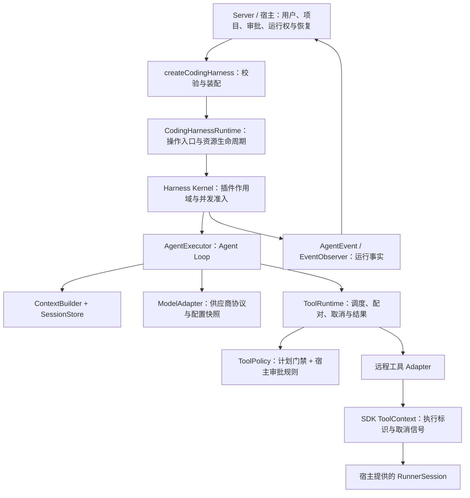

# Coding Harness 架构与演进

日期：2026-10-04。依据 [功能基线与未来目标](功能清单与重构升级参考.md)。本文描述 `packages/coding-harness` 的本次重构，不表示 nova-server 的现有 Agent 主链路已经迁移，也不把扩展接口计为完整产品功能。

## 评估结论

原 `src/index.ts` 作为 dashboard 示例封装足够直接，但作为长期 Coding 基座有五个明显限制：

1. 系统提示词把所有任务约束为 `plan.md` 和 `index.html`，通用 Coding 与具体示例混在一起。
2. 模型协议、内存存储、上下文、工具运行时与 Loop 固定，扩展必须修改同一个工厂函数。
3. 必须提供 Runner，普通聊天、搜索与业务工具不能共用装配入口。
4. 计划门禁使用固定读取工具名称，新增读取能力默认被拒绝；“计划写入成功”被命名为“计划获批”，容易混淆权限与事实。
5. 创建会话失败后未回收 Kernel；并发 `close` 后来的调用者会提前返回；结果观察者异常会把成功操作变为调用失败。

另外，原 `tsconfig.build.json` 的 `rootDir: "."` 生成 `dist/src/index.js`，但包导出指向 `dist/index.js`，影响真实包导入。本次改为 `rootDir: "src"` 并禁止有编译错误时生成产物。

本次建立的是薄装配层：底层 Harness 负责插件与执行语义，Coding Harness 负责可用默认值、执行环境适配、业务预设与易用 API。新的变化通过稳定契约进入，不再不断扩大 `index.ts`。

## 边界与数据流

| 层                    | 持有的事实与职责                                                 | 不应承担的职责                                 |
| --------------------- | ---------------------------------------------------------------- | ---------------------------------------------- |
| Server / 宿主         | 用户归属、项目完整执行环境、授权决策、运行权、持久化恢复         | 把 UI loading 当作运行事实                     |
| Coding Harness        | 预设、预算默认值、一个 Agent 会话、计划写入状态、Kernel 生命周期 | 数据库实体、设备连接管理、租户认证、隐式换设备 |
| Harness Kernel / 插件 | 能力图、作用域、模型快照、并发、工具结果与上下文                 | 把某个 dashboard 的要求硬编码到公共契约        |
| Runner SDK / Runner   | 文件访问边界、命令进程、取消与执行结果                           | 任务意图、模型重试、人类授权                   |

一个 Coding Harness 拥有一个 Kernel 和一个 AgentSession，运行串行。不同 Harness 的计划状态与上下文相互独立。多会话共享的 Runner 仍由宿主管理；跨 Harness 的进程总容量由共享 Runner 和 Server 控制。本次不引入第二个调度器。

## 文件职责与设计模式

| 文件                           | 职责                                              | 使用的模式及原因                                |
| ------------------------------ | ------------------------------------------------- | ----------------------------------------------- |
| `src/index.ts`                 | 对外导出                                          | 明确公共 API，避免入口承担实现                  |
| `src/contracts.ts`             | 选项与 Facade 契约，复用底层类型                  | 依赖倒置：调用方依赖稳定契约                    |
| `src/create-coding-harness.ts` | 校验后的能力装配、SDK 适配、初始化回滚            | Factory / Composition Root，集中实际装配决策    |
| `src/configuration.ts`         | 默认配置、预算校验、远程路径语义                  | 单一配置来源，创建时失败优于执行中猜测          |
| `src/profiles.ts`              | 普通对话、通用 Coding、dashboard 提示词与计划要求 | Strategy，隔离会变化的任务规则                  |
| `src/plan-gate.ts`             | 等待写入确认 → 已确认；依据 effects 授权          | Decorator 包装 SDK 写入事实；组合策略形成责任链 |
| `src/runtime.ts`               | run/resume/compact、预算封顶、关闭与观察者隔离    | Facade 简化常用操作；Observer 输出事实副本      |

模型协议、SessionStore、ContextBuilder、ToolRuntime、AgentExecutor 继续使用已有 Harness 插件契约。`components` 替换默认提供者，`plugins` 添加新能力，Kernel 校验重复提供、缺失依赖、作用域和生命周期。不再创建平行的 PluginManager、事件协议或 Repository 层。

## 保证与限制

- 有 Runner 的默认配置继续要求先写计划，但可按项目修改多个文件、执行测试；dashboard 示例显式选择自己的预设。
- 没有 Runner 时不注册远程工具。只提供一部分远程配置、未知 workspace 或无 Runner 的计划文件门禁会明确报错。
- 读取按工具的 `effects` 判断，包含额外与插件贡献的工具；工具副作用声明是受信任宿主代码的契约，不能把危险工具标记为读取来绕过审批。
- 计划路径的匹配与确认采用相同规范化规则，支持相对路径与 Windows 分隔符。计划状态只由 SDK 成功写入改变，失败和未知结果保持关闭。
- 所有策略都要允许才能执行。计划文件门禁不会自动授予人类审批权限。本次不实现文件编辑等待五分钟自动允许等产品策略。
- 底层 Loop 遇到未知工具结果会停止，当前批次中已经派发的其他调用仍需核实；本次不承诺跨进程一次且仅一次执行或任意 Shell 自动重放。
- Facade 的 run/resume/compact 使用统一期限封顶，取消信号与执行标识传到 SDK。原生 `session` 是高级接口，直接调用会绕过 Facade 的额外封顶和观察者。
- 模型更新沿用 Kernel 的运行快照，当前运行不会中途换配置。扩展模型插件应实现对应快照契约，不能只在可变全局对象里替换配置。
- `close` 共用清理 Promise；初始化失败回收 Kernel；不会关闭宿主 Runner。清理失败向调用方保留可观察错误。
- 回调收到数据副本，失败只输出通用诊断；回调不等同于持久化提交，未完成的异步回调也不是恢复检查点。
- 自定义 Loop / ToolRuntime 属于受信任能力提供者，必须继续实施预算、允许工具、所有策略、取消与未知结果停止契约。

## 对照未来目标的接入位置

| 功能基线中的方向        | 本次提供的接入位置                                       | 仍需完成的产品工作                                        |
| ----------------------- | -------------------------------------------------------- | --------------------------------------------------------- |
| 普通模式与项目模式      | 可选 Runner、显式 workspace/cwd、chat/coding profile     | Server 创建规则、项目重绑时完整环境快照、离线草稿保留     |
| 项目指令                | `instructions` / 自定义 profile                          | 宿主读取 AGENTS/CLAUDE，执行大小与格式校验                |
| 多协议模型              | `model: { modelId, plugin }`，插件提供 `modelRouter`     | Anthropic/Responses 实现、Thinking 协议、能力和错误测试   |
| 工具与用户授权          | `tools`、`allowedTools`、组合 `policies`、身份传递       | 审批预览、授权范围、审批超时规则、授权审计                |
| TODO / Skills / MCP     | 工具贡献、上下文贡献、附加 Harness 插件                  | 分发与激活、信任、Action、当前计划存储与恢复              |
| 会话持久化与恢复        | `components.sessionStore`、替换 Loop、显式 runId、resume | 提交确认、排他执行权、Runner 代次核对、恢复次数与累计期限 |
| 自动与手动压缩          | compaction 插件 + `compact`                              | 保留目标/TODO 的领域摘要策略、压缩 UI 与上下文清空协议    |
| 子 Agent 与长任务       | 插件复用原有 Agent/Task 能力；Loop 可替换                | 共享调度装配、父子预算、深度上限、子 Agent 产品事件       |
| 用量、配额与限流        | modelRouter 包装/替换 + 模型用量结果                     | 请求前准入、终态计量、价格版本与幂等账本                  |
| 浏览器事件恢复          | 原有事件契约与插件                                       | 持久化事件、游标、跨实例广播、断线全量对齐                |
| Thinking / 命令实时日志 | 模型/SDK 适配和现有事件边界                              | 扩展统一事件契约、接通 Tool stdout、UI 配对与背压         |
| 多模态与产物            | `AgentMessage` 输入、模型能力与额外工具                  | 附件归属校验、真实内容快照、签名、配额与生命周期          |
| 多实例与团队协作        | 会话 namespace、传到工具策略的 identity                  | 团队 ACL、Runner 路由、数据库 fencing、分布式事件与调度   |

当前 `SessionStore` 是同步 `snapshot/commit` 契约。不能把一个异步 PostgreSQL Repository 强转为该接口，也不能用 `onRunResult` 的异步写库假装完成可靠恢复。若未来要求数据库确认提交后才允许派发外部操作，应先升级底层存储和检查点契约，再在此装配新插件。内存插件的同步 `onCommit` 可用于同步事实通知或宿主写入队列，不保证异步持久化完成。

默认 BasicLoop 是同步推进到终态的工具循环，`resume` 接口本身不会产生人类审批等待。等待审批可先通过支持取消的异步策略接入；若需要服务重启后恢复等待，需配置能持久化 continuation 的 Loop 和 Store，并明确授权是否仍有效。

当前 `AgentEvent` 只描述已有运行、正文和工具状态事实，没有新增完整 Thinking、命令输出、暂停原因或审批事件。本次避免为了产品目标重复定义第二套事件类型，下一步应扩展底层 canonical contract 并同步 Server 投影和 UI。

## 建议接入顺序与验收

1. **P0：主链路迁移。** 在 Server 装配边界接入 Harness，保留明确的用户/项目/Runner/cwd 快照、审批和现有事件投影；覆盖取消、离线、未知执行结果和同路径写入。不要在迁移时改变既有审批超时或项目隔离产品规则。
2. **P0：可靠持久化。** 明确提交确认、恢复检查点、排他运行权和执行回执协议，再实现恢复插件。取消保持不可恢复，未知副作用需要核实，累计预算不能因重启重置。
3. **P1：模型和事件能力。** 新增协议适配、Thinking 与实时日志契约，在模型调用唯一入口实现用量与配额；补齐上下文、TODO 和 Skills 的保留与清空语义。
4. **P2：共享调度和团队能力。** 接入已有 Task Engine，建设共享容量、父子预算、团队授权、多实例路由与持久化事件。需求明确后再加入故障转移与成本策略。

本次测试使用真实 Kernel/Loop/ToolRuntime，替换模型和设备网络边界，覆盖普通对话、多模态转发、门禁成功/失败/未知结果、同批写入、策略交集、插件替换与冲突、初始化回滚、并发关闭、取消、预算、模型快照、观察者隔离和等待恢复装配。它们证明进程内基座的契约，不替代真实模型、Rust Runner、浏览器和数据库的端到端验收。
