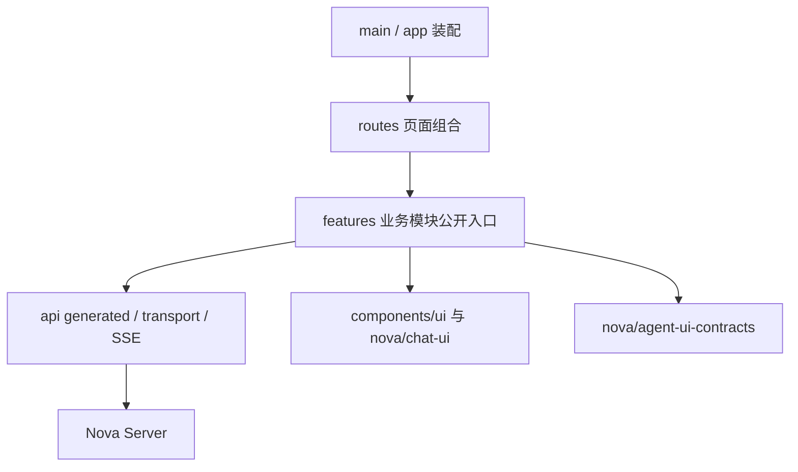
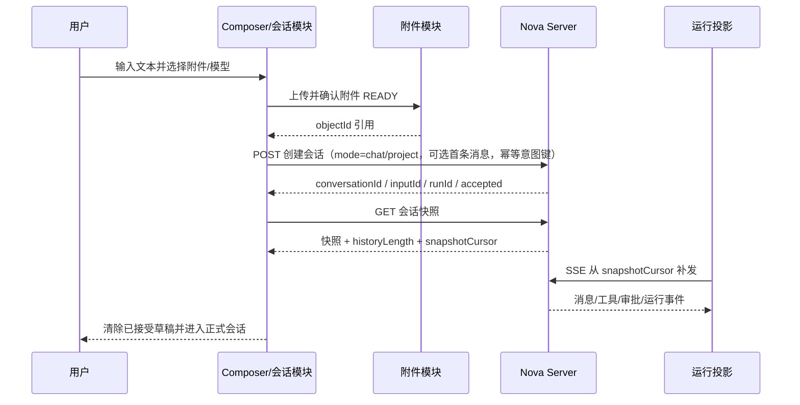
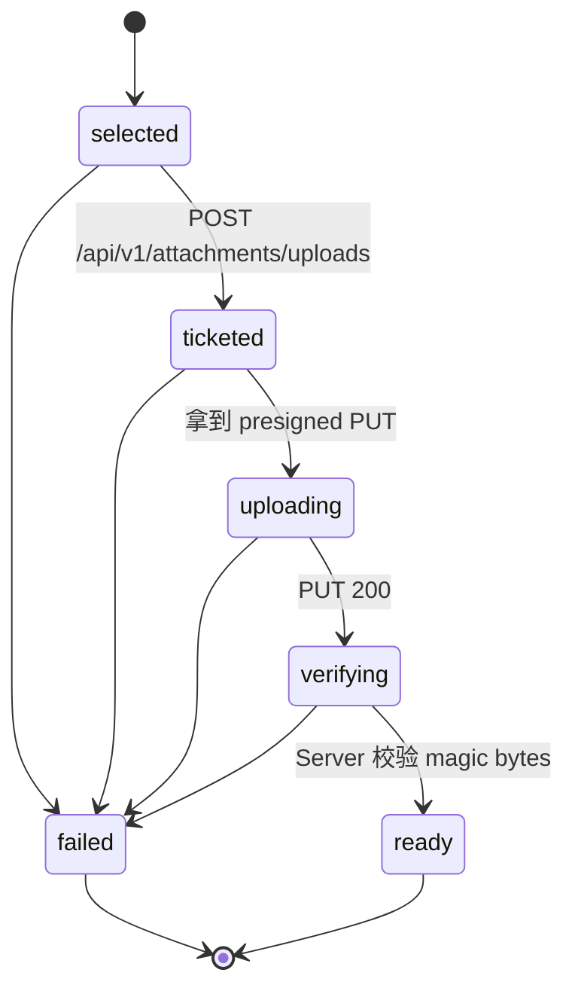
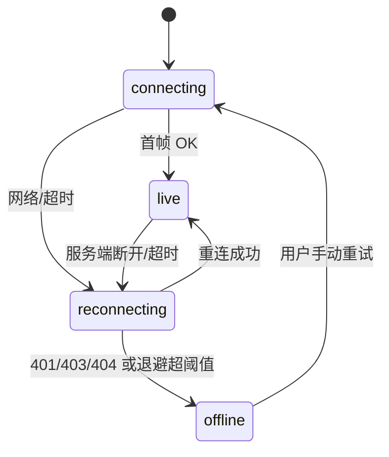

# Nova 前端技术架构设计

设计日期：2026-10-04。适用应用：`apps/nova-client/`。配套文档：[Nova 后端技术架构设计](nova-server.md)。

本文是可实施的目标架构及迁移方案。它以现有源码、[业务功能基线](docs/功能清单与重构升级参考.md)、[Coding Harness 架构](docs/coding-harness-architecture.md)为依据；业务基线中的“已具备”描述产品能力，不表示这些能力已经接入当前 `nova-client` 模板。尚未提供正式并发规模、部署条件和团队需求，文中的容量与性能数字均为初始验收建议。

## 1. 设计结论与约束

保留 `apps/nova-client/`，采用 React + TypeScript 的模块化单页工作台。按业务能力组织 `features`，路由承担页面组合，TanStack Query 管理服务端快照，独立流式运行投影管理尚未提交的内容，展示组件通过 props 和回调接入。前端承担交互、输入及状态展示，运行执行权、资源授权、审批有效性和恢复决策由 Server 持有。

复用 `@nova/chat-ui`、`@nova/agent-ui-contracts`、`@nova/casdoor` 的公开入口；不会因本设计新建一套通用 SDK 或业务框架。

| 目标       | 工程落点                                         | 验收依据                                        |
| ---------- | ------------------------------------------------ | ----------------------------------------------- |
| 高可用     | 静态资源多副本/CDN，订阅重连，快照对齐，版本回滚 | API/订阅实例切换后可恢复，草稿保留              |
| 高扩展性   | 业务模块公开入口、生成式 REST 客户端、版本化事件 | 新增业务不修改底层 transport 与其他模块内部文件 |
| 高可维护性 | 状态唯一 owner、单向依赖、路由薄化               | 边界检查、类型检查和关键流程验证                |
| 低耦合     | 展示组件不请求接口、不访问全局业务 store         | 组件可在无 Server 的示例中使用                  |
| 多人协作   | 模块责任人、契约先行、生成物可重复生成           | 契约及实现能并行推进，冲突集中在公开边界        |
| 长期迭代   | 分阶段接入、兼容窗口、性能预算                   | 可独立发布、回退且不破坏存量会话                |

## 2. 现有模板审计

| 已检查位置                                          | 当前事实                                                                                     | 迁移要求                                                     |
| --------------------------------------------------- | -------------------------------------------------------------------------------------------- | ------------------------------------------------------------ |
| `apps/nova-client/package.json`                     | React 19、Vite、TypeScript、TanStack Router/Query、RHF、Zod、@heroui/react、Tailwind、Orval 已配置 | 保留技术栈，以 lockfile 和实际构建验证版本兼容               |
| `src/app/`、`src/routes/`、`src/features/projects/` | 已有壳、导航、路由和项目 CRUD 页                                                             | 从已有业务目录渐进扩展                                       |
| `src/api/transport.ts`                              | 已统一解析 `{ code, message, data }`，将业务错误转成 `ApiError`                              | 保留单一 transport，增加身份、取消、幂等与新版本兼容         |
| `orval.config.ts`                                   | 输入仍为 `../app-server/openapi.json`                                                        | 首先修正为 `../nova-server/openapi.json`，再导入目标 v1 契约 |
| `README.md`                                         | 存在旧目录、旧根脚本说明                                                                     | 实施时同步真实命令及生成来源                                 |
| package 名称                                        | 仍为 `@react-fastify-template/app-web`                                                       | 首阶段用现名执行过滤命令；单独变更后才使用新包名             |
| `api:check`                                         | 检查过程中会重新生成文件                                                                     | CI 在隔离 checkout 中执行，并检查工作区漂移                  |
| `@nova/chat-ui` / UI 事件包                         | 存在共享组件和精简事件 v1；应用尚未声明完整接入依赖                                          | 补 workspace 依赖，先扩展 canonical event，再接入完整 Chat   |
| 身份与长期任务                                      | 当前应用没有完整认证、运行恢复和审批闭环                                                     | 不能把目录模板和共享包能力视为上线完成                       |

根目录 `package.json` 当前以 Harness 演示为入口；不假设根目录存在 `dev:web`、`check`、`openapi:export` 等脚本。此次交付只新增设计文档，以上源码修复列入实施计划。

## 3. 业务边界与核心交互

### 3.1 业务模块

| 模块              | 负责的用户能力                                | 对外入口                         | 明确不负责                   |
| ----------------- | --------------------------------------------- | -------------------------------- | ---------------------------- |
| `auth`            | 登录、回调、退出、身份投影                    | `AuthBoundary`、身份 hooks       | 业务资源授权和凭据验证       |
| `projects`        | 项目列表、创建、目录绑定、指令配置            | 项目页面、项目选择器             | 会话上下文及 Runner 连接管理 |
| `conversations`   | 会话列表/详情、消息、草稿、历史、当前 TODO    | 会话页、会话导航、提交命令       | Agent 决策和执行结果核实     |
| `runs`            | 运行状态、工具过程、审批/提问、取消、调整方向 | `RunPanel`、事件投影、命令 hooks | 分布式执行权、自动执行工具   |
| `runners`         | 设备状态、Token 引导、远程目录/文件浏览       | 设备页、设备选择器、目录数据源   | 浏览器直连设备、OS 安全边界  |
| `attachments`     | 上传队列、上传确认、预览与下载                | 附件选择与上传服务               | 决定对象 key、持久化签名 URL |
| `models`          | 可用模型和能力、后续运行配置                  | 模型选择器、模型配置表单         | 持有 Provider 密钥、推理转发 |
| `settings`        | 偏好、必要的账户设置                          | 设置页                           | 混入各业务模块的写操作       |
| `skills`、`admin` | 后续技能管理、模型/配额后台                   | 独立路由与模块                   | 首期先创建空目录或占位业务   |

`conversations` 负责历史阅读与输入，`runs` 负责运行生命周期。`TodoPanel` 可展示当前计划，但计划的写入仍来自 Server 事件与快照；不另建一套可编辑的项目任务系统。

跨模块组合放在路由页面或应用装配层。例如“项目中新建会话”使用项目公开选择结果创建会话；`projects` 不直接改写 `conversations` 私有缓存。

### 3.2 必须落实的产品语义

| 事项             | 目标设计默认值                                             | 与现状的关系                               |
| ---------------- | ---------------------------------------------------------- | ------------------------------------------ |
| 会话模式         | 创建时确定 `chat` 或 `project`，项目设备离线仍保持项目模式 | 保留业务基线                               |
| 首次发送         | 不区分 bootstrap；临时会话草稿首次发送时创建会话、首条消息和运行/排队输入，落库原子、幂等可查 | 不需新增首条消息专用端点；UI 凭 `historyLength===1` 提示”第一条消息” |
| 项目重绑         | 新会话使用新绑定；旧会话保留完整环境快照                   | 解决 Runner 与 cwd 混用，需业务确认        |
| 运行中下一条输入 | 提交到 Server 的有序 `pending_inputs`，可撤回未消费项      | 升级当前浏览器内存队列                     |
| 调整方向         | 显式命令，在工具批次安全边界消费                           | 与下一次运行的输入清楚区分                 |
| 审批超时         | 默认 `expired`，不执行；展示期限和范围                     | 改变现有编辑超时放行策略 |
| 清空上下文       | 新 `contextEpoch`，当前 TODO 清零，历史展示保留            | 修复从旧历史恢复当前计划的问题             |
| Runner Token     | 目标为只显示一次的可撤销凭据，旧可重复查看机制走兼容迁移   | 列表展示脱敏标识，需业务确认               |
| 未知执行结果     | 显示”需要核实”，给出日志、Diff 和手动核实入口              | 不提供无条件”重试原命令”                   |
| 文件上传（项目模式）| 会话绑定 Runner 时，点击附件按钮直接打开 `RemoteExplorer`，选择 Runner workspace 内的文件/目录；Server 落 `{ kind: "runner_ref", relative_path, summary }`（Runner workspace 内的相对路径 + 摘要），字节由 Runner 执行阶段按需读取 | 复用 `@nova/chat-ui` 的 RemoteExplorer；需后端目录接口、绑定必需 |
| 文件上传（普通 chat）| 会话未绑定 Runner 时，点击附件按钮触发浏览器原生文件选择；走 Server 对象存储 upload-intent/complete，最终用 `objectId` 引用 | 浏览器本地文件上传；普通 chat 不强制 Runner |

这些默认值也是后端文档中的统一决策。产品决定改变时，应同时更新两份文档、API、事件及验收用例；实施期间保留旧环境明确的策略版本，避免静默变更。

## 4. 应用内部目录与依赖规则

目录仅描述 `apps/nova-client/` 内部；标注未来能力的部分按阶段创建。一个小功能可保留单文件，不强制复制完整子树。

```text
apps/nova-client/
├── public/                         # 无敏感数据的固定公共资源
├── scripts/
│   ├── api-check.ts                # 现有生成契约检查
│   └── check-boundaries.mjs        # 实施时新增 import 约束
├── src/
│   ├── main.tsx                    # 应用启动入口
│   ├── app/
│   │   ├── providers.tsx           # Auth / Query / Router / UI providers
│   │   ├── router.tsx
│   │   ├── query-client.ts
│   │   ├── app-shell.tsx
│   │   ├── navigation.ts
│   │   └── route-feedback.tsx
│   ├── routes/                     # TanStack 文件路由：组合、loader、guard
│   ├── features/
│   │   ├── projects/               # 在现有 projects.page.tsx 上演进
│   │   │   ├── projects.page.tsx
│   │   │   ├── project-form.tsx
│   │   │   ├── project.queries.ts
│   │   │   └── index.ts
│   │   ├── conversations/
│   │   │   ├── conversation.page.tsx
│   │   │   ├── conversation.queries.ts
│   │   │   ├── conversation-composer.tsx
│   │   │   ├── draft-storage.ts
│   │   │   └── index.ts
│   │   ├── runs/
│   │   │   ├── run-panel.tsx
│   │   │   ├── run.commands.ts
│   │   │   ├── run-event-reducer.ts
│   │   │   ├── run-stream-manager.ts
│   │   │   ├── run-projection-store.ts
│   │   │   └── index.ts
│   │   ├── auth/                   # SDK bridge / callback / auth boundary
│   │   ├── runners/                # 设备页、目录浏览与连接状态
│   │   ├── attachments/            # 上传、确认、签名续期
│   │   ├── models/
│   │   └── settings/
│   ├── api/
│   │   ├── generated/              # Orval 生成，只读
│   │   ├── transport.ts            # REST 认证、解包、错误、AbortSignal
│   │   ├── api-error.ts
│   │   └── sse-client.ts           # 仅负责 SSE 帧解析与连接
│   ├── components/ui/              # 现有 Base UI/shadcn 基础组件
│   ├── lib/                        # 无业务语义的 cn、时间等稳定能力
│   ├── styles/globals.css          # tokens 与全局样式
│   ├── routeTree.gen.ts            # Router 生成，只读
│   └── vite-env.d.ts
├── tests/                          # 关键流程、契约及 E2E，实施时引入
├── orval.config.ts
├── vite.config.ts
└── package.json
```



依赖规则落实到 ESLint 限制和边界检查：

1. `app/routes -> features -> api/components/lib`；`api/components/lib` 不反向导入业务模块。
2. feature 只通过其他 feature 的 `index.ts` 协作；默认不形成 feature 间循环。多个能力的编排优先上提到页面组合。
3. feature 的 `index.ts` 只导出页面、组件、必要命令及类型，不暴露 store 的内部写方法。
4. 禁止导入 `nova-server` 源码、数据库 schema、Harness 执行器、Runner SDK 或 Casdoor server 入口到浏览器。
5. generated 文件只由 OpenAPI/Router 配置生成，不手改、不拷贝 API 类型到 feature。
6. `components/ui` 不知晓项目、会话、审批；业务组件留在所属 feature。公共逻辑至少有实际复用再提取。

## 5. 技术选型与状态所有权

| 技术                                  | 使用范围                                              | 约束与取舍                                                          |
| ------------------------------------- | ----------------------------------------------------- | ------------------------------------------------------------------- |
| React / Vite / TypeScript             | 工作台应用、分块构建、静态部署                        | SPA 适合登录后的工作台；公共 SEO 页可独立评估，不重建当前应用       |
| TanStack Router                       | URL、params/search、loader、错误边界                  | 搜索参数先校验；访问控制只改善体验                                  |
| TanStack Query                        | 服务端资源、快照、mutation、分页                      | 禁止把服务端列表复制到 UI store                                     |
| RHF + Zod                             | 表单和未提交编辑                                      | 输入校验为体验；Server 重新校验                                     |
| heroui / Tailwind / 现有 UI 源码     | 控件、交互与设计 token                                | 复用现有视觉系统和焦点行为                                          |
| Orval                                 | OpenAPI 生成 REST 类型和 Query options                | SSE 使用事件包校验，不能当 JSON 请求解包                            |
| `@nova/chat-ui`                       | Chat、Block、Decision、TODO、Composer、RemoteExplorer | 宿主持有数据与副作用，不改成业务容器                                |
| 原生外部 store                        | 大量流式增量的定向订阅                                | 优先 `useSyncExternalStore`；出现实际复杂共享 UI 状态才引入 Zustand |
| Vitest / Testing Library / Playwright | reducer、交互与核心流程                               | 当前应用未配齐，作为实施依赖，不假称已有测试脚本                    |

TanStack Query 的 stale/refetch/retry/GC 行为必须显式配置；实际值按资源变化速度确定，不能依赖默认值形成业务规则。参见 [TanStack Query 官方说明](https://tanstack.com/query/latest/docs/framework/react/guides/important-defaults)。

| 状态                                      | 唯一 owner                              | 生命周期与持久化                             |
| ----------------------------------------- | --------------------------------------- | -------------------------------------------- |
| 搜索、分页、选中会话                      | Router URL                              | 分享/刷新可还原；URL 不包含 Token 或敏感正文 |
| 用户、项目、设备、模型、历史、运行快照    | Query cache                             | 按已验证 identity 隔离，退出时清理           |
| 未提交文本与字段错误                      | RHF / 就近 state                        | 保存失败保留；会话草稿可有受控本地持久化     |
| 当前未提交消息 delta、命令输出尾部        | `runs` projection store                 | 内存有界；reload 从 Server 快照和游标恢复    |
| 连接、退避、AbortController、订阅引用计数 | `run-stream-manager`                    | 当前用户会话期，退出统一关闭                 |
| 待处理输入和审批有效性                    | Server，Query/事件只做投影              | 刷新和换标签页仍一致                         |
| 面板开合、弹窗、滚动、侧栏                | 就近 React state                        | 真正跨组件才上提；偏好可本地持久化           |
| 文件二进制、object URL、上传进度          | `attachments` 上传任务                  | 有界并发；释放时 revoke object URL           |
| 当前 TODO                                 | Server 的 `contextEpoch + planRevision` | 历史 TODO 仅历史快照，不覆盖当前计划         |

Query cache 和流式 store 不分别持有整份权威消息：cache 保存已提交快照，store 只保存指定 `messageId/blockId` 的未提交增量和连接信息；由只读 selector 合成展示。收到提交事件后按版本更新快照并清除已覆盖增量。切换身份或 `contextEpoch` 时不得混入旧投影。

## 6. API 契约、错误与写入语义

### 6.1 单一契约来源

REST 来源为后端模块的 request/response Zod schema，经 OpenAPI 导出到 `apps/nova-server/openapi.json`，再由 Orval 生成 `src/api/generated/`。前端表单 schema 只表达编辑需求，不冒充 API schema；DTO 与 ViewModel 的转换放在所属 feature。

前后端可保留各自 Zod 主版本，不跨包传 Zod 实例。后端当前 Zod 3 与 type-provider 4 对应；事件包使用自己的 Zod 4。若统一版本，应在独立变更中一起验证 runtime、serializer、OpenAPI 与生成物。

目标新 API 使用 `/api/v1`，正常 HTTP 状态码和既有成功信封 `{ code: 200, message: "ok", data }`。目标错误如下；旧 `/api/projects/` 的业务失败 HTTP 200 由 compatibility transport 继续识别，至约定退役日期后移除：

```json
{
  "code": 200,
  "subCode": 409,
  "message": "该会话已有进行中的任务",
  "requestId": "req_01...",
  "details": { "reason": "ACTIVE_RUN" }
}
```

`ApiError` 持有 `httpStatus`、语义 `code/subCode`、`requestId`、允许的字段错误及重试信息；不能以 `error.message` 文本作为程序分支。网络错误与用户主动取消分别处理；网关返回 HTML、非法 JSON、schema 不兼容时显示可恢复错误并记录安全诊断。

| 分类                        | 前端行为                                               |
| --------------------------- | ------------------------------------------------------ |
| 400/422 输入错误            | 统一 Toast 提示，按需补充字段校验，保留输入             |
| 401 身份失效                | 一次 single-flight refresh；失败退出并保留可允许的草稿 |
| 403 操作受限                | 说明权限不足，不反复刷新身份                           |
| 404 会话/项目不可访问       | 回到资源列表，移除相关私有缓存                         |
| 409 版本或运行冲突          | 重新取权威快照，保留草稿，用户确认后重新提交           |
| 429 限流/配额               | 显示限制和 `Retry-After`，暂停自动发起                 |
| 503 依赖/过载               | 有界退避，允许重试；不将已接受运行判为失败             |
| `EXECUTION_OUTCOME_UNKNOWN` | 进入核实交互，禁止自动重发有副作用命令                 |

### 6.1.1 API 层统一通知

所有请求失败（网络、超时、4xx、5xx、业务失败与响应不完整）在 API 层统一转成 Toast。业务通常无需再编写报错提示；通知后仍以 rejected Promise 抛出同一个错误，供特殊流程判断。规则如下：

- Orval 生成的客户端全部经由 `src/api/transport.ts` 的 `apiFetch` 发出请求，通知逻辑只写在这一处即可覆盖所有接口；`apps/model-console` 的 `apiMutator` 同理。
- `apiFetch` 和 `apiMutator` 支持 `silent: true`：用于后台探测（如健康检查）或业务完全接管提示，错误仍会抛出。用户主动取消不弹 Toast；401 刷新成功时不提示中间错误。
- 通知出口统一在 `src/lib/notify.ts`；相同类型、相同文案的失败合并更新，不同业务错误各自提示。
- 被提示的错误标记 `notified`，错误文案与状态码、业务码、详情、请求编号等仍可读取，`errorMessage()` 不因是否通知而改变结果。公共错误组件避免重复告警，加载失败仍保留重试入口；表单可以继续映射字段错误，特殊业务照常通过 `catch`、`onError` 或 query/mutation 的 `error` 处理。

### 6.2 缓存与 mutation

Query key 工厂以身份 scope 为前缀，例如 `['nova', identityId, 'conversation', id]`；列表包含规范化筛选与游标。未来团队功能必须再加入 active space，但前端不能通过修改 key 获得权限。

路由 loader 和组件复用 query options，通过 `ensureQueryData` 预取。rename 等可逆编辑可乐观更新并回滚；创建运行、审批、取消和删除以 Server 确认为准。删除成功先关闭订阅，再清理详情缓存和列表；跨资源失效由 mutation 的所属模块协调。

写操作默认不自动重试。首次发送、排队输入、创建上传及审批回填使用一次用户意图对应的稳定 `Idempotency-Key`。请求超时后按意图键查询提交结果，仍未接受才重试同键；改变 payload 必须生成新键。重复点击期间禁用同一命令，但最终去重依赖数据库。

## 7. 实时事件、快照与页面生命周期

### 7.1 统一协议

浏览器到 Server 的命令走 REST；Server 到浏览器的更新走带 Bearer header 的 fetch SSE。浏览器不连 Runner。SSE framing、`id` 与 `Last-Event-ID` 遵循 [HTML 标准](https://html.spec.whatwg.org/multipage/server-sent-events.html)，fetch 实现需自行完成帧解析和重连，不假设 native EventSource 会为 fetch 管理游标。

当前 `@nova/agent-ui-contracts` v1 仅有正文、基本工具和运行事件。目标增加 v2，以该包为 UI 事件唯一事实源；Server、浏览器同步生成/校验，禁止每端另写完整事件联合类型。模型内部事实继续归 Harness canonical contract，Server 只将事实投影成 UI 事件。

目标字段：`protocolVersion: 2`、`eventId`（可复用 SSE id）、`conversationId`、可空的 `runId`、会话内单调 `sequence`（十进制字符串）、`occurredAt`（UTC ISO 8601）、`contextEpoch`、`type`、判别式 payload。`sequence` 不跨会话比较；不沿用当前 v1 “每运行 number sequence”的假设。

| 事件组       | 目标事件与必要内容                                                                                     |
| ------------ | ------------------------------------------------------------------------------------------------------ |
| 消息         | `text.delta/reset`、`thinking.delta`、`message.committed`，携带 message/block ID、累计偏移/版本        |
| 工具         | `tool.started/output/finished`，区分 toolCallId、operationId、stdout/stderr、输出偏移、截断/缺口与终态 |
| 运行         | `run.state.changed`，明确 waiting、paused、cancelling、终态及原因                                      |
| 人类参与     | `decision.requested/resolved/expired`，授权摘要、期限、revision                                        |
| 计划与上下文 | `todo.replaced`、`context.changed`，epoch、完整计划与 planRevision                                     |
| 排队输入     | `input.queued/consumed/removed`，input ID、顺序、revision                                              |
| 对齐控制     | `snapshot.required`，保留窗口、快照地址或安全原因码                                                    |

Thinking 只展示模型实际提供的可展示内容，不将签名、隐藏协议字段或推测的推理过程放入 UI。

### 7.2 无丢失对齐流程

1. 获取授权快照：消息提交版本、当前运行、尚未提交的正文/Thinking blocks、输出尾部、待处理输入、decision、TODO 和 `snapshotCursor=C`；快照各部分必须在后端一致视图中读取。用快照的草稿 blocks 初始化增量投影，否则会跳过 C 之前仍未提交的内容。
2. 以 `Last-Event-ID: C` 建立 SSE，服务端按会话顺序补发 `sequence > C` 的持久化事件，再跟随新事件。即使任务先开始，持久化事件仍可补齐。
3. 校验协议与身份 scope，丢弃已应用的重复事件；遇到游标缺口或不支持的必需版本，暂停投影并重新获取快照。
4. `message.committed` 用提交版本/覆盖游标替换完整内容，不能把完整正文再次拼到 delta 后。迟到的旧请求结果不得覆盖更高 revision。
5. 游标早于保留窗口时，服务端在流建立前返回 `410 EVENT_CURSOR_EXPIRED`；流已建立后使用 `snapshot.required`。客户端保留草稿，替换完整权威投影后重订阅。
6. 浏览器刷新不单独从本地游标续读：先取快照。游标只与同一份投影一起有效，避免“保存了游标却没有保存内容”。

订阅是至少一次交付，UI reducer 必须幂等。纯连接心跳无 sequence；会话内排序只以服务端 sequence 为准，时间戳用于展示。

### 7.3 连接管理与背压

`run-stream-manager` 由登录用户的应用 providers 持有，按会话维护订阅引用计数。路由切换后，仍活动的运行继续订阅；结束且无消费者时释放。非活动历史会话只加载快照。每标签页初始最多保留 4 条会话流，超额后台会话降为按需快照/低频刷新；此值需按实际使用和 HTTP/2 配置调整。

多标签页先各自订阅并幂等应用，利用 `BroadcastChannel` 通知退出/身份变化；不在首期实现脆弱的跨标签页 leader。超过实际连接容量后再评估单条 multiplex 流，保持原事件和授权边界。

重连指数退避带抖动，建议 1–30 秒；尊重服务端限流。401 完成一次刷新后重建连接，403/404 停止订阅，网络波动重连。连接状态 `connecting/live/reconnecting/offline` 与运行状态分开。

文本 delta 每 30–50 ms 或每帧批量更新，单条事件有大小限制；工具输出只保留内存尾部（初始建议每运行 1 MiB），完整日志通过受授权分页/下载查看。背压超限由 Server 关闭慢订阅并要求快照；慢页面不阻塞 Agent。可见历史按游标分页，达到性能阈值再引入虚拟列表。

## 8. 核心端到端流程

### 8.1 首次发送与运行中输入



创建会话在同一事务内写入会话、用户消息、运行或排队输入及 durable job；无执行环境的项目模式返回明确冲突，不创建半成品运行。客户端不依赖专门的”bootstrap”端点区分首条消息：首次发送与继续输入使用同一 `POST /api/v1/conversations`（带首条消息）或 `POST /api/v1/conversations/:id/inputs` 接口，仅凭快照中的 `historyLength===1` 决定是否展示”这是本会话的第一条消息”等 UI 文案；首条消息之外没有别的特殊处理。

已有运行时默认创建 Server 队列输入；界面区分”已排队”和”尚未提交的本地草稿”。撤回只作用于未消费项；与消费竞争时返回冲突并刷新。调整方向是单独命令，不自动将全部队列投入当前任务。

### 8.1.1 文件上传两种模式

附件入口按会话模式分支，**不在 UI 上区分按钮**：

- **项目模式**（会话绑定 Runner）：点击附件按钮直接打开 `RemoteExplorer`，数据源来自 `runners` 调用 Server 的远程目录接口；选定路径经 Server 落地为 `{ kind: "runner_ref", relative_path, summary }`（Runner workspace 内的相对路径 + 摘要），消息提交时随 input 一同落库，文件字节仍按需由 Runner 在执行阶段读取。
- **普通 chat 模式**（无 Runner 绑定）：点击附件按钮即触发浏览器原生 `<input type=”file”>`，文件经 §11 的对象存储 upload-intent/complete 流程生成 `objectId`，与首条消息或后续输入一同持久化。

模式由 `conversation.mode` 决定；新建项目会话时强制要求 Runner 已绑定，未绑定不能进入项目模式也无法发消息。

### 8.2 绑定设备与项目环境

项目模式会话**必须**先绑定 Runner 才能创建或发送消息；绑定完成后，附件入口直接打开 `RemoteExplorer`，由 `runners` 模块调用 Server 的目录接口返回 Runner workspace 内的目录/文件结构，用户在远程目录中选择路径作为附件。Server 落 `{ kind: "runner_ref", relative_path, summary }`（Runner workspace 内的相对路径 + 文件摘要），实际字节由 Runner 在执行阶段按需读取，不经过对象存储。

目录浏览器复用 `@nova/chat-ui` 的 `RemoteExplorer`，数据源由 `runners` 调用 Server。只提交 Runner ID、workspace ID 和规范化相对 cwd，不根据浏览器平台拼接绝对路径。

Server 校验设备归属、当前连接代次、目录存在与边界，并保存完整 binding revision。项目重绑前展示”新会话采用新环境，已有会话保留原环境”；确需迁移已有会话时使用独立迁移入口，仅在无活动/未知执行时允许，显示完整旧/新环境。

普通 chat 模式会话不强制绑定 Runner；附件入口走 §9.2 的浏览器本地文件上传，与项目模式的 RemoteExplorer 是两套互不影响的入口。

当前 Runner 文件 API 限制在注册 workspace；任意 Shell 可以具有更广 OS 权限，界面不得声称 workspace 是完整沙箱。要求项目级强隔离的入口仅在后端能力明确支持后出现。

### 8.3 审批、取消与未知结果

Decision 展示操作摘要、完整命令/参数或 Diff、作用路径、期限和授权范围。提交包含 decision revision 与幂等键；两个标签页竞争时，以 Server 第一个有效决策为准。倒计时结束，浏览器默认执行确认操作。

取消请求被接受后显示 `cancelling`，收到 Server 确认或超时分类才展示终态。网络中断不等于进程终止；结果未知时展示风险与可核实材料，允许发起只读核实或结束运行，不自动再执行原操作。

### 8.4 上下文和计划

压缩/清空在活动运行、等待审批、暂停未结束任务时被后端互斥检查拒绝。占用值标明“估算”，与实际计量分开。压缩保持当前 TODO；清空产生新 epoch 并清零当前计划，消息中的历史 TODO 仍可查看。

## 9. 身份、附件与内容安全

### 9.1 身份接入

复用 `@nova/casdoor/client/react` 的 provider/hooks，由 `auth` bridge 隔离 SDK 形状。浏览器仅配置 appName、Auth Service base、允许的 callback/logout URL，不持有 Casdoor 或 Provider secret。


### 9.2 附件与内容

附件入口按 `conversation.mode` 分支为两条互不影响的路径：

- **项目模式**：点击附件按钮直接打开 `RemoteExplorer`，由 `runners` 模块调用 Server 列出 Runner workspace 目录/文件；选定路径经 Server 落地为 `{ kind: "runner_ref", relative_path, summary }`（Runner workspace 内相对路径 + 文件摘要），不下载字节到浏览器。消息提交时随 input 一起落库，文件字节由 Runner 在执行阶段按需读取。删除/重读通过 Server 与 Runner 协议完成。
- **普通 chat 模式**：点击附件按钮触发浏览器原生文件选择，走 Server 对象存储：状态 `selected -> ticketed -> uploading -> verifying -> ready`，失败可重试但必须显示原因；READY 的 `objectId` 才能提交消息。上传票据的 URL、headers、method、expiry 由 Server 指定。客户端初始并发建议 3 个，可取消，不把大文件读进字符串或 Query cache。

两条路径在 UI 上共享同一个附件按钮，但触发器与后续数据流互不影响；项目模式不下载到浏览器，普通 chat 不依赖 Runner。


## 10. 性能、可访问性和故障体验

| 领域       | 实施要求                                           | 初始验收建议                               |
| ---------- | -------------------------------------------------- | ------------------------------------------ |
| 首屏       | 按路由分块，后台/重型 Diff 和代码高亮按需载入      | 压缩后首屏 JS 预算 300 KiB，CI 记录增量    |
| Chat 渲染  | 批量 delta、稳定 block key、分段高亮、尾部日志有界 | 1000 条历史分页场景，输入交互 p95 < 100 ms |
| 网络       | 请求取消、去重、分页，避免每条 delta refetch       | 新增模块不产生持续无界轮询                 |
| 草稿与输入 | 保存失败保留、上传反馈、队列显式状态               | 弱网/超时后可继续同一意图                  |
| 阅读       | 用户读历史时保持锚点，底部才跟随输出               | 切换会话还原滚动，新增内容不抢阅读位置     |
| 可访问性   | 键盘、焦点、label、contrast、reduced motion        | WCAG 2.2 AA 作为设计目标，关键流程人工验证 |
| 适配       | 侧栏窄屏变 drawer，长文件名和错误内容可折行        | 360px 窄屏与桌面可完成登录、发送和审批     |


## 11. 附件与资源删除

附件按 `conversation.mode` 走两条互不影响的路径，落地到 `messages.attachments` JSONB 的同一个字段。两轨共享 UI 按钮，但触发器、数据流、错误语义与回收策略各自独立。附件元数据的权威形状在 Server 端定义：

```json
[
  {
    "kind": "minio",
    "key": "uploads/{userId}/{uuid}.ext",
    "summary": { "size": 18432, "mime": "image/png", "sha256": "…" }
  },
  {
    "kind": "runner_ref",
    "relative_path": "src/lib/foo.ts",
    "summary": { "size": 18432, "sha256": "…", "mtime": "2026-10-04T03:11:00Z" }
  }
]
```

现有客户端文档在 §3.2、§8.1.1、§8.2、§9.2 中以 `attachment_ref` 一词指代上述两种 kind 的总称。本节按 Server 端的 canonical 字段统一使用 `kind: "minio"` / `kind: "runner_ref"`，下游代码与生成类型按此对齐；旧 `attachment_ref` 仅作为本节范围内的概念简称，不作为生成类型或 API 字段名。

### 11.1 普通 chat 模式：对象存储直传

普通会话（`mode=chat` 且未绑定 Runner）下的附件入口触发浏览器原生文件选择；本应用不内置文件选择 UI 库，按 `<input type="file">` + 受控 `accept` 列表实现。上传状态机严格串行：



只有 `ready` 状态的 `objectId`（即 `key`）能随消息一同提交；`ticketed`/`uploading`/`verifying`/`failed` 任一状态下点击发送，按钮禁用并显示当前阶段。状态由 `attachments` 模块内单一 owner 持有；同一文件可由多个并发任务共享，但读入浏览器内存采用流式 `Blob`/`ArrayBuffer`，不把整个 base64 写入 React state 或 TanStack Query cache。

普通 chat 模式的请求链对应 Server 端 §11.1（[nova-server.md](nova-server.md) §11.1）：

```ts
// 票据申请
type CreateUploadRequest = {
  filename: string;
  mime: string;
  size: number;
};
type CreateUploadResponse = {
  key: string;          // 形如 uploads/{userId}/{uuid}.ext
  upload: {
    url: string;        // presigned PUT
    method: "PUT";
    headers: Record<string, string>;
    expiresAt: string;  // UTC ISO 8601
  };
  download: {
    url: string;        // 短时 GET；过期需重新申请
    expiresAt: string;
  };
};
```

浏览器按 `upload` 直接 `fetch(url, { method, headers, body: file })`，不通过 Server 中转字节。`PUT` 完成后调用 Server 的 `POST /api/v1/attachments/uploads/:key/complete`，Server 在事务中按 `validateOwnedKey` 校验 `key` 前缀必须为 `uploads/{userId}/`，并通过流式读取实际 decode 探测 magic bytes（PNG/JPEG/GIF/WebP），超 5 MiB 或类型不符即拒收；ETag 不作为 checksum。校验通过后 `key` 进入 `ready` 状态，可被组装进消息的 `attachments` 数组。

图片预览与模型输入均不依赖长期 presigned URL。Server 暴露两个端口：

- `POST /api/v1/attachments/read-image`：返回 `{ data: base64, mimeType }`，用于直接渲染 ``。
- `GET /api/v1/attachments/image-url`：返回短时 GET URL 与 `expiresAt`；浏览器只在到期前使用，到期后重新申请。

二者均通过 Server 授权，不在前端缓存 key → URL 映射；HTML/SVG 默认按 `Content-Disposition: attachment` 处理，预览隔离在独立 origin 并附 CSP。

### 11.2 项目模式：远程目录引用

项目会话（`mode=project` 且已绑定 Runner）下的附件入口直接打开 `@nova/chat-ui` 的 `RemoteExplorer`，数据源由 `runners` 模块调用 Server 的 `GET /api/v1/runners/:id/files` 返回：

```ts
type RemoteExplorerListing = {
  root: string;        // 当前 binding 的规范化 workspace 根
  path: string;        // 浏览器请求的相对 cwd
  parent: string | null;
  entries: readonly {
    name: string;
    path: string;      // 相对 root 的规范化路径
    kind: "file" | "directory";
  }[];
};
```

浏览器只持有路径与展示所需的目录条目，不下载字节。用户在 `RemoteExplorer` 中确认后，Server 在该会话 binding 的 workspace 内做规范化校验（禁止 `..` 越界、禁止绝对路径），并由 Runner 对选定路径计算摘要（sha256 + size + mtime）。摘要连同 `{ kind: "runner_ref", relative_path, summary }` 写入 `messages.attachments` JSONB，与消息同事务落库。`RemoteExplorer` 的 `loadDirectory` 回调由 `runners` feature 实现，对接 Server 的 `files`/`files/summary` 接口；运行时配置（`loadDirectory` 来源、AbortSignal、确认回调）由 §4 中的 feature 公开入口提供，组件本身不感知数据源。

执行阶段由模型触发工具读取，Server 在事务中创建 `runner_operations` intent（含 `(run_id, tool_call_id, runner_ref)` 摘要），通过 `RunnerExecutionPort` 派发；Runner 在原 workspace 内按 `relative_path` 读取并照常落 `tool_calls`。执行前再次校验 Runner 连接、workspace、binding revision 与摘要，摘要不一致按未知结果处理，禁止按工具名 blanket 放行。读取失败时 `tool_calls` 标记 `OUTCOME_UNKNOWN`。

### 11.3 `kind` 对比与客户端责任

| 事实                                | `kind: "minio"`                                       | `kind: "runner_ref"`                                      |
| ----------------------------------- | ----------------------------------------------------- | --------------------------------------------------------- |
| 数据位置                            | MinIO/S3 私有对象存储                                 | Runner 设备本地 workspace                                  |
| 字节是否经过浏览器                  | 经：浏览器直传对象存储                                | 否：浏览器只持有相对路径 + 摘要                            |
| 谁决定 key / 摘要                   | Server（`createUpload` 返回 key）                     | Runner（执行前摘要校验；写入时 `attachments`）            |
| Server 校验点                       | `validateOwnedKey` 前缀 `uploads/{userId}/`           | workspace + 摘要 + binding revision                       |
| UI 预览来源                         | `readImage` / `imageUrl`                              | 不在 UI 预览字节；只展示路径与摘要                         |
| 删除语义                            | Server 把 key 移交对账 job；MinIO lifecycle + 孤立对象扫描 | 标记 JSONB 引用为悬挂；Runner 删除/移动需上报事件        |
| 浏览器删除按钮                      | 不直删对象；只删消息/会话引用                         | 不直删文件；只删引用                                       |

两种 kind 的字段集合不重合：客户端读取 `messages.attachments` 后须按 `kind` 分发到不同渲染分支；统一渲染视作实现错误。

### 11.4 上传错误、超时与重试

- `ticketed` 申请失败：把票据状态回滚到 `failed`，保留本地文件，提供”重新生成上传链接”。
- `uploading` 阶段 `fetch` 中断：`AbortController` 取消后状态 `failed`，文件可重传；同一文件重新上传必须申请新 key（key 含 UUID，禁止复用旧 key 试探）。
- `verifying` 阶段失败（如 magic bytes 不符、超过 5 MiB）：状态 `failed`，不向用户泄露具体校验规则；提示”文件类型或大小不支持”，并保留服务端 `requestId`。
- 上传票据过期：状态 `failed`，提示重新上传；不试图续期 presigned URL，由 Server 重新签发。
- 上传完成但消息发送失败：用户可见对象已上传成功，提示”附件已就绪，但消息未送达”，允许重新提交消息；不主动删除对象，等待 Server 对账 job 处理悬挂引用。

网络层超时默认 30 秒，可按文件大小分档；超时后只重试当前阶段，不重新走完整状态机。进度反馈按 `Content-Length` 与已读取字节计算，不假装精确百分比。

### 11.5 删除与回收

普通 chat 模式：用户在 UI 删除单条消息/整个会话时，浏览器只调用 Server 的删除接口；Server 将 `messages.attachments` JSONB 中相关 `key` 移交后台对账 job，MinIO lifecycle rule 配合 prefix `uploads/{userId}/` 周期清理。前端不直接删除对象存储，也不通过 presigned DELETE 自行清理；`api:check` 不为对象存储动作生成类型。

项目模式：会话/project 删除由 Server 标记 JSONB 中的 `runner_ref` 为悬挂引用；文件本身仍在 Runner 上，不进行字节级回收，但要求 Runner 在文件被删除/移动时通过设备事件上报以便引用失效。普通会话不受项目删除影响。

跨资源失效由 mutation 的所属模块协调：消息删除成功后关闭相关 SSE 订阅（如该会话只剩草稿/历史），清理详情缓存并按列表 key 移除项目中的引用条目。删除不可逆，UI 必须二次确认并提示将丢失附件预览。

### 11.6 实施说明

- §3.2 的”调整方向”行已列出本节是默认落点；本节将”上传状态机”与”`kind` 形状”作为 §3.2 的实施补全。
- §6 的 `api:check` 须确保新生成类型覆盖 `kind: "minio"` / `kind: "runner_ref"` 两种载荷；旧的 `attachment_ref` 在生成物中仅作为字段别名（如保留）出现一次，集中解释见 §11 开头。
- `RemoteExplorer` 复用 `@nova/chat-ui` 的现成组件；首期不修改组件本身，只在 `runners` feature 注入 `loadDirectory`。
- 本节未引入新的浏览器端缓存；对象 key 不写入 localStorage 或 sessionStorage，退出时由 Query cache 清空。

## 12. 模型调用、用量、配额与子任务

模型调用、配额计量、上下文预算与子 Agent 派发由 Server 持有权威；客户端只展示目录、配置、运行时锁、用量提示、配额反馈和子任务进度，不发起 Provider 请求，不持有 secret。本节落实 §3.2 的”调整方向”行所对应的运行时行为。

### 12.1 模型目录与运行时配置

模型目录 UI 当前没有正式接入（§3.1 中 `models` 模块尚未实际页面）。目标形态：

| 元素                | 目标设计                                                          | 现状与差距                                                                       |
| ------------------- | ----------------------------------------------------------------- | -------------------------------------------------------------------------------- |
| 模型目录列表        | 按 Provider 维度分组；显示 capability、价格版本、visible 范围     | 未实现；首期占位由 `models` feature 提供空组件或骨架                              |
| 推理强度选择        | low/medium/high 或由 Provider 给出的离散档；提交会话时锁定         | 首期不实现强度枚举，按 Server 默认；UI 上”推理强度”控件列入实施计划                |
| 运行时锁            | 会话创建时确定 `modelId` + `priceVersion`；运行中切换需新会话     | 现状：会话首期先创建空目录；本节定义目标语义                                       |
| 模型可观测性        | `cost_micros`、`usage`、`reservation` 在 UI 投影，但不暴露 secret | UI 只显示成本估算、用量条与预算百分比                                             |
| 跨标签页一致性      | 同一会话在多标签页看到一致模型/价格                               | 同一 identity 下 Query cache key 一致；不允许在不同标签页临时切到未发布模型        |

`priceVersion` 跟随会话创建时锁定；服务端允许的新价格不静默回写到运行中的会话；模型目录的 `deprecated`/`hidden` 状态由 Server 在目录接口返回脱敏 DTO，前端只展示可见模型。

### 12.2 上下文用量与”估算”标签

`@nova/chat-ui` 导出 `contextUsagePercent(usage: ComposerContextUsage): number` 与 `<ComposerContextUsageIndicator usage={...} />`，分别位于 `packages/chat-ui/src/composer-context-usage.tsx`。`ComposerContextUsage` 类型在 `composer-types.ts` 中定义。`contextUsagePercent` 在 `estimatedInputTokens === 0` 时返回 0，且百分比被钳制在 1–100，避免出现 0% 又带有非零估算值的歧义显示。

显示侧要求：

- 文案明确为估算：`上下文 ≈N%`、`≈{estimated} / {max} tokens`；不允许出现”精确 %”文案。
- 估算与实际计量分别渲染：估算来自 `usage.estimatedInputTokens`，实际由 Server 在 `model_invocations.usage` 中结算；UI 不替换前者为后者，仅在消息提交后展示”本次调用实际用量”。
- 压缩/清空后估算刷新：在 `snapshot.required` 之后显示新估算，避免旧数字误导。
- 不把估算作为发送按钮的禁用条件：发送门控由”附件未 `ready`/运行态冲突”等明确状态决定，不引入百分比隐式门控。

### 12.3 配额、限流与依赖不可用

服务端配额返回 HTTP 429、503 与业务信封 `code/subCode`；客户端按 §6.1 的错误映射处置，并补充本节的具体 UX：

| 场景                            | 用户可见行为                                                                               | 客户端责任                                                                  |
| ------------------------------- | ------------------------------------------------------------------------------------------ | --------------------------------------------------------------------------- |
| 429 配额/速率限制               | 顶部 toast 显示 `Retry-After`（秒）；暂停自动重试；可手动重试                              | 从响应头解析 `Retry-After`；按值在 `run-stream-manager` 中设置倒计时暂停        |
| 503 依赖/过载                   | 列表/详情保留；按钮显示”过载，稍后重试”；不重置已接受运行                                   | 触发有界退避；不动 `runs` 投影状态                                           |
| `RESERVATION_RELEASED`         | 静默重试一次同 `Idempotency-Key`；仍失败展示”预算已释放，请稍后再发”                          | 保留原 key，调用查询接口确认是否已接受后再重试                               |
| `EXECUTION_OUTCOME_UNKNOWN`     | 进入核实流程；禁止自动重发有副作用命令                                                      | 显示 §8.3 的”需要核实”面板                                                   |
| `INFERENCE_STRENGTH_UNAVAILABLE` | 模型目录标灰；不发起提交                                                                    | 切回默认强度或保留旧锁定版本                                                 |

配额预留/释放不在客户端计算；UI 只读取 `usage` 与 `reservation` 投影展示，不持有预算 owner。

### 12.4 子 Agent 与子任务进度

子任务由 Server 复用现有 Harness Task Engine 派发，父预算包含子用量，父取消传播。客户端首期不展示可编辑的子任务列表，仅展示只读进度：

```ts
type SubTaskProgress = {
  subTaskId: string;
  parentRunId: string;
  status: "queued" | "running" | "succeeded" | "failed" | "cancelled";
  attempts: number;
  startedAt?: string;
  finishedAt?: string;
  summary?: string;
};
```

`runs` feature 在事件流中识别 `task.*` 类事件，按 `parentRunId` 聚合到 `RunPanel` 的折叠区域；不允许前端 spawn 子任务、修改并发/深度或绕过 Server 直接调用 Provider。深度与并发上限（如初始并发 4、深度 1）由 Server 在 §12 中作为产品配置持久化，UI 不暴露调整入口。

父 run 终止/取消时，已展示的子任务投影保留为历史，不自动隐藏；用户在只读列表中点开条目可查看终态原因与日志引用。

### 12.5 DTO 脱敏与一致性

- 模型目录 DTO 在 OpenAPI 中不含 `secret`、`apiKey`、`endpoint` 字段；生成类型与 `api:check` 共同保证。
- Provider 错误不在 UI 展示原始 body；只展示用户层文案与 `requestId`，由 transport 在 §6.1 统一处理。
- 实际用量（`actualInputTokens`/`actualOutputTokens`/`costMicros`）与估算分别展示，不替换；同一会话在不同标签页必须显示一致数值，由 Query cache 的 identity scope 保证。
- 模型重试仅 Server 持有权：客户端不发起自动重试，仅在收到明确 `RESERVATION_RELEASED` 或 503 时按上表处理；不把 `Idempotency-Key` 暴露在 UI。

### 12.6 实施说明

- §3.1 中 `models` 模块的首期目标为”提供空目录或占位业务”；本节落实目录显示、强度选择与运行时锁三个目标态。
- §6.2 的 `Idempotency-Key` 在子任务/重试场景下复用为同一意图键；本节不另设请求重试策略。
- 上下文用量组件直接复用 `@nova/chat-ui` 的现成导出；首期不内嵌成本估算组件。
- 不假设子 Agent 完整 UI 已存在；本节定义投影 DTO 形状与只读渲染目标。

## 13. 高可用部署、容量与故障处理（客户端视角）

前端的高可用建立在三类可控面之上：浏览器到 Server 的 REST/SSE 连接、客户端自身资源预算、用户可见的错误反馈。Server、数据库、Runner、对象存储、Auth Service 的故障不在前端解决，但前端必须以确定的方式表达故障、保留草稿、避免数据丢失。本节按 §6.1 的错误表扩展到运行时行为，并交叉引用 §10 的性能预算。

### 13.1 连接状态与生命周期

`run-stream-manager` 维护会话订阅，并暴露连接状态机：

```ts
type ConnectionState = "connecting" | "live" | "reconnecting" | "offline";
```

连接状态与运行生命周期状态分开：连接 `reconnecting` 不改变 `run.state`；`snapshot.required` 触发的是”取最新快照并替换增量”，不是”重连”。重连指数退避建议 1–30 秒，带抖动；401 完成一次刷新后重建连接，403/404 停止订阅，网络波动按指数退避重连。连接状态在 `RunPanel` 顶部以指示条展示（不弹模态），文案与操作按钮按状态分发。



`offline` 是终态而非循环中的状态：进入 `offline` 后由用户点击”重试”或”切换路由”再次进入 `connecting`；不在后台无限循环。`snapshot.required` 事件触发 `run-projection-store` 重新拉取快照，不触发连接状态切换。

### 13.2 多标签页与 BroadcastChannel

多标签页各自订阅并幂等应用事件，利用 `BroadcastChannel('nova:' + identityId)` 通知身份变化、退出与订阅释放：

```ts
type BroadcastMessage =
  | { type: "identity-changed"; identityId: string }
  | { type: "subscription-released"; conversationId: string }
  | { type: "snapshot-required"; conversationId: string };
```

收到 `identity-changed` 后所有标签页清空 Query cache 与流式投影；收到 `subscription-released` 后仅释放引用计数，不重连；`snapshot-required` 由任一标签页处理并广播，避免重复拉取。第一版不实现脆弱的 leader 选举；超过实际连接容量后再评估 multiplex 单连接。

每标签页初始最多保留 4 条会话流；超额后台会话降为按需快照/低频刷新。此值需按实际使用与 HTTP/2 配置调整，不写入产品默认值。

### 13.3 错误码到 UI 映射

下表为 §6.1 的运行时扩展，明确每个错误码在订阅、写操作、上传三种上下文中的客户端责任：

| HTTP / subCode | 用户可见行为                                                          | 客户端责任                                                                                  |
| -------------- | --------------------------------------------------------------------- | ------------------------------------------------------------------------------------------- |
| 400/422        | 表单字段提示，保留输入                                                  | 解析 `details.field`，写入 RHF；不发起自动重试                                                |
| 401            | 一次 single-flight refresh；失败退出并保留草稿                          | `run-stream-manager` 在飞行请求前后只触发一次 `refresh`；并发请求复用该 Promise                |
| 403            | 文案”权限不足”，不反复刷新身份                                          | 标记身份 scope 不匹配；订阅在 `offline` 后停止                                                |
| 404            | 路由回资源列表，移除相关私有缓存                                         | `queryClient.removeQueries(['nova', identityId, ...])`；不再发起对同一资源的请求               |
| 409            | 重新取权威快照；用户确认后重新提交                                       | `ensureQueryData` 取快照；保留草稿；UI 不静默合并                                             |
| 410（事件游标）| 弹”快照已过期”，保留草稿，重订阅                                        | 触发 `snapshot.required` 路径；不拼接重复正文                                                 |
| 413            | 提示精简后重试；本地草稿保留                                            | 取消本次写；不重新上传                                                                       |
| 429            | 显示 `Retry-After`，暂停自动发起                                        | 解析 `Retry-After` 并在 `run-stream-manager` 设置倒计时；不重试                              |
| 503            | 有界退避；不把已接受运行判为失败                                         | 触发指数退避；保留 `runs` 投影与 `pending_inputs`                                             |
| `EXECUTION_OUTCOME_UNKNOWN` | 进入核实交互；禁止自动重发有副作用命令                              | 显示 §8.3 的核实面板；不发起重新 `Execute`                                                   |
| 网络断开        | 状态条显示”离线”，草稿保留；订阅进入 `reconnecting`                    | 区分主动取消（`AbortController.abort()`）与被动断开；后者继续退避                              |

`ApiError` 持有 `httpStatus`、`subCode`、`requestId`；`requestId` 用于支持联系与上报，不作为 UI 主键。

### 13.4 Runner 离线与不自动降级

Runner 是用户资源执行的执行者；客户端不与 Runner 直接通信（`@nova/runner-protocol` 不导入客户端，见 §4 依赖规则）。Runner 离线对前端是 Server 投影中的 `runs.state` 与 `runner.lastSeen`：

| 场景                              | 前端可见                                                                              | 前端行为                                                                                       |
| --------------------------------- | ------------------------------------------------------------------------------------- | ---------------------------------------------------------------------------------------------- |
| Runner 暂时不可达                 | `runs.state=paused`，`pauseReason=RUNNER_OFFLINE`                                     | 状态条文案”设备离线”；不自动取消；保留草稿与 `pending_inputs`；可允许用户继续编辑              |
| Runner 重新连接                   | Server 推送 `run.state.changed` 事件                                                  | 状态条回到正常；不触发连接重连（连接是浏览器↔Server）；不假装已自动恢复副作用                   |
| Runner 替换（用户手动）           | 列表展示新设备；旧会话不自动迁移                                                       | 展示”新会话采用新环境”；旧会话保留原 binding；迁移走独立入口                                     |
| Runner 永久下线                   | `runs.state=cancelled_unconfirmed`（参考 [nova-server.md](nova-server.md) §7.1）         | 切换到”需要核实”面板；区分 `cancelled` 与 `cancelled_unconfirmed`，不显示”已停止”              |

`cancelled_unconfirmed` 是终态但效果未确认：UI 必须区分 `cancelled`（已确认停止）与 `cancelled_unconfirmed`（宽限结束但设备未确认），前者显示”已停止”，后者显示”需要核实”并提供日志/Diff/手动核实入口。客户端不自动重试原命令，也不允许静默回退到上一稳定状态。

### 13.5 性能预算与容量假设

§10 列出初始性能预算；本节补全其在多标签页、慢网络和 SSE 场景下的应用：

| 维度                  | 预算                                              | 应用与验证点                                                                       |
| --------------------- | ------------------------------------------------- | ---------------------------------------------------------------------------------- |
| 首屏 JS               | 压缩后 ≤ 300 KiB                                  | CI 记录增量；超过阈值阻断合并；按路由分块                                          |
| Chat 输入交互         | p95 < 100 ms                                      | 1000 条历史分页场景下保持；批量 delta 避免 refetch                                |
| 每标签页订阅流        | 初始上限 4 条                                     | 超额后台会话降为低频刷新；可按团队规模与 HTTP/2 配置调优                            |
| 流式帧大小            | 单条事件建议 ≤ 64 KiB；工具输出 1 MiB 内存尾部    | Server 关闭慢订阅时由 `snapshot.required` 恢复；不阻塞 Agent                       |
| 退出/重建            | Query cache 按 identity 清空；草稿可本地保留       | 切换身份不清草稿；切换会话不清草稿                                                 |

容量场景以 Server §13.2 的建议值为参考（2000 条 SSE、300 台在线 Runner、30 个活动 run、50 REST RPS），客户端容量假设仅与浏览器侧渲染、SSE 订阅数与 Query cache 相关；不假设前端能解决服务端过载。

### 13.6 健康检查与重连交互

`/health/ready` 失败时前端不立即退出；它影响重连策略与 UI 提示：

- `ready` 失败且连接处于 `live`：保持 `live`；下一次操作触发时才检查。
- `ready` 失败且连接处于 `reconnecting`：退避翻倍；超过阈值进入 `offline`。
- `live` 进入 `ready=false` 的事件：以 toast 形式提示”服务端正在切换”，不打断用户当前编辑。

健康响应在 transport 层不展开；客户端只读取布尔值，不解析 endpoint、credential 或用户数据。

### 13.7 实施说明

- §7.3 的连接管理与本节的错误映射共同形成运行时的”无静默失败”边界；任一环节假设”网络抖动会自动恢复”都被视为实现错误。
- §6.2 的写操作不自动重试与本节错误码到 UI 映射一致；`429`/`503` 的暂停语义由 `run-stream-manager` 持有，避免每个组件自行实现。
- §13.4 中 `cancelled_unconfirmed` 的处理是 §8.3 的细化，列入实施计划。
- 本节未引入新的对外 API；所有路径仅依赖现有 REST/SSE 契约。

## 14. 配置、探针与可观测性（客户端视角）

配置、探针与可观测性在前后端有清晰的职责切分：Server 持有运行配置、进程探针与结构化日志；客户端只持有构建时打包的公开配置、面向用户的健康状态展示，以及浏览器侧可观测的指标。本节不复制 [nova-server.md](nova-server.md) §14 的服务端内容，只描述客户端侧对应的接口与限制。

### 14.1 配置：构建时 vs 运行时

| 类别                       | 形式                                                   | 示例                                                                       | 边界                                                                                     |
| -------------------------- | ------------------------------------------------------ | -------------------------------------------------------------------------- | ---------------------------------------------------------------------------------------- |
| 构建时公开配置             | Vite 环境变量注入到 `import.meta.env`                  | `VITE_API_BASE_URL`、`VITE_SSE_BASE_URL`、`VITE_AUTH_BASE_URL`              | 必须为公开 endpoint；不能包含 secret、token、内部域名                                   |
| 运行时动态配置             | Server 拉取并下发                                     | 功能开关、UI 文本、可观测采样率                                            | 由 `/api/v1/config` 返回；前端按 identity scope 缓存，不持久化敏感字段                  |
| 用户偏好                   | `localStorage`/`IndexedDB`（受控 schema）              | 主题、侧栏宽度、reduced motion                                            | 不写 token、密码、模型 secret；版本字段必须存在以兼容迁移                                |
| 域策略版本                 | 由 Server 推送或随资源返回                             | `policyVersion`、`contractVersion`                                         | 客户端只读取并显示，不作为决策依据                                                       |

`VITE_*` 变量必须出现在仓库的 `.env.example` 中并附说明；新增公开 endpoint 必须先确认其公开属性，再考虑是否纳入运行时配置。运行时配置由 Server 验证后下发，不允许在客户端引入环境判断分支。

### 14.2 健康检查与连接状态

`/health/live` 与 `/health/ready` 的语义由 Server 定义。客户端的交互点：

- `/health/live` 失败：触发 503 的统一 UI 提示；订阅保持现状。
- `/health/ready` 失败：影响重连策略（见 §13.6），不中断当前会话。
- 健康响应仅消费布尔值；不解析 endpoint、credential、用户数据。

`run-stream-manager` 的连接状态（`connecting/live/reconnecting/offline`）与 Server 健康状态正交：连接断开不直接判定服务不可用；服务不可用不直接判定连接断开。

### 14.3 可观测指标（浏览器侧）

可观测指标分两类：上传到 Server 的诊断数据、暴露给运维的浏览器指标。前者受 §10（业务基线）的隐私约束，后者用于产品决策与排障。

| 类别           | 指标/事件                                                    | 上报/展示                                                            |
| -------------- | ------------------------------------------------------------ | -------------------------------------------------------------------- |
| 连接与订阅     | 连接状态切换次数、订阅创建/释放次数、重连退避分布           | 浏览器内部计数器；不上送 message/PII                                 |
| 慢消费者       | 单条 SSE 连接慢消费断开次数、`snapshot.required` 触发次数   | 浏览器内部计数器；关联 `conversationId`（不含正文）                  |
| 游标           | `snapshotCursor` 起始值、过期次数、补发延迟                  | 起始值与过期次数聚合上传；不上送 cursor 序列本身                     |
| 首屏 JS        | 路由分块后首屏体积（压缩后）、增量                          | CI 记录；超过 §10 预算阻断合并                                       |
| Web Vitals     | LCP、INP、CLS（按路由采样）                                  | 浏览器内采样聚合；不上送 URL/参数                                    |
| 错误码分布     | 5xx/4xx/业务 subCode 计数（不含 message）                    | 聚合上传；包含 `requestId` 便于后端关联                              |
| 身份事件       | `identity-changed` 广播触发次数、登出次数                    | 仅次数；不上送 user id                                              |
| 上传阶段耗时   | `ticketed`/`uploading`/`verifying` 阶段直方图                | 仅耗时；不上送文件名/字节                                            |
| 模型用量展示   | `contextUsagePercent` 触发 UI 更新次数                       | 仅计数；估算值与实际值分开记录                                       |

禁止上送：消息正文、Thinking、prompt、文件字节、签名 URL、token、cookie、provider secret、Casdoor clientSecret。这些字段在 transport 层一律 redact；任何尝试把这些字段写入日志/指标的代码路径在 §6.1 的代码评审中视为阻断项。

### 14.4 requestId 与运行标识

请求/事件携带的标识符：

- `requestId`：REST 响应错误信封与 SSE 错误控制事件共用；UI 在错误提示中提供 `requestId` 复制按钮，不展示完整链路。
- `runId` / `conversationId` / `operationId` / `invocationId` / `jobId`：随事件流携带；UI 在调试面板中按 `conversationId` 聚合，不展示敏感正文。
- `idempotencyKey`：客户端持有但不写入 URL 或 localStorage；仅在内存中按用户意图对应一次重试。

调试面板作为开发态可见，生产构建按 §14.5 关闭。

### 14.5 开发态与生产构建

`@nova/agent-ui-contracts/dev-auth` 提供本地开发 mock（`packages/agent-ui-contracts/src/dev-auth.ts`）：`DEV_MOCK_ACCESS_TOKEN`、`DEV_MOCK_USER`。该模块在生产构建中必须剔除：

- 入口只在 `import.meta.env.DEV` 为 true 时引用；生产构建经 Vite tree-shaking 移除。
- `pnpm build` 校验：`grep -r "dev-auth" dist/` 应为空；CI 阻断。
- 调试面板、上传取消注入、事件回放等只读开关同样受 `import.meta.env.DEV` 控制。

`api:check` 与 `routes:generate` 必须在 CI 中验证生成物漂移；新增调试开关需在 `api:check` 中保留运行时分流，避免在生成类型中泄漏 dev-only 形状。

### 14.6 实施说明

- §4 的依赖规则保证 `runner-protocol`、`nova-server`、`@nova/casdoor/server` 等不进入浏览器；本节以可观测性视角重申该约束——任何把上述模块打包进 `dist/` 的构建路径视为阻断项。
- 配置变更必须先进入 `.env.example` 与文档，再合入；运行时配置走 Server 下发，不在客户端引入分支。
- 生产构建剔除 dev-only 模块的验证脚本列入 CI。

## 15. 多人协作、验证与发布门禁

多人协作按模块 owner 与生成物边界展开；客户端特有的关注点是 OpenAPI/路由生成漂移、协议窗口、调试面板剔除和 E2E 覆盖。`scripts/check-boundaries.mjs` 尚未实现，本节定义它的目标形态并把它列入 CI 门禁计划。

### 15.1 模块 owner 与客户端责任

| 模块              | 客户端 owner 责任                                                       | 公共契约输出                                                              |
| ----------------- | ----------------------------------------------------------------------- | ------------------------------------------------------------------------- |
| `auth`            | `auth` bridge 隔离 `@nova/casdoor` SDK 形状；不持有 Provider secret     | `AuthBoundary`、identity hooks                                            |
| `projects`        | 项目 CRUD UI；绑定与指令配置展示                                         | `ProjectReader`、`bindEnvironment` 类型                                    |
| `conversations`   | 会话页面、Composer、消息列表、快照展示                                   | `ConversationReader`、输入/草稿命令类型                                    |
| `runs`            | 运行投影、命令 hooks、决策/取消面板                                      | `RunCommands`、`RunRuntimeHost` 类型                                       |
| `runners`         | 设备页、`RemoteExplorer` 数据源                                         | `RunnerDirectory` 类型                                                    |
| `attachments`     | 上传状态机、`kind` 解析、预览                                            | `AttachmentPort`、上传错误类型                                             |
| `models`          | 模型目录显示、运行时锁                                                   | `ModelCatalog` 类型                                                       |
| `settings`        | 偏好与账户设置                                                          | 偏好 DTO 类型                                                              |
| `api` / generated | OpenAPI/Routes 生成物的导入与边界维护                                     | REST 类型、Query options                                                  |

跨模块组合只通过 `index.ts` 与路由页面装配；feature 内部不互相导入；§4 的依赖规则由 `scripts/check-boundaries.mjs` 自动验证。

### 15.2 边界检查（`scripts/check-boundaries.mjs` 目标形态）

`scripts/check-boundaries.mjs` 尚未实现；目标规则如下：

| 规则                           | 含义                                                                  | 违规示例                                                       |
| ------------------------------ | --------------------------------------------------------------------- | -------------------------------------------------------------- |
| 单向依赖                       | `app/routes -> features -> api/components/lib`                        | `api/transport.ts` 导入 `features/projects`                    |
| feature 间隔离                 | feature 只能导入其他 feature 的 `index.ts`                            | `features/runs` 导入 `features/conversations/...` 内部文件      |
| 不暴露 store 写方法            | `features/*/index.ts` 仅导出页面、命令、类型；不导出 `store.setX`     | `features/runs/index.ts` 导出 `runStore.setState`              |
| 浏览器禁入                     | `nova-server`、`@nova/runner-protocol`、`@nova/runner-sdk`、`@nova/casdoor/server` 不进入客户端构建 | `features/runners` 导入 `@nova/runner-protocol`                |
| generated 只读                 | `src/api/generated` 与 `src/routeTree.gen.ts` 不接受手改              | 编辑 `projects.ts` 添加手写方法                                  |
| `components/ui` 无业务         | `components/ui` 不引用项目/会话/审批类型                              | `components/ui/Button.tsx` 引用 `features/runs` 类型           |
| 公共逻辑提取门槛               | 至少两处复用才提取到 `lib`                                             | 单文件工具直接进入 `lib`                                         |

脚本输出违规文件与违规导入路径；CI 阻断合并。脚本自身不解析 TS 类型，按文本正则与 import 解析运行，运行时间保持在秒级。

### 15.3 契约门禁

| 门禁                      | 触发方式                                                  | 失败处理                                                              |
| ------------------------- | --------------------------------------------------------- | --------------------------------------------------------------------- |
| `api:check`               | 生成前后快照 `src/api/generated` 内容；漂移即失败           | `apps/nova-client/scripts/api-check.ts` 已在；CI 在隔离 checkout 执行 |
| `routes:generate` 漂移    | `tsr generate` 输出与 `routeTree.gen.ts` 文本对比         | 与 `api:check` 同等处理；列入实施计划                                  |
| `lint`                    | ESLint `--max-warnings 0`                                  | 阻断合并                                                              |
| `typecheck`               | `tsc -p tsconfig.app.json --noEmit` + `tsconfig.node.json`  | 阻断合并                                                              |
| `build`                   | Vite 生产构建                                              | 阻断合并；首屏 JS 超 §10 预算阻断                                     |
| `format:check`            | Prettier 校验                                              | 阻断合并                                                              |
| 生产构建剔除 dev-only     | `grep -r "dev-auth" dist/` 应为空                          | 阻断合并                                                              |
| 浏览器禁入检查            | `check-boundaries.mjs` 规则集                              | 阻断合并                                                              |

`api:check` 与 `routes:generate` 必须在隔离 checkout 执行，避免本地未提交生成物造成误判；这一点在 §2 的现状行已记录。

### 15.4 v1↔v2 协议窗口

`@nova/agent-ui-contracts` v1（`packages/agent-ui-contracts/src/events.ts`）使用 `protocolVersion: 1`、整型 `sequence`，事件集见 §7.1。v2 计划扩展：

| 维度              | v1                                       | v2 计划                                                                                              |
| ----------------- | ---------------------------------------- | ----------------------------------------------------------------------------------------------------- |
| `protocolVersion` | `1`                                       | `2`                                                                                                   |
| `sequence`        | `number.int().positive()`                 | 十进制字符串（与 Server 一致）                                                                        |
| 文本/Thinking     | `text.delta` / `text.reset`              | 增加 `thinking.text.delta` / `thinking.reset`；`message.committed` 携带 block ID 与累计偏移/版本       |
| 工具              | `tool.started`/`tool.finished(succeeded\|failed)` | `tool.started`/`tool.output`/`tool.finished`，含 `operationId`、输出偏移、截断/缺口与终态             |
| 运行              | `run.started`/`run.error`/`run.finished` | `run.state.changed`，显式 `waiting`/`paused`/`cancelling`/终态                                        |
| 决策              | （v1 无）                                 | `decision.requested`/`decision.resolved`/`decision.expired`                                            |
| 计划              | （v1 无）                                 | `todo.replaced`/`context.changed`，携带 `contextEpoch` 与 `planRevision`                              |
| 输入              | （v1 无）                                 | `input.queued`/`input.consumed`/`input.removed`                                                       |
| 对齐控制          | （v1 无）                                 | `snapshot.required`，保留窗口或安全原因码                                                              |

兼容窗口策略：

- Server 在同一会话内可同时持有 v1 与 v2 projector（参考 Server §5.2）；前端按订阅时的协议协商结果选择 parser。
- 客户端在 v2 必需事件不可用时（如老版本服务端）进入”协议降级”模式：文本/工具/运行三类基础事件可显示，决策/计划/上下文事件按缺失处理；UI 在状态条提示”部分能力不可用”。
- 升级顺序：先发布 Server v2 生成器，再发布 Client v2 reducer；v1 reducer 仅保留至下一大版本。
- `eventId` 在 v2 中可编码 `conversationId:sequence`，仅作游标，不作授权凭据。

### 15.5 E2E 计划

首版 E2E 在 `apps/nova-client/tests/` 引入；按风险分层验证，不在初版追求广覆盖。脚本列入实施计划，不假设已就绪。

#### 15.5.1 关键流程覆盖

| 流程                    | 验收要点                                                                                                |
| ----------------------- | ------------------------------------------------------------------------------------------------------- |
| 普通 chat 首条消息      | `historyLength===1` 文案；快照对齐；订阅补发；附件 `kind:"minio"` 上传→发送                              |
| 项目模式会话            | 绑定 Runner 后 `RemoteExplorer` 打开；附件 `kind:"runner_ref"` 落库；Runner 离线不自动降级                 |
| 审批/取消               | Decision 倒计时；回填 `expectedRevision`；取消显示 `cancelling` → `cancelled` 或 `cancelled_unconfirmed` |
| 上下文维护              | 压缩/清空互斥；`contextEpoch` 切换后估算刷新；新 TODO 与历史 TODO 分别展示                              |
| SSE 重连                | 401 后 single-flight refresh；410 触发 `snapshot.required`；多标签页 `identity-changed` 清空             |
| 配额/限流               | 429 `Retry-After` 倒计时；503 有界退避；`EXECUTION_OUTCOME_UNKNOWN` 进入核实                             |
| 浏览器禁入              | 构建产物不包含 `runner-protocol`、`nova-server`、`@nova/casdoor/server`；`dev-auth` 在生产构建中不存在   |

#### 15.5.2 工具链

- Vitest + Testing Library 覆盖 reducer 与交互。
- Playwright 覆盖跨页流程；第一版只覆盖上述表格中的 6 条核心路径。
- MSW 或本地 Fastify 进程模拟 REST/SSE；不引入额外 mock 服务端框架。

### 15.6 发布流程

1. 合并前：`api:check`、`routes:generate` 漂移、`lint`、`typecheck`、`format:check`、构建体积预算、边界检查、dev-only 剔除验证。
2. 协议变更：先发 Server `openapi:export` 与事件包 v2；Client 在同一窗口升级；任一变更附兼容说明。
3. 灰度：v2 reducer 默认关闭，特性开关控制；旧客户端不受影响。
4. 回退：协议不兼容时通过功能开关关闭 v2 路径，UI 回退到 v1 显示；不依赖”立即回滚代码”。
5. 收尾：`api:check` 与 `routes:generate` 在隔离 checkout 中复跑；CI 记录首屏 JS 增量与慢消费者断开次数基线。

### 15.7 实施命令入口

本设计没有执行任何应用构建或数据库迁移；`scripts/check-boundaries.mjs` 与 `apps/nova-client/tests/` 下的 E2E 脚本在实施阶段补齐并接入 `pnpm` 命令。包名仍为 `@react-fastify-template/app-web`，重命名为 `@nova/client` 是独立变更。

当前可执行的命令入口见文档末尾的实施命令块；新增 `check-boundaries.mjs`、E2E 与 dev-only 剔除验证在该命令块中按阶段补全。

实施时可执行的现有命令如下，先修正 Orval 路径。新边界、测试和 E2E 脚本需要在相应阶段新增；本设计没有执行这些应用构建命令：

```powershell
pnpm --filter @react-fastify-template/app-server openapi:export
pnpm --filter @react-fastify-template/app-web api:generate
pnpm --filter @react-fastify-template/app-web routes:generate
pnpm --filter @react-fastify-template/app-web api:check
pnpm --filter @react-fastify-template/app-web lint
pnpm --filter @react-fastify-template/app-web build
```


