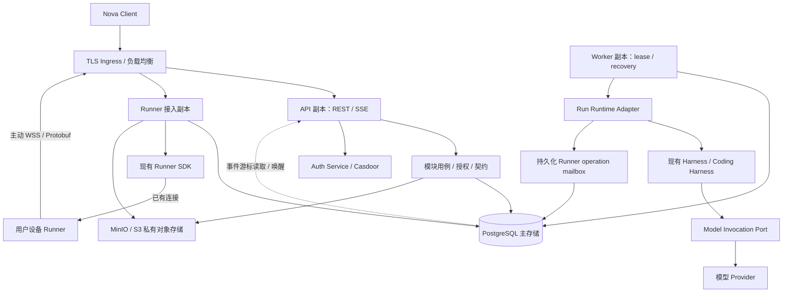
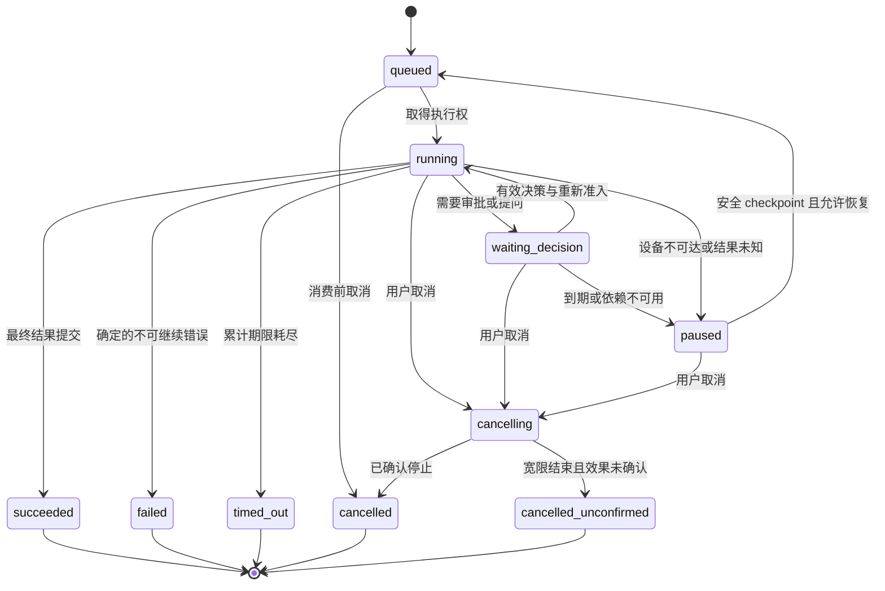
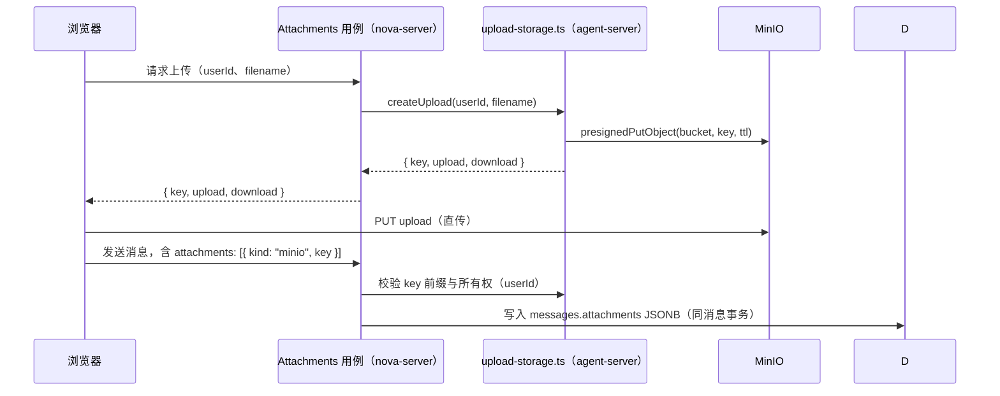

# Nova 后端技术架构设计

设计日期：2026-10-04。适用应用：`apps/nova-server/`。配套文档：[Nova 前端技术架构设计](nova-client.md)。

本文以当前 Server 模板、[产品功能基线](docs/功能清单与重构升级参考.md)、[Coding Harness 说明](docs/coding-harness-architecture.md)、[当前 Runner SDK](packages/runner-sdk/README.md)和 [Rust Runner](crates/runner/README.md)为依据，描述目标架构、约束及实施步骤。正式部署规模、SLO 和团队共享需求尚未提供，文中的数量为建议配置或验收场景，不代表现有吞吐和可用性已经达到。

## 1. 架构结论与系统责任

保留 `apps/nova-server/`，采用 Fastify + TypeScript + PostgreSQL + Drizzle 的模块化单体。应用内明确 HTTP API、后台 Worker、Runner 接入三种运行角色；它们复用同一业务代码和发布版本，可以使用独立进程/副本部署。所有入口、schema、migration 和 Worker 源码保留在 `nova-server` 内，不新增顶层服务应用。

Server 持有身份投影、资源权限、项目/会话配置、运行执行权、持久化、审批、恢复、事件和计量。Harness 持有 Agent/Task 决策与循环，Runner SDK 持有设备协议和连接，Runner 持有真实文件与进程执行。Server 不复制 Agent 调度器，也不把 UI 事件当成全部模型上下文。

首个生产版本必须具备持久化工作队列、恢复检查点、授权事件订阅和跨副本执行隔离；多副本 UI/HTTP 并不能单独满足长任务高可用。Redis 初期为可选加速设施，不能成为唯一队列、运行事实或恢复来源。

| 目标     | 具体机制                                           | 必须验证的故障                     |
| -------- | -------------------------------------------------- | ---------------------------------- |
| 高可用   | API/Worker/Runner 接入多副本、持久化状态、受控接管 | kill 进程、数据库切主、设备重连    |
| 高扩展   | 模块公开 ports、分角色扩容、有界并发、分区/归档    | 队列积压和流量热点，不仅平均 QPS   |
| 高维护性 | 事务 owner、契约单一来源、显式依赖、错误分类       | schema 漂移和跨模块内部导入        |
| 低耦合   | HTTP、模型、Runner、存储都有实际变化边界           | 替换 provider 不修改核心用例       |
| 多人协作 | 模块 owner、契约/迁移评审、独立验收                | 并行开发能保持权限、状态和数据一致 |
| 长期演进 | 兼容协议、expand/contract、分阶段拆分依据          | 旧客户端和旧 Runner 共存、版本回退 |

## 2. 现状、证据优先级与缺口

| 位置                                            | 当前事实                                                          | 目标要求                                                 |
| ----------------------------------------------- | ----------------------------------------------------------------- | -------------------------------------------------------- |
| `src/app.ts` / `src/server.ts`                  | 已分离 buildApp 与 listen，注册 errors/OpenAPI/database/projects  | 保留装配和启动边界，新增明确运行角色                     |
| `src/modules/projects/`                         | routes/service/repository/schema，CRUD 以 id 查询                 | 首先加入身份 scope 和数据库归属约束                      |
| `database/schema/project.table.ts`              | 当前仅 id/name/timestamps，无 owner 或 Runner 环境                | 不能直接对外提供多用户资源访问                           |
| `src/shared/response.schema.ts` / errors plugin | 业务失败 HTTP 200，基础设施错误真实 HTTP 状态                     | 旧 API 兼容，新 `/api/v1` 使用真实状态                   |
| 后端依赖                                        | Fastify 5、Drizzle/PostgreSQL、Zod 3、type-provider 4             | 以实际 lockfile 验证；不强制与前端 Zod 4 统一            |
| 根脚本及 frontend Orval                         | 根目录偏演示，客户端引用旧 app-server 路径                        | 先修正真实生成入口，不假设根 `check` 已存在              |
| `@nova/harness`                                 | 进程内 Kernel/Agent/Task，默认内存 Queue/Store，同步 SessionStore | durable 队列与 awaitable checkpoint 是宿主接入的前置工作 |
| `@nova/coding-harness`                          | 远程工具薄装配，可选 Runner、策略、模型插件                       | 不是现成的 Server 持久化恢复引擎                         |
| `@nova/agent-ui-contracts`                      | 精简 UI 事件 v1                                                   | 完整产品需要版本化扩展，不能两端各写一套                 |

资料冲突按“当前实现与测试 > 对应包 README > 产品基线 > 历史专题文档”核对。产品规则不能仅因为技术代码改变就视为已经定稿；涉及行为变化仍需明确迁移。

当前 Runner/SDK 已使用 WebSocket + Protobuf，有 `bootId`、operation query、ack、同 boot 内存回执，传输断开后可以继续执行。产品基线和 `docs/runner-features-and-error-handling.md` 中的 gRPC、断连立即杀进程、没有回执等描述对应旧阶段。目标接入按当前实现，但只保证同一 Runner 进程内协调；重启、回执丢失或 Server 缺少可恢复关联时结果仍可能未知。

此次交付只新增两份架构文档。认证、持久化 Worker、事件 v2、可靠 checkpoint、HA 部署均为待实施要求，不算现有功能。

## 3. 业务语义与架构决策

### 3.1 统一业务默认值

| 决策        | 目标语义                                                       | 迁移与边界                                                       |
| ----------- | -------------------------------------------------------------- | ---------------------------------------------------------------- |
| 模式        | 会话创建时确定普通/项目模式；设备离线不隐式降级                | 普通会话可创建时绑定 Runner，已有会话不直接切 Runner             |
| 项目环境    | 保存版本化完整 binding；会话保存完整环境快照                   | 重绑影响新会话；旧会话迁移使用显式独立用例                       |
| 单会话运行  | 同时最多一个未结束运行；waiting/paused/cancelling 仍占运行资格 | 新普通消息进入 durable input 队列                                |
| 上下文      | 模型上下文、运行事实、聊天展示独立                             | 压缩不删展示；清空开启 epoch、重置当前 TODO，审计事实保留        |
| 审批        | 默认读取策略允许；写入/命令依据风险申请；超时默认不执行        | 现有编辑 5 分钟后自动放行需产品决定，作为显式 policyVersion 兼容 |
| Runner 凭据 | 目标只显示一次、hash 保存、撤销/轮换/期限明确                  | 旧可复用且再次查看 Token 不能直接假称 hash 后仍可查看            |
| 未知副作用  | 暂停核实，查询原 operation；禁止创建新执行代替未知操作         | 无跨进程 exactly-once 承诺                                       |
| 工作区      | 使用 Runner 注册 workspace ID 和规范化相对 cwd                 | 文件 API 有边界，任意命令仍无 OS 沙箱                            |
| 队列与计量  | Server 唯一准入、计量与配额边界                                | 模型管理 UI 不被当成独立推理网关                                 |

项目绑定、审批超时、凭据变更、强隔离和团队共享属于业务定稿事项。本文给出可开发默认值；未定稿时先完成无行为变更的边界建设，行为发布使用明确的策略版本和迁移说明。

### 3.2 主要架构决策与取舍

| 编号 | 决策                               | 理由与代价                                       | 重新评估条件                           |
| ---- | ---------------------------------- | ------------------------------------------------ | -------------------------------------- |
| S-01 | 模块化单体                         | 本地事务和单版本交付简化一致性；需要自动维护边界 | 模块出现独立团队、发布或资源需求       |
| S-02 | 同应用内独立 Worker 进程           | HTTP 与长任务互不绑生命周期；增加进程运维        | 首期生产即需要                         |
| S-03 | REST + SSE / Runner WSS            | 用户命令清晰、UI 单向事件、设备主动连接          | 真正双向协作需求再评估浏览器 WebSocket |
| S-05 | 复用 Harness/SDK，升级必要存储契约 | 减少平行实现；接入前需解决同步内存限制           | 契约无法满足可靠提交或隔离时           |
| S-06 | 授权私有对象存储                   | DB 管元数据与引用，MinIO/S3 管字节               | 高敏隔离/合规另制定存储策略            |
| S-07 | 个人归属先行                       | 现业务为用户资源；不预建泛化租户引擎             | 团队产品获批准后引入 space/membership  |

## 4. 逻辑架构、进程角色与内部目录



Gateway 连接句柄属于进程本地且可丢弃的状态；资源 owner、连接租约和 operation intent 属于持久化控制平面。API 无需落到 Runner 所在副本，Worker 也不持有唯一不可恢复的执行句柄。初期 API 和 Gateway 可同进程运行，生产 Worker 独立；流量/停机要求出现后 Gateway 单独部署，源码位置不变。

```text
apps/nova-server/
├── database/                         # 保留现有内部目录
│   ├── client.ts
│   ├── index.ts
│   ├── schema/                       # 按业务 owner 的 table 文件
│   ├── migrations/                   # 前向迁移，纳入版本管理
│   └── drizzle.config.ts
├── src/
│   ├── app.ts                        # buildApp，组装 HTTP，不 listen
│   ├── server.ts                     # API/可选 Gateway 启动与停机
│   ├── worker.ts                     # 同应用内 Worker 独立入口
│   ├── runner-gateway.ts             # 按需独立 Gateway 入口
│   ├── config.ts / environment.ts / paths.ts
│   ├── modules/
│   │   ├── identity/                 # 身份校验、用户投影
│   │   ├── authorization/            # 业务策略，未来 membership
│   │   ├── projects/                 # 现有模块，绑定与指令
│   │   ├── conversations/            # 历史、输入队列、context epoch/TODO
│   │   ├── runs/                     # 状态机、执行权、checkpoint、恢复
│   │   ├── decisions/                # 审批/问题及授权记录
│   │   ├── runners/                  # 凭据、连接租约、设备、operation mailbox、远程目录引用（项目模式 attachments）
│   │   ├── attachments/              # 委托 upload-storage.ts（chat 模式）：生成 presigned PUT、key 所有权校验、引用悬挂回收
│   │   ├── models/                   # 目录、凭据、模型调用入口
│   │   ├── usage/                    # 配额预留、实际计量、价格版本
│   │   ├── events/                   # UI 投影、游标、事件保留/订阅
│   │   ├── audit/                    # 安全与重要操作审计
│   │   └── health/                   # 保留基础 health，新增角色探针
│   ├── plugins/                      # Fastify 基础设施生命周期
│   │   ├── database.ts / errors.ts / openapi.ts
│   │   ├── auth.ts / storage.ts / observability.ts
│   │   └── runner.ts                 # 仅挂 SDK，业务逻辑在 runners
│   ├── runtime/                      # Server 到 Harness 的真实适配边界
│   │   ├── run-runtime.ts
│   │   ├── checkpoint-store.ts
│   │   ├── runner-execution-port.ts
│   │   └── event-projector.ts
│   ├── transport/sse.ts              # framing、背压、断开与 heartbeat
│   ├── shared/                       # 稳定的 error/scope/idempotency/pagination
│   ├── types/fastify.d.ts
│   └── scripts/openapi-export.ts
├── tests/                            # 按风险建设综合验证
├── openapi.json                      # 后端生成物
├── tsconfig.json
└── package.json
```

小模块延续 `*.routes.ts / *.service.ts / *.repository.ts / *.schema.ts / index.ts`；有真实映射逻辑再加 controller。复杂 `runs` 可在模块内拆 application/domain/infrastructure，不要求每个 CRUD 建一套 DDD 空层。后续 Skills 管理按明确需求在 modules 内新增。

### 4.1 模块 owner 与依赖

| owner                    | 持有的数据/规则                                                                                                                             | 主要公开能力                                       |
| ------------------------ | ------------------------------------------------------------------------------------------------------------------------------------------- | -------------------------------------------------- |
| identity / authorization | 验证身份、本地用户、资源能力                                                                                                                | `IdentityVerifier`、`ResourceAuthorizer`           |
| projects                 | project、binding revision、指令配置                                                                                                         | `ProjectReader`、`bindEnvironment`                 |
| conversations            | conversation、messages、pending_inputs、context epoch、当前 TODO                                                                            | `ConversationReader`、输入/维护用例                |
| runs                     | runs、checkpoint、tool facts、run lease                                                                                                     | `RunCommands`、`RunRuntimeHost`                    |
| decisions                | decision、会话内授权范围                                                                                                                    | `DecisionPort`、回填/到期用例                      |
| runners                  | token、runner、connection lease、operation intents/results                                                                                  | `RunnerDirectory`、`RunnerExecutionPort`           |
| attachments              | `messages.attachments` JSONB（普通 chat `kind=minio`、项目模式 `kind=runner_ref`），引用悬挂检查，MinIO 生命周期由 `upload-storage.ts` 自管 | `AttachmentPort`、远程目录引用解析、引用悬挂回收   |
| models / usage           | 模型配置、Provider 密文、调用、账本与预留                                                                                                   | `ModelCatalog`、`ModelInvocationPort`、`QuotaPort` |
| events / audit           | UI event journal、projection cursor、审计                                                                                                   | `UiEventWriter/Reader`、`AuditWriter`              |

依赖方向为 `transport -> use case -> domain/port`，adapter 实现 port；domain/application 不导入 Fastify request/reply、SDK socket、MinIO client、Drizzle row。route 做 schema/hook/输入映射，use case 持有事务和业务决策，repository 持有 SQL。

跨模块只导入公开 `index.ts`/port，不直接操作其他模块表或 repository。涉及跨模块原子写入时，由明确的业务用例通过共同 transaction context 调用公开写 port；例如 `runs.acceptInput` 原子写 conversation、input、run 与 event，不在每个 repository 隐式开启事务。公共 `UnitOfWork` 是窄的事务上下文，不发展成万能 repository。

当前隔离边界已经落到代码与 ESLint：

- SQL 放在所属模块的 `*.repository.ts`，作业队列 SQL 集中在 `jobs/postgres-job-store.ts`。路由、service、连接注册表、transport 和 job host 不导入 ORM 或数据库运行时值；组合入口可以传递 `app.db`，不能直接执行查询。
- `ConversationReader.readOwnedHead(input)` 由 Scope 绑定调用方上下文；events 的游标校验在 Service 中声明 `repeatable read` 事务，会话头部和事件窗口使用相同的作用域。附件通过 `readMessageBlock` 读取归属校验后的消息块。
- projects 的绑定 schema、业务规则与 SQL 分别位于 `project-binding.schema.ts`、`project-binding.service.ts`、`project-binding.repository.ts`。绑定用例拥有事务，Runner 工作区校验通过 `RunnerReader` 使用同一个 `tx`；项目锁仍负责串行化首次绑定和 revision 更新。
- `UiEventWriter`、`runJournal` 与投影 reader 通过统一的依赖声明绑定事务，公开方法不接收原始 `tx`，没有单独的兼容入口。运行投影、会话 head 与 journal 一起提交。`EventRetentionService` 独立拥有清理事务，通过 `ConversationEventHeads` 按固定顺序锁定会话，批量删除过期事件前缀，再批量推进游标下界；两个模块共同提交或回滚。
- conversations 与 runs 目前仍共同维护 conversation/input/run 运行聚合，ESLint 为这部分表访问保留显式白名单；这不代表其他模块可以访问它们。其余跨域协作只走公开 `index.ts`，禁止深层导入及外域表引用。`tests/architecture.test.ts` 验证这些护栏；真实 PostgreSQL 综合测试覆盖事务回滚、同快照读取、并发 revision/Token 轮换和资源归属。

Repository / Service 使用统一的不可变 Scope 绑定机制，框架入口为 `defineRepository`、`defineService`、`createScope`，普通实例和 `.tx(tx)` 实例拥有独立依赖作用域。Service 嵌套调用加入已有事务，失败标记 rollback-only，事务结束后实例失效。具体 API、迁移方式和事务要求见 [Repository / Service 事务作用域](transaction-scope.md)。

`app.ts` 是 composition root，按 config、observability、database、身份、各业务插件顺序组装。Fastify encapsulation 按 `/api/v1`、`/internal`、`/admin` 隔离 hooks；只有共享基础设施使用 `fastify-plugin`，不把所有业务 service 装成全局 decorator。参见 [Fastify 官方封装规则](https://fastify.dev/docs/latest/Reference/Encapsulation/)。

API plugin、Worker 和 Gateway 组装相同的用例及 adapter；Worker 不通过 localhost 调用公共 HTTP API，也不构造虚假的 Fastify request。内部 mailbox 消费不绕过资源 scope 和原操作授权。

## 5. API、事件与外部契约

### 5.1 REST 与错误

保留旧 `/api/projects/` 的兼容信封，新业务使用 `/api/v1`。成功仍返回 `{ code: 200, message: "ok", data }`；创建/接受分别可用 HTTP 201/202，信封 code 表示业务成功。DELETE 使用 HTTP 200 成功信封，避免前端需要为无 body 的 204 另设隐含解包规则。

错误使用真实 HTTP 状态和 `{ code, subCode, message, requestId, details? }`。400/422 参数错误、401 身份无效、403 明确权限不足、404 不可发现资源、409 并发/状态冲突、410 事件游标过期、413 体积超限、429 限流、503 依赖不可用、500 未知异常。业务错误名保持稳定，message 经过安全映射。

旧 handler 当前绕过默认 serializer 发送 HTTP 200 业务错误；v1 必须给各成功/错误状态声明 schema，由统一 serializer 校验，不复制这种 bypass。未知异常只记录受控服务端诊断，拒绝泄露 SQL、stack、token、prompt 或 provider 原始 body。

模型管理后台使用独立的直接 JSON 契约：`/admin/model-config/providers` 和 `/admin/model-config/models` 仅允许 `admin` 角色访问。Provider 凭据使用 AES-256-GCM 加密后保存，响应只包含遮罩值；创建或替换凭据前必须配置 32 字节十六进制 `MODEL_CONFIG_ENCRYPTION_KEY`（可用 `node -e "console.log(require('node:crypto').randomBytes(32).toString('hex'))"` 生成）。缺少密钥时服务仍可启动，但凭据写入返回 503。删除 Provider 会清除密文、停用关联模型并保留记录；模型名在删除后仍保留，避免历史配置被复用。

SSH 连接的密码、私钥和私钥口令不按明文过线，统一用传输信封提交。客户端先取 `GET /api/remote-connections/transport-key`：服务端返回用调用方 Bearer token 经 HKDF-SHA256 派生的 wrap key 加密后的传输密钥（AES-256-GCM，十六进制 `w1.<iv>.<tag>.<ct>`），密钥本体不出现在任何响应体，身份未通过校验的请求拿不到。客户端用该传输密钥把凭据封成 `enc1.<iv>.<tag>.<ct>`（十六进制，不用 base64），服务端解开后按原有逻辑加密落库。明文凭据一律 400；主密钥轮换后旧信封解密失败返回 `CREDENTIAL_ENVELOPE_INVALID`，客户端换新密钥重试一次。约定常量与实现见 `src/shared/credential-transport.ts` 和 `apps/nova-client/src/api/credential-transport.ts`，两侧已知向量由 `tests/credential-transport.test.ts` 锁定。

| 核心用例         | 目标接口                                                                                                                     | 关键语义                                                                                                       |
| ---------------- | ---------------------------------------------------------------------------------------------------------------------------- | -------------------------------------------------------------------------------------------------------------- |
| 创建会话         | `POST /api/v1/conversations`                                                                                                 | mode `chat`/`project`，可选携带首条消息；幂等键；原子建立会话、首条 input、run                                 |
| 会话阅读         | `GET /api/v1/conversations/:id/snapshot`                                                                                     | 一致快照、`historyLength`、`snapshotCursor`、活动运行与计划；客户端凭 `historyLength===1` 判定首条消息         |
| 后续输入         | `POST /api/v1/conversations/:id/inputs`                                                                                      | mode=`next_run` 或显式 `steer`，有序持久化                                                                     |
| 撤回排队输入     | `DELETE /api/v1/conversations/:id/inputs/:inputId`                                                                           | 未消费才允许，竞争返回 409                                                                                     |
| 事件             | `GET /api/v1/conversations/:id/events`                                                                                       | 独立鉴权、协议协商、Last-Event-ID                                                                              |
| 取消/恢复        | `POST /api/v1/runs/:id/cancel`、`.../resume`                                                                                 | 取消不可恢复，resume 校验安全 checkpoint                                                                       |
| 审批回填         | `POST /api/v1/decisions/:id/resolve`                                                                                         | expectedRevision、授权范围、幂等键                                                                             |
| 项目环境         | `PUT /api/v1/projects/:id/binding`                                                                                           | expectedRevision、完整环境、远程验证                                                                           |
| 历史会话迁移     | `POST /api/v1/conversations/:id/environment-migrations`                                                                      | 无活动/未知执行时，显式迁移                                                                                    |
| 上下文维护       | `POST /api/v1/conversations/:id/context/compact`、`.../clear`                                                                | 与运行互斥，contextEpoch 明确                                                                                  |
| 附件             | `POST /api/v1/attachments/uploads`（委托 `upload-storage.ts` 生成 presigned PUT/GET）、`POST /api/v1/attachments/read-image` | 返回 `{ key, upload, download }`；前端直传 MinIO；key 在消息事务中校验所有权（`uploads/{userId}/` 前缀）       |
| 附件（项目模式） | `GET /api/v1/runners/:id/files`、`.../files/summary`                                                                         | `RemoteExplorer` 数据源；返回目录列表与文件摘要；选中后写 `messages.attachments` JSONB（`kind: "runner_ref"`） |
| Runner 管理      | `/api/v1/runners`、`/api/v1/runner-tokens`                                                                                   | 归属校验、注册、撤销、排空                                                                                     |

分页采用稳定 `(created_at, id)` 游标，限制页大小，参数必须有长度/数量边界。可选 count 单独查询；项目模板最多 100 条列表不能直接成为全量统计。日期为 UTC ISO 8601，bigint 游标/计量为十进制字符串，明确 nullable/optional。

### 5.2 契约来源与版本

REST canonical source 为模块 Zod schema -> Fastify validation/serialization/OpenAPI -> `apps/nova-server/openapi.json` -> Orval，客户端输入路径为 `../nova-server/openapi.json`。后端 Zod/type-provider 版本作为一组验证：官方兼容说明中 type-provider 4 对应 Zod 3；升级到 Zod 4 需要匹配 provider 并验证转换后输出类型。参见 [type-provider 官方兼容表](https://github.com/turkerdev/fastify-type-provider-zod#zod-compatibility)。

UI 事件唯一来源为已有 `@nova/agent-ui-contracts`，目标新增 v2；Harness 内部模型/工具事实仍沿用其 canonical contract，通过 Server projector 转成 UI DTO；Runner wire 唯一来源为已有 `proto/runner/v1/` 和 `@nova/runner-protocol` 生成物。三类协议有不同语义，不能用 ORM row 或某一 UI message 代替全部契约。

v2 UI envelope 与前端一致：`protocolVersion=2`、`eventId`、`conversationId`、可空 `runId`、会话内单调 bigint `sequence`（字符串）、UTC `occurredAt`、`contextEpoch`、`type` 和判别式 payload。需要完整的 text/thinking、message commit、tool/output、run state、decision、TODO、input、snapshot-required 事件。事件 ID 可编码为 `conversationId:sequence`，仅作游标，不作为授权凭据。

已有 v1 的字段和 sequence 语义不静默改变。按明确协议选择兼容 projector；旧协议无法表示新必需能力时要求客户端升级。API/事件/Runner 握手均声明 supported versions/capabilities，至少覆盖约定的滚动发布窗口。

### 5.3 幂等与接收语义

Idempotency scope 为已验证 owner + operation kind + key，保存请求摘要、状态和结果引用；同键同 payload 返回同结果，同键不同 payload 返回 409。记录和业务接受放在同事务，不能先返回 accepted 再在内存启动任务。目标保留至少 24 小时且不早于所关联运行结束与重试窗口，期限由配置定义；HTTP 幂等不等于 Shell 可重放。

写操作要求资源 revision 或 expectedRevision，优先使用条件更新。mutation 超时后可按意图键查询是否已接受；网络库不自动重试未经保护的写入。认证 401、权限 403、运行冲突 409 不作为后台无限重试条件。

## 6. 数据模型、归属与事务不变量

### 6.1 核心数据模型

初期采用稳定 `identity_id -> local user_id` 映射。所有个人资源显式携带 `owner_user_id`；principal 由 Server 验证生成，客户端传 owner 不生效。团队需求获批准后增加 spaces/memberships/resource scope，并迁移授权 predicate，不提前把个人项目解释成团队租户。

| 表/聚合                                | 关键字段                                                                              | 约束与 owner                                                  |
| -------------------------------------- | ------------------------------------------------------------------------------------- | ------------------------------------------------------------- |
| `users`                                | id、identity_id、active、必要资料投影                                                 | identity_id 唯一；identity                                    |
| `projects`                             | id、owner、name、deleted_at                                                           | 保留现表并前向升级；projects                                  |
| `project_bindings`                     | project、revision、runner、workspace、canonical cwd、instruction config、`is_current` | 完整版本，不能拆开更新；projects                              |
| `conversations`                        | owner、mode、project?、context_epoch、active_run_id?、last_event_sequence、updated_at | chat/project 创建语义；conversations                          |
| `pending_inputs`                       | conversation、input_id、sequence、mode、status、payload refs                          | 唯一顺序，queued/consumed/removed；conversations              |
| `messages`                             | conversation、message_id、role、blocks JSONB、attachments JSONB、updated_at           | 已提交展示；blocks/attachments 内嵌；conversations            |
| `context_snapshots`                    | conversation、epoch、summary、model history refs                                      | 模型上下文单独保存，不复用 UI Markdown；conversations         |
| `conversation_plans`                   | conversation、epoch、完整 TODO                                                        | 清空新 epoch 不读旧计划；conversations                        |
| `runs`                                 | conversation、state、phase、deadline、budget、worker_id?、lease_until?、updated_at    | 单会话非终态互斥；runs                                        |
| `run_checkpoints` / `tool_calls`       | run、step/batch、call ID、完整参数/结果引用、known outcome                            | checkpoint 可确定恢复阶段；runs                               |
| `decisions`                            | run、tool_call、kind、scope hash、expires_at、resolution                              | 单表覆盖 single_decision + grant；首个有效回填胜出；decisions |
| `runner_tokens`                        | owner、token_hash、prev_token_hash?、status、status_changed_at、rotated_at?           | token 高熵、hash lookup、撤销；runners                        |
| `runners`                              | owner、runner_id、boot_id、registered_at、last_seen、workspace/capabilities           | 唯一有效 owner+runner；runners                                |
| `runner_connections`                   | runner、gateway、lease_until、replaced_at、revoked                                    | 唯一有效控制连接；runners                                     |
| `runner_operations`                    | operation_id、run、tool_call、boot、status、result_payload、known_outcome             | 持久化派发关联与回执；runners                                 |
| `providers` / `model_catalog`          | visibility、owner?、secret ciphertext、model capabilities、config version             | 无明文凭据 DTO；models                                        |
| `model_invocations`                    | invocation、run、price_version、usage JSONB、cost_micros、reserved_micros?、released? | 幂等计量；models/usage                                        |
| `ui_events`                            | conversation、sequence、type、payload、occurred_at                                    | 唯一会话 sequence；events                                     |
| `idempotency_records` / `audit_events` | scope/key/request_hash/result_ref/status/expires_at；actor/action/result              | 可追溯，不记录秘密；shared/audit                              |

表按实际阶段创建，大小内容可存受控对象引用，核心状态不堆入一个任意 JSON blob。JSONB 用于版本化环境/模型配置、内容块与 checkpoint payload，仍需 schemaVersion、大小限制和必要约束。

#### 6.1.1 表关系与 ID 关联约定

**约定**：Server 不在数据库层声明外键约束（`FOREIGN KEY`），所有跨表关联通过应用层持有 `*_id` 字段并由 owner predicate 与唯一索引保证完整性。这样迁移、归档、分区与重建更可控，避免级联删除与隐式行为。`(owner_user_id, resource_id)` 复合唯一键仍用于 owner predicate 与跨表一致性；新资源表都应继承这一约定。

附件复用现有 MinIO 实现（参考 `apps/agent-server/src/modules/uploads/upload-storage.ts`）：presigned PUT/GET、key 形如 `uploads/{userId}/{uuid}.ext`，图片走 `readImage`/`imageUrl` 走 base64 + 内联；MinIO 自管元数据与版本，附件 key 直接存放在 `messages` / `pending_inputs` 的 JSONB payload 中（`kind: "minio"`）。

项目模式下的远程附件（Runner workspace 路径）：相对路径 + 摘要写入消息 JSONB（`kind: "runner_ref"`）。

| 表                                         | 关键唯一键 / 部分索引                                                                           | 关联 ID 字段                                                                              | 备注                                                                                                          |
| ------------------------------------------ | ----------------------------------------------------------------------------------------------- | ----------------------------------------------------------------------------------------- | ------------------------------------------------------------------------------------------------------------- |
| `users`                                    | `(identity_id)` 唯一                                                                            | -                                                                                         | 稳定身份映射                                                                                                  |
| `projects`                                 | `(owner_user_id, id)`                                                                           | `owner_user_id`                                                                           | 保留旧主键并加 owner                                                                                          |
| `project_bindings`                         | `(project_id, revision)` 唯一；`(project_id) WHERE is_current=true` 部分唯一                    | `project_id`、`runner_id`                                                                 | 每项目仅一个当前 binding；历史 revision 保留                                                                  |
| `conversations`                            | `(owner_user_id, id)`                                                                           | `owner_user_id`、`project_id?`                                                            | `mode=project` 必须有 `project_id`；`mode=chat` 不强制项目                                                    |
| `pending_inputs`                           | `(conversation_id, sequence)` 唯一；`(conversation_id, input_id)` 唯一                          | `conversation_id`                                                                         | 顺序由 sequence 强制                                                                                          |
| `messages`                                 | `(conversation_id, message_id)` 唯一                                                            | `conversation_id`                                                                         | blocks 与 attachments 全部内嵌到 `blocks` / `attachments` JSONB                                               |
| `context_snapshots`                        | `(conversation_id, epoch)` 唯一                                                                 | `conversation_id`                                                                         | 模型上下文事实；不与展示共享表                                                                                |
| `conversation_plans`                       | `(conversation_id, epoch)` 唯一                                                                 | `conversation_id`                                                                         | 当前 TODO 仅 active epoch                                                                                     |
| `runs`                                     | `(conversation_id) WHERE state IN (queued,running,waiting_decision,paused,cancelling)` 部分唯一 | `conversation_id`                                                                         | 单会话非终态互斥；`worker_id` / `lease_until` 内嵌列                                                          |
| `run_checkpoints` / `tool_calls`           | `(run_id, step, batch, call_id)` 唯一                                                           | `run_id`                                                                                  | checkpoint 与批次内 call 由复合键定位                                                                         |
| `decisions`                                | `(run_id, tool_call_id, decision_revision)` 唯一                                                | `run_id`、`tool_call_id`                                                                  | 单表覆盖 `kind: single_decision \| grant`                                                                     |
| `runner_tokens`                            | `(owner_user_id, token_hash)` 唯一索引；`(owner_user_id) WHERE status='active'` 部分唯一        | `owner_user_id`                                                                           | 仅存 hash；明文不落库                                                                                         |
| `runners`                                  | `(owner_user_id, runner_id)` 唯一                                                               | `owner_user_id`                                                                           | 同一 owner 不允许重名设备                                                                                     |
| `runner_connections`                       | `(runner_id) WHERE lease_until > now()` 部分唯一                                                | `runner_id`、`gateway_id`                                                                 | 唯一有效控制连接                                                                                              |
| `runner_operations`                        | `(operation_id)` 主键；`(run_id, tool_call_id)` 索引                                            | `run_id`、`runner_connection_id?`                                                         | `status` + `result_payload` 二合一                                                                            |
| `messages` / `pending_inputs` 内的附件字段 | （无独立表）                                                                                    | `attachments` JSONB：`[{ kind: "minio" \| "runner_ref", key \| relative_path, summary }]` | 复用现有 MinIO                                                                                                |
| `providers` / `model_catalog`              | `(owner_user_id?, id)`                                                                          | `owner_user_id?`                                                                          | 全局或私有可见；DTO 脱敏                                                                                      |
| `model_invocations`                        | `(invocation_id)` 主键；`(run_id, attempt)` 索引                                                | `run_id`、`provider_id`                                                                   | `usage` JSONB + `cost_micros` 内嵌                                                                            |
| `ui_events`                                | `(conversation_id, sequence)` 唯一索引                                                          | `conversation_id`                                                                         | 单调 sequence；`conversations.last_event_sequence` 同事务更新                                                 |
| `idempotency_records`                      | `(scope_owner, scope_kind, key)` 唯一                                                           | `scope_owner`                                                                             | 8 字段最小集：`scope_owner`/`scope_kind`/`key`/`request_hash`/`result_ref`/`status`/`created_at`/`expires_at` |
| `audit_events`                             | `(actor_user_id, action, occurred_at)` 索引                                                     | `actor_user_id`                                                                           | 不记录秘密；独立保留策略                                                                                      |

不变量由唯一索引 + 应用层 owner predicate 共同保证：

- 单会话非终态 run 互斥由 `runs` 部分唯一索引保证；活动运行状态由 `runs.state` 表达。
- 项目绑定完整版本由 `project_bindings` 的 `(project_id, revision)` 唯一保证，避免跨字段拆开更新。
- `runner_connections` 的部分唯一索引表达"同一 runner 同时刻仅一个有效控制连接"。
- `ui_events` 的 `(conversation_id, sequence)` 唯一索引是事件单调顺序的最终保障。
- 所有 `(owner_user_id, resource_id)` 复合唯一键是 owner predicate 与跨表一致性的基础；任何新增资源表都应继承这一约定。
- 附件元数据全部存放在 `messages.attachments` JSONB，引用即 `kind + key/path + summary`；项目删除时按会话维度回收 JSONB 内的引用并标记悬挂。

### 6.2 不变量由数据库与用例共同保证

1. 每个资源查询包含 owner predicate；关联表采用可行的 `(owner_user_id, resource_id)` 复合唯一键/FK，避免通过跨 owner 的项目、设备、附件形成错误关联。
2. `project` 模式必须关联自己的项目；普通模式不得因附加 Runner 自动变项目模式。运行期环境由 `conversations.project_id` 关联 `project_bindings WHERE is_current=true` 解析（`runnerId + workspaceId + cwd + instructionsRevision`）；boot/connection 作为运行校验事实另存，不把会话永久绑死某次 TCP 连接。
3. 项目绑定唯一性仅约束当前有效 binding 的 `(owner, runner, workspace, canonical_cwd)`，并限制每项目一个 current binding；历史 revision 可以保存相同目录。Windows 大小写/路径语义交给 Runner 规范化结果，不能在 Server 盲目 lowercase 所有路径。
4. 对 runs 建部分唯一索引，限制每 conversation 一个非终态 run；接受任务、消费 input 和更新 active_run 在同事务。waiting/paused/cancelling 仍为非终态，不允许新任务绕过未知运行。
5. 模型/环境 snapshot 在运行开始固定；配置变化只影响下一次运行。项目文件指令在准备阶段读取，保存已验证文本/hash 与来源 revision，恢复时不悄悄重读成新版本；保留基线文件指令 64 KiB、自定义文本 32 KiB 上限。secret snapshot 保存安全引用及 credential version，不向日志或 UI 输出密文/明文。
6. `toolCallId`、`operationId`、`invocationId` 分开：模型意图、远程执行、模型请求不是同一生命周期。工具批次内结果按 call 顺序进入模型，不按网络返回顺序排列。
7. 每个 operation intent 有唯一 ID 和 payload hash；一旦标记 dispatch reserved，即使不知道是否到达设备也不自动产生第二次 Execute。
8. revision/fence 条件失败代表失去写入权，不由 worker“强制覆盖”。超时、用户取消和服务停机有不同原因与恢复资格。
9. 清空模型上下文不物理删除运行审计。旧 context 标记 superseded，保留展示和必要执行事实；当前计划只来自 active epoch。
10. 删除资源先变更可访问状态并阻止新任务，再按 retention/GC 策略异步清理引用和对象；不能在运行/审批仍活动时直接 cascade 删除全部证据。

### 6.3 事务与查询策略

短事务用于接受输入、claim、checkpoint、决策回填、取消标记、配额预留、事件头更新。模型请求、用户等待、文件读取、MinIO 和 Runner 网络 IO 全部在事务外。项目绑定流程先验证远程目录，再用 expectedRevision + boot/epoch 条件更新；目录仍可能随后被用户删除，执行前再次验证并返回明确不可用。

会话快照使用主库的 REPEATABLE READ 只读事务，同时读取 display、run、当前未提交 blocks/输出尾部、decision、pending inputs、当前计划和 event head，返回 `snapshotCursor=C`。snapshot 的 materialized display/projection 必须覆盖至 C；`message.committed` 和更新已提交展示在同事务，未提交 delta 已持久化且纳入运行暂存投影。不得读取旧消息列表却返回更新后的 cursor，也不能遗漏 C 之前尚未提交的流式内容。

事件 append 对 conversation event-head 短时行锁分配连续 sequence，插入 event 和更新权威投影在同事务。delta 可在服务端按约 50–100 ms 批量，数据库确认后才发布；序列只对 durable UI journal 有意义，不把 ephemeral 心跳计入序列。多 Writer 对同会话按 head 锁序列化，监控热点与写放大。

列表有界 projection、稳定游标、必要组合索引，避免 N+1；冷热历史和 ui_events 按实际增长分区/归档。恢复、ACL、幂等与最新运行读主库，报表可用允许延迟的 replica。跨副本 max pool 总量保留数据库维护余量，不能每个进程都设成最大连接数。

## 7. 运行状态机、检查点与恢复

### 7.1 持久化状态机



`state` 表示生命周期，`phase` 表示恢复位置：prepare、model_request、model_committed、tool_batch_prepared、tool_dispatch、tool_results_committed、finalizing。pauseReason 如 RUNNER_OFFLINE、OUTCOME_UNKNOWN、DEPENDENCY_UNAVAILABLE；failureReason/budgetReason 不用含糊 loading 表达。

所有状态转移校验 state/revision/fence；终态不可自动回到 queued。waiting_decision 保存 continuation 并释放 CPU worker 槽位，但仍保留会话唯一运行资格；决策回填重新取得 fence 继续。多次回填不能多次派发。

取消接受后将 `runs.state` 推进为 `cancelling` 并写高优先级控制意图，Worker/模型/工具收到 AbortSignal；设备超时仍未确认时进入 `cancelled_unconfirmed`。它是不可恢复终态，但保留 outstanding operation 风险标记；涉及同一工作环境的后续副作用操作在停止/核实前被隔离。不能释放会话资格后直接让另一任务与未停止进程竞争。

### 7.2 必须升级的底层契约

当前 Harness `SessionStore.snapshot/commit` 同步，`onEvent/onRunResult` 为最佳努力观察者；同步 onCommit 排队写库、退出时 flush 都无法消除“工具已执行，数据库未提交”的崩溃窗口。生产持久化不能强转一个 Promise 为同步返回值。

在原 `packages/harness` canonical contract 内演进可确认提交能力，Server adapter 实现 PostgreSQL Store；旧内存插件可兼容新能力但明确 durability=memory。Loop、ToolRuntime 和等待 continuation 的实现必须等待 durable commit，不能只在 `runtime/` 外壳追加一层异步回调。

目标必要 port 示例，名字是待实施接口而非当前 SDK API：

```ts
interface DurableCheckpointStore {
  load(scope: ResourceScope, runId: string, signal?: AbortSignal): Promise<RunCheckpoint>;
  commit(
    input: {
      scope: ResourceScope;
      runId: string;
      expectedRevision: number;
      fence: string;
      checkpoint: RunCheckpoint;
      facts: readonly RunFact[];
    },
    signal?: AbortSignal,
  ): Promise<{ revision: number }>;
}
```

主链路阶段顺序：

1. 接受用户输入并持久化 run，Worker claim 和校验权限/预算/环境。
2. 模型请求前保存请求 intent、model snapshot 和 invocation ID；只在完整模型响应提交后形成可恢复上下文。
3. 准备工具批次：完整参数、call ID、风险、目标环境、审批要求和 operation ID 全部持久化；部分参数不得执行。
4. 批准后在事务中保存决策消费事实和 operation intent，确认提交后才允许 Gateway 派发；commit 失败立即停止推进。
5. 各工具结果到达后独立持久化，不等待整批才存；全部结果确定后按模型 call 顺序提交下一轮上下文及 checkpoint。
6. 最终模型结果、显示消息、计量、run terminal 按用例原子收尾；已提交 final 可不等 Runner 在线就完成。

流式 delta 是可展示草稿，不是完整可恢复模型结果。模型流中断时保存已显示草稿及 incomplete 标记；只有无副作用且未提交结果的明确策略才可重新请求，用新的 invocation ID，不能把重复内容追加到同一正文。

### 7.3 执行权、租约与恢复判定

claim 使用数据库时间的 lease，初始建议 30 秒、每 10 秒续约；同事务增加单调 fence。每个 checkpoint/终态提交带 fence 和 lease 有效性 predicate。数据库不可达或续租失败时停止新模型/工具派发，尽力取消可取消工作。租约丢失的 Worker 即使稍后恢复也不能写回旧结果。

lease 和 fencing 保护数据库提交，不会自动停止设备上的 Shell。恢复者先判断所有 in-flight operations；发现 dispatch reserved/dispatched 但缺结果时，只查询原 operation ID、核实或暂停，不能因为取得新 fence 就再执行。接管前的未知运行不为新工具开放权限。

| 持久化阶段                                          | 恢复行为                                         |
| --------------------------------------------------- | ------------------------------------------------ |
| queued / 未派发的工具 intent                        | 校验累计预算、授权、环境后推进                   |
| 完整模型结果已提交                                  | 复用结果，不再调模型                             |
| waiting decision                                    | 重发同一 decision 展示，校验期限；不重新创建审批 |
| 原 operation 同 boot 有完整回执                     | await durable receipt 后继续，幂等保存结果       |
| 同 boot operation 仍在运行                          | 重新观察/查询与期限校验，不再 Execute            |
| boot 改变、回执遗失、派发结果无法确定               | paused/OUTCOME_UNKNOWN，人工核实                 |
| 全部工具确定、context checkpoint 提交               | 进入下一模型轮次                                 |
| final 已提交                                        | 只完成 terminal/计量等幂等收尾                   |
| cancelled、cancelled_unconfirmed、failed、timed_out | 不自动恢复                                       |

按同 checkpoint 最多自动恢复 3 次作为初始策略，恢复不重置总 deadline、step/tool 预算、用量或 approval deadline。设备恢复只针对环境快照的原 Runner/workspace；不自动选择另一个在线设备。恢复扫描有界并发、抖动及可见失败原因。

## 8. 跨实例 Runner 与取消

### 8.1 Worker 调度与 lease

Worker 通过 `runs.lease_until` 与 `runner_connections` 上的 fence 在短事务中 claim 有界批次，再立即提交；外部执行不持有数据库行锁。可恢复 handler 使用 at-least-once 语义并靠数据库约束收敛；run continuation 不通过通用重试重新执行未知副作用，它进入第 7 节恢复判定。GC、外部通知与扫描由后台进程按各自周期完成，业务用例以同步事件和 lease 推进表达，不依赖单独的 durable queue 表。

### 8.2 跨实例 Runner 调度的具体路径

选择 PostgreSQL operation mailbox 作为首期实现，避免共享 socket registry 或要求 Worker 命中同一进程：

1. Runner 通过 `/runner/v1/connect` 主动 WSS 接入任意 Gateway；由 Server 根据 token 确定 owner，不信任设备自报 user/权限。
2. Gateway 保存 `runnerId + bootId + connectionEpoch + gatewayId + leaseUntil + workspace/capabilities`，建立本地 SDK session；重复 runner 接入通过数据库有效连接约束替换旧 epoch。
3. Worker 的 `RunnerExecutionPort` 在有 fence 的事务中创建 operation intent：原 runner/workspace/cwd、call ID、payload hash、deadline、审批事实引用。通过 mailbox 转交，不把 socket 放进 Harness 核心。
4. 当前 owner Gateway claim mailbox，复核连接租约、run 未取消、授权范围、boot、能力及 workspace；在派发前原子标记 `dispatch_reserved`，再调用 SDK。未 claim 的意图可安全转移；已 reserved 的意图只能 query/reconcile，不能再次 Execute。
5. 输出和结果按 operation ID 回写 durable facts，结果可能晚于 worker lease；Runner 事实仍可持久化，后续 run 推进必须由当前 fence 持有者决定。旧结果不能改写新运行终态。
6. Gateway 宕机后 Runner 重连新副本，新副本从 DB 载入 outstanding operation IDs，调用已有 query/reconcile 能力；当前 SDK 的自动 reconcile 只覆盖进程内 pending，不能代替这份恢复索引。
7. 所有控制请求使用独立优先级 mailbox，cancel/query 不排在巨量输出后。Gateway 轮询初始建议 100–250 ms，并结合 LISTEN/NOTIFY 或 Redis 唤醒；通知丢失不丢工作，周期扫描保证发现。

当前 SDK 的 onOutput 不暴露完整输出 sequence/offset，且收到 output/result 后自动 ack；ack 可能早于数据库保存，从而让 Runner 提前释放唯一回执。可靠接入需在原 SDK 内增加显式 durable receipt/output sink 或 manual ack 模式：Server durable commit 后才 ack，暴露 boot/operation/sequence/offset 元数据，并支持从数据库恢复 query 关联。对受限 Runner 回执容量必须做背压/拒绝与未知结果分类，不能仅在调用 SDK 后 `await db.save()` 宣称可靠。

SDK 改动维持现有默认自动 ack 兼容演示，生产 Gateway 必须启用经过验证的 durable 模式。输出超限/保留丢失用 `truncated/outputGap` 标识；完整日志按单独有界存储策略，用户事件和模型输入分别有大小限制。

### 8.3 连接替换、隔离与物理执行边界

相同 owner+runner 只允许一个有效控制连接，Gateway heartbeat/lease 更新必须匹配 epoch；新连接使旧 owner 停止接受新 work，旧连接收到 revoke/关闭。分区中无法确认旧连接状态时，停止新副作用派发并核实原 operation。当前 Runner 不持有数据库 fence；要支持更激进的网络分区接管，应扩展握手/operation authority generation，并让 Runner 强制拒绝旧 generation，不能只靠 Server 内存 Map。

设备连接独立于会话，不随单次 run 关闭。workspace ID 必须来自已验证注册，cwd 为 Runner 规范化结果；文件读写必须在 Runner 再验证路径、symlink、digest 和只读权限。Server 不能仅字符串 startsWith 判断 Windows/Unix 路径安全。

当前 Runner 文件 API 有 workspace 边界，命令拥有 Runner OS 用户权限且不存在完整 CPU/memory/network sandbox。多项目相同 workspace 使用共享环境写锁/串行准入，任意 shell 视为 workspace 写操作；同路径写有 expectedSha256，避免多个会话读后覆盖。`runs` 持有数据库环境租约与 outstanding-operation 隔离记录，以 owner/runner/workspace 为 key；失去 worker lease 不能直接释放未知操作的环境隔离，待操作停止或核实后才允许下一写入。不同 workspace 能否并行按设备容量和操作 effect 判断；无 OS 隔离的命令若可能跨 workspace，提升到整台 Runner 的独占操作。强隔离需要独立 OS 身份、容器/VM 或每项目专用 Runner，并核实 capability；未支持的隔离要求直接拒绝。

### 8.4 取消与停机

浏览器 SSE 断开只取消订阅读取，不取消后台运行。同步短 HTTP 请求断开可取消其只读下游；已经返回 accepted 的业务运行只有显式用户 cancel、deadline 或系统策略改变。

取消先持久化，再唤醒当前 worker/gateway；模型 AbortSignal、工具批次和 Runner process cancellation 分别确认。权限撤销或 token 撤销使相关 Gateway 排空/断开并阻止新 work，但网络分区下不能即时保证远端进程死亡，必须保留未确认状态。多副本校验撤销版本和原审批，不以长连接已认证为永久授权。

停机顺序：readiness 置失败/停止新 claim -> 持久化安全 checkpoint 和 pause/cancel reason -> 停止新 Runner 派发 -> 在有界宽限内处理回执与取消 -> 关闭 SSE/SDK -> 释放租约 -> 关闭 DB/存储连接。初始宽限建议 30 秒，由部署 terminationGrace 配合；到期不假称所有副作用已结束。新实例通过 DB 恢复判定接管。

## 9. 实时事件、日志与快照恢复

SSE 只订阅当前 principal 有权读取的会话，UUID 和高熵 ID 不能代替授权。使用 Bearer fetch SSE，服务端校验 cursor 所属会话/版本；不在 URL 放长期 access token。长流定期复核身份有效期与权限，授权失效终止，客户端刷新后重新建立。

UI journal 是权威展示投影/可恢复订阅日志，Run checkpoint 是恢复执行位置；二者在关键提交边界由同一事务关联，但不能相互替代。工具 stdout/stderr 保留 stream/offset/sequence、截断和缺口；正文和 Thinking 保留独立 block ID，不把模型签名和隐藏协议元数据映射到 UI。

无丢失订阅流程：

1. 客户端取第 6 节的一致快照及 cursor C，再发起 SSE。
2. SSE adapter 在建立前鉴权，检测 C 是否超出保留窗口；过期返回 410，合法则按主库读取 sequence > C。
3. adapter 按顺序分页读取、发送并推进 lastSent；tail 阶段通过通知唤醒并周期扫描，不能在“补历史 -> 注册内存监听”的窗口遗漏新事件。
4. LISTEN/NOTIFY、Redis Pub/Sub 只传可丢弃的唤醒/ID，内容仍由 durable journal 补齐；不要求客户端和 producer 位于同一实例。
5. 若分页范围已被 retention 清理或发现中断，发 `snapshot.required` 后关闭；客户端替换快照和增量投影，不拼接重复正文。

SSE `id` 与 Last-Event-ID 遵守 [HTML SSE 标准](https://html.spec.whatwg.org/multipage/server-sent-events.html)。心跳是注释帧，不分配业务序列；建议每 15 秒一次，Ingress idle timeout 高于心跳和抖动窗口。输出 Content-Type 正确，禁用代理缓冲/压缩缓冲造成的延迟；业务错误在握手前返回 JSON，流内以安全控制事件关闭，不能更换已发出的 HTTP 状态。

每订阅者独立有界队列，初始建议 256 帧或 1 MiB 上限，达到上限关闭并快照恢复；慢浏览器不阻塞数据库提交或 Agent。Server/Runner 输出、UI 展示、模型输入、归档日志各有字节上限，禁止 `Promise.all` 或广播数组无界增长。

初始建议 UI delta 事件保留 24 小时、最终消息/必要运行事实保留 90 天，实际应由产品及数据要求确认。保留期间支持补发，过期依赖快照；不承诺任意年份完整逐 token 回放。日志大体积内容可流式转存私有对象，DB 保存安全引用和 offset 索引。删除/权限撤销后的事件也必须不可被原 cursor 再读。

## 10. 身份、授权、凭据与审批

### 10.1 Authentication 与 Authorization

复用仓库 `@nova/casdoor` 的适用 client bridge；Server 通过窄 `IdentityVerifier/AuthServiceClient` 调用 Auth Service 验证 access token，Casdoor clientSecret/certificate 不进入业务应用。身份映射用稳定 identity ID，本地仅保存必要资料和业务归属。

Auth Service 无效 token 返回 401；网络/超时/非法响应返回 503 并拒绝访问，不能降级匿名或信任客户端角色。设置短时 token-hash cache，不缓存明文 token，TTL 不超过到期且结合禁用/撤销要求；明确 Auth Service 可用性是控制平面的外部依赖。管理员权限也要由验证后的身份与本地策略计算。

`Principal + ResourceScope` 显式进入 use case/repository。每次 REST、SSE、Runner 管理、附件签名、审批回填独立鉴权；不可发现的资源用 404，已知资源操作受限用 403。未来 space scope 由 membership 重算，不能用 request 中的 owner/role/space 直接构造。

Runner token 是设备接入身份凭据；Decision 是一次工具操作授权；会话“总是允许”是有限 scope grant。三者不能互相替代。审批绑定 run、toolCall、完整参数摘要、环境 revision、政策版本及期限；修改命令/路径后必须重新判断，不能按工具名 blanket 放行。

### 10.2 Token 和 secret 生命周期

新 Runner token 为高熵随机凭据，只返回一次，保存 hash（可用带 keyVersion 的 HMAC lookup）及 owner/expiry/revoked metadata。初始保留每用户最多 3 个的基线规则，可复用绑定多个 Runner，但目标过期/轮换策略需要产品定稿；不强制改成一次性 bootstrap，也不声称现有可再次查看凭据已安全 hash 化。

旧 token 若需保留再次查看，短期只能使用受密钥管理保护的加密密文和严格查看授权/审计；发布期间提示迁移到新凭据，明确旧机制退役时间。不可恢复 hash 后不能继续提供“再次查看”，两种数据状态必须有版本字段。

Provider secret 使用 envelope encryption/KMS 或合适的 secret manager，保存 credential version；列表 DTO 只返回脱敏指示。密钥轮换不使已运行任务悄悄改变模型配置，失效凭据明确暂停或失败；日志统一 redact Authorization、Cookie、Token、code、secret、签名 query。

### 10.3 网络与工具策略

部署默认 TLS，受限 trustProxy，CORS allowlist，body/header/timeouts 与 route-level 限流；内部控制面不开放到公网，采用角色凭据/私网策略并限定操作。模型 endpoint、搜索/网页读取、导入 Skill 资源必须防 SSRF：解析/重定向后拒绝不允许的 loopback/link-local/private 地址，内网 provider 仅管理员显式允许，配合出站网络策略和响应大小/超时限制。

读取类工具可自动执行，但命令字符串的“只读”不能靠模糊前缀匹配；命令路径、参数、shell 与副作用 effect 必须受信任策略判定。操作系统执行使用 executable + args，只有显式 shell 能力允许 shell 语义并展示完整内容。

审批到期默认为 expired，不派发操作；可按版本化策略将拒绝结果交回模型继续或暂停等待用户。会话内 grant 失效于会话、环境/权限变化或规定期限，不保存成全账户通用授权。Skill 脚本导入不自动成为可执行 Action，插件是受信任代码；不受信任代码使用可终止隔离执行单元和明确能力白名单。

## 11. 附件与资源删除

附件按 `conversation.mode` 分两轨，**互不影响**，附件元数据统一存放在 `messages.attachments` JSONB：

- **普通 chat 模式**：浏览器本地文件经 Server 调用 MinIO 生成 presigned PUT URL，浏览器直传 MinIO；上传成功后客户端把 key（含 `uploads/{userId}/` 前缀）直接放进 `messages.attachments` JSONB（`kind: "minio"`）。
- **项目模式**：会话已绑定 Runner，点击附件按钮直接打开 `RemoteExplorer` 浏览 Runner workspace 内的文件/目录；选定路径落地为 `{ kind: "runner_ref", relative_path, summary }` 写入 `messages.attachments` JSONB，文件字节**不经过对象存储**，执行阶段由 Runner 按需读取。

复用现有 MinIO 实现（`apps/agent-server/src/modules/uploads/upload-storage.ts`）：presigned PUT/GET、`createUpload`/`putFile`/`readImage`/`imageUrl` 由其提供，MinIO 自身管元数据与版本；DB 只持有引用 key/path，引用悬挂由会话/project 删除流程异步处理。

### 11.1 普通 chat 模式：presigned PUT 直传



调用链要点：

1. Server 收到上传请求后调用 `upload-storage.ts.createUpload`：返回 `{ key, upload(presigned PUT), download(presigned GET) }`，TTL 默认 7 天（沿用 `SIGNED_URL_TTL_SECONDS`）。
2. 浏览器按 presigned URL 直传 MinIO。
3. 浏览器把 `key` 放进消息 payload 一同提交；Server 在写入 `messages` 前用 `validateOwnedKey` 校验 key 前缀必须是 `uploads/{userId}/`，防止跨 owner 引用。
4. 图片走专用路径：`readImage` 返回 `{ data: base64, mimeType }`，`imageUrl` 返回短时 GET URL；模型输入和 UI 预览通过这两个端口，避免长期 presigned URL 扩散。
5. ETag 不视为 checksum；以 MinIO `getObject` 流读取后实际 decode 探测 magic bytes（PNG/JPEG/GIF/WebP）并限制 5 MiB；超过即拒绝。

method、必需 headers、expiry、object key 由 Server/`upload-storage` 指定；MIME/扩展名不可信，HEAD 的 Content-Type 也不等于实际格式检测。Server 不能修改 presigned URL 来"修复地址"；生产 bucket 由 provisioning 创建，应用最小权限不含 admin/makeBucket，Browser endpoint 必须可访问且 TLS/代理 host 一致。参见 [S3 官方签名 URL 语义](https://docs.aws.amazon.com/AmazonS3/latest/userguide/using-presigned-url.html)。

Runner 上传沿授权的原设备读取，以流或有界块上传，不能把多个 20 MiB 文件同时全读入 Node heap。下载每次重新授权再签名；HTML/SVG/未知文件默认 attachment，处理后的 preview 放隔离 origin/CSP。

### 11.2 项目模式：远程目录引用

`RemoteExplorer` 入口调用 `runners` 模块的目录列举接口：

1. Server 校验 `conversation.mode=project`、当前 `project_bindings.revision`（`is_current=true`）、Runner 连接代次与 workspace 边界。
2. 列出当前 cwd 子项（目录/文件），不下载字节；服务端可一次性 LIST 路径，也可按需递归。
3. 用户选择路径后，Attachments 用例在该会话 binding 的 workspace 内做规范化路径校验（不允许 `..` 越界、不允许绝对路径），并请求 Runner 对选定路径计算摘要（sha256 + size + mtime）。
4. 摘要连同 `{ kind: "runner_ref", relative_path, summary }` 一起写入 `messages.attachments` JSONB；不下载字节，不持有对象存储 key。
5. 执行阶段：模型触发工具调用读取附件，Server 在事务中创建 `runner_operations` intent（含 `(run_id, tool_call_id, runner_ref)` 摘要），通过 `RunnerExecutionPort` 派发；Runner 在原 workspace 内按 `relative_path` 读取，输出/结果照常落 `tool_calls`。

执行前 Server 再次验证 Runner 连接、workspace、binding revision 与摘要；摘要不一致按"未知结果"处理，禁止按工具名 blanket 放行。Runner 删除或移动文件导致读取失败时，工具结果标记 `OUTCOME_UNKNOWN`，由 Server 决定暂停或转交用户。

### 11.3 删除与回收

**普通 chat 模式**：用户删除消息/会话 → Server 把 `messages.attachments` JSONB 中的 key 标记为悬挂 → MinIO lifecycle rule 配合 prefix `uploads/{userId}/` 周期清理；后台对账脚本扫描 owner_user_id 前缀下"DB 已无引用"的孤立对象。

**项目模式**：会话/project 删除时标记 JSONB 中的 `runner_ref` 为悬挂引用；文件本身仍在 Runner 上，无需字节级回收，但要求 Runner 删除/移动时通过设备事件上报以便引用失效。

项目删除目标流程：标记 `deleting`/`tombstone` 阻止新会话/运行 → 取消/核实相关活动操作 → 逻辑删除所属会话和展示 → 按引用/保留策略异步回收对象、日志和模型快照。普通会话不受项目删除影响。删除流程不恢复已删除资源权限。

## 12. 模型调用、用量、配额和子任务

模型调用唯一入口为 Server 组装进 Harness 的 `ModelInvocationPort/modelRouter`：解析可见 model -> 固定能力/价格/credential version -> 预留预算 -> 请求 provider -> 保存调用结果/用量 -> 结算。普通、项目、压缩、标题生成、子 Agent 均经过入口，不允许某个插件直接调用 Provider 绕过配额。

当前 Harness 默认主要是 OpenAI/AI SDK adapter；Anthropic/Responses、Thinking、图片能力等需要逐一实现并验收，业务基线的多协议描述不能直接证明新基座全部已接通。模型管理端提供配置/目录，不自行变成推理代理；如未来建设独立网关，只替换 invocation adapter。

每调用有稳定 invocation ID、attempt、priceVersion、estimated/actual tokens、cost、provider request ID、安全状态和结果关联。账本唯一 invocation 结算，无法获知 usage 时记录 unknown/estimated，不算成零，也不冒充精确金额；在可核实期限内对账。对货币使用定点 decimal/整数最小单位，不用 JavaScript float 任意累计。

配额用原子 reservation 防并发超卖，请求前预留 input 估算 + 最大 output/cost，返回后转实际并释放差额；失败/超时/未知 provider 结果按策略保留和对账，不能立即把全部预算放回允许再发。用户、模型、Provider 三层速率/并发限制在共享准入入口生效；可用 PostgreSQL 原子更新，规模增长后 Redis 加速但账本仍持久化。

模型重试仅限明确的 transient 且未输出/未执行副作用阶段，带次数、抖动与 deadline；已流式显示的内容不能简单再次拼接。tool unknown 不能触发 provider failover 重跑整个任务。配置的轮数/调用数、期限、输出和成本上限沿父子任务共享，不因 worker 重启归零。

上下文预算包含完整待发请求、输出预留与安全空间。沿用约 85% 触发、目标 65% 的业务基线作为可配置默认值；保留目标、完整工具对和当前计划，压缩结果提交后才替换 context revision。手动维护与未结束 run 互斥；清空开始新 epoch，但执行事实仍按 retention/audit 保留。

子 Agent 复用现有 Task Engine 的有界并发与失败传播；初始产品并发 4、深度 1 可作为基线，最终使用有效配置快照，不能与 Coding Harness 的读取/写入默认数混为一谈。子任务作用于同环境时共享环境写准入，父预算包含子用量，父取消传播；产品界面及 durable child continuation 仍需独立验收，不仅暴露 spawn API。

## 13. 高可用部署、容量与故障处理

### 13.1 生产拓扑

建议基线为 API 至少 2 副本、Worker 至少 2 副本、Runner Gateway 至少 2 副本（可初期与 API 同部署），跨故障域放置；同机两个进程不能代表故障域高可用。所有角色来自同一 `nova-server` 镜像，可分别配置启动入口、资源和扩容策略。

PostgreSQL 使用支持切主、WAL/PITR 和备份验证的高可用服务；对象存储需要多节点/托管持久性及适合数据等级的备份，单节点 MinIO 是可用性单点。Auth Service、Ingress/DNS 和 secrets 服务同样纳入可用性预算。Redis 若启用采用符合用途的冗余配置，但丢失唤醒不丢作业。

Runner 长连接在生命周期内固定到一个 Gateway，重连可到任意副本，不依赖额外 HTTP sticky session；SSE 可重新连接任意 API，从 DB cursor 补发。API 依连接/请求延迟扩容、Worker 依队列年龄与 provider 容量扩容、Gateway 依活连接/输出速率扩容，不用单一 CPU 指标驱动全部角色。

DB migration 由单个发布锁执行，各应用副本不启动时同时 migrate。数据库 schema 先 expand，应用兼容旧/新列，再回填、约束和 contract。应用 rollback 不通过删除列或回写旧 migration 回退数据。

### 13.2 目标指标和容量计算

| 指标                 | 初始建议目标                          | 解释                                            |
| -------------------- | ------------------------------------- | ----------------------------------------------- |
| 控制平面可用性       | 月度 99.9%                            | 授权后核心 API/接受任务，外部模型最终成功率另计 |
| 常规 CRUD 延迟       | p95 < 300 ms                          | 在约定数据量/区域，不含模型与设备等待           |
| 接受任务延迟         | p95 < 500 ms                          | durable accepted，不是模型首 token              |
| 展示事件延迟         | durable commit 到在线客户端 p95 < 1 s | 慢消费者单独统计                                |
| Worker 故障发现/接管 | 通常 60 s 内进入安全恢复/明确暂停     | 只保证状态可判定，不保证未知 Shell 自动续跑     |
| 备份恢复             | RPO <= 5 min、RTO <= 30 min           | 建议灾备目标，需 WAL/对象策略和演练证明         |

以上均需团队确认和实测，不作为已实现 SLA。建议首轮容量场景：2000 条 SSE、300 台在线 Runner、30 个活动 run、50 REST RPS，并包含集中重连、日志突发、队列积压和慢文件操作。

容量模型必须按实际输出计算：`eventWrites/s = streamingRuns × batches/s + 状态事件`；`fanoutFrames/s = Σ(各会话事件率 × 订阅数)`；`DB connections = Σ(各角色副本 × poolMax) + 管理/迁移余量`。例如 20 个流式运行每秒各 5 个 1 KiB 事件，全天持续就约 8.24 GiB/天 payload，尚未包含索引/副本/WAL；需要批量、保留窗口和容量测试，不能把“支持 SSE”当作成本已解决。

并发 owner 为：会话非终态 run 唯一、共享 workspace 写准入、用户/Provider/model 并发、Runner 硬容量、Worker claim 容量和附件上传容量。CPU/内存/连接/队列均有上限；过载返回 429/503 或 BUSY，不靠无限排队等待。

### 13.3 故障矩阵

| 故障                      | 对外行为                              | 恢复/补偿                                           |
| ------------------------- | ------------------------------------- | --------------------------------------------------- |
| API 副本退出              | 浏览器重连，后台 run 仍由 Worker 管理 | 快照/cursor 对齐                                    |
| Worker 退出或租约失效     | 运行等待接管/暂停                     | 新 fence，按 checkpoint 和 operation query 判定     |
| Gateway 退出              | 设备重连，相关输出暂不可见            | 原 operation query，持久化 ack barrier，未知则核实  |
| DB 不可用/切主            | 拒绝新任务/派发，提交失败不假称成功   | 重连后读权威状态，旧 fence 不能覆盖                 |
| Runner 断网               | 传输不可达，进程可能仍在执行          | 同 boot 查询，deadline/取消仍有未确认风险           |
| Runner 重启               | 原 boot 结果可能未知                  | 不重发，人工核实或结束                              |
| 模型限流/故障             | 明确 retryable、配额/用量保留状态     | 受限重试或暂停，禁止重复副作用                      |
| MinIO 故障                | 上传/下载失败，草稿保留               | 上传确认/GC 重试与对象对账                          |
| Auth Service 故障         | 503 且不接受未验证身份                | 短缓存有期限，依赖恢复再鉴权                        |
| 通知/Redis 丢失           | 事件可能短时延迟                      | DB polling catch-up，不丢 durable journal           |
| 超时/取消但进程未确认停止 | 保留 outstanding operation 隔离       | 与 cancelled_unconfirmed 一样核实，不放开同环境写入 |

数据库故障时仅凭进程内 token 继续派发副作用不可接受。没有设备/OS级 fencing 时，已开始的命令仍可能继续；架构保障是停止新增执行、阻止不安全接管、保存/重建未知状态，而不是宣称网络分区下远端操作必然立即停止。

## 14. 配置、探针与可观测性

config 在启动边界一次校验，区分公开配置、部署参数和 secrets。角色配置包括 DB pool/timeouts、lease、SSE bounds、Runner handshake/heartbeat、storage endpoint/policy、Auth Service timeout、model limits 与 shutdown grace；域策略按版本持久化，不能任意读运行时可变 env 改变已开始的任务。

`/health/live` 仅判断进程/event-loop 存活；`/health/ready` 按角色确认关键本地初始化与 DB 可用，Runner role 再确认接入 listener。存储 bucket 等必要能力启动检查，外部 Provider/Auth Service 用独立 dependency health/circuit 状态，不因短暂全局外部故障让所有副本 liveness 重启。健康响应不泄露 endpoint、credential 或用户数据。

结构化 Pino log + OpenTelemetry traces/metrics（待接入），统一 requestId、runId、operationId、invocationId 和安全 owner 引用。HTTP 接受到 Worker/Runner 的链路传递允许的 trace context，不记录消息正文、Thinking、prompt、文件内容、完整命令秘密或签名 URL。

| 观测主题     | 必须指标/事件                                                          |
| ------------ | ---------------------------------------------------------------------- |
| HTTP         | 状态/业务 subCode、延迟、body 拒绝、授权拒绝                           |
| Worker       | queue age、claim/lease 失败、attempt、dead-letter、恢复次数            |
| Run          | 当前状态数、暂停原因、unknown operations、取消未确认、checkpoint 延迟  |
| Runner       | 活连接、重连、boot/epoch 变化、BUSY、输出缺口/截断、ack 延迟           |
| SSE          | 活连接、慢订阅断开、cursor 过期、补发延迟、事件持久化延迟              |
| Models/usage | Provider latency/error、并发、配额拒绝、未结算 reservation、未知 usage |
| Storage      | 上传失败、stuck PENDING、missing object、GC retry、bytes               |
| DB           | pool wait、事务/查询延迟、锁等待、WAL/事件表增长、replica lag          |

高基数 run/user/object ID 用受控日志/trace，不作为无限 metrics label。告警基于队列年龄、持续 lease 失败、unknown 增长、依赖不可用和错误率/SLO 消耗，且有对应 runbook。审计和运行 facts 与调试日志有独立存取权限及保留规则。

## 15. 多人协作、验证与发布门禁

模块 owner 对 schema、公开 port、权限与数据生命周期负责；共同事务、canonical contract 和 migration 由受影响 owner 联合评审。允许前后端围绕 fixture/mock 和 OpenAPI 并行开发，接口变更同时提交错误/事件/兼容说明和生成物。设置 import boundary checks，禁止深层导入、循环依赖和共享模块泄漏。

生产可靠性测试应验证结果与副作用，不能仅断言某个 handler 被调用：

| 验证层              | 必须覆盖                                                                           |
| ------------------- | ---------------------------------------------------------------------------------- |
| 业务/状态机         | 单会话互斥、审批竞争、epoch/TODO、环境重绑、预算累计                               |
| Fastify inject/契约 | 真 HTTP 状态、serializer、OpenAPI、identity/跨用户、错误脱敏                       |
| 真实 PostgreSQL     | 多 worker claim、partial unique、fence 过期、事务回滚、一致 snapshot/cursor        |
| 真实 MinIO          | ticket PUT/HEAD/GET、version/final key、重复 complete、回收、外网地址/CORS         |
| 真 Runner/SDK       | 文件摘要冲突、进程取消、boot 改变、重连 query、ack 延迟、输出背压                  |
| 全栈 E2E            | 普通与项目首发、队列刷新、审批、清空/压缩、附件、浏览器重连                        |
| 崩溃注入            | intent 前后、dispatch reserved 后、Runner 完成前后、DB commit/ack 前后、final 收尾 |
| HA/容量             | API/Worker/Gateway kill、DB 切主、通知丢失、集中重连、慢消费者、压测               |

必须证明：外部操作派发前 intent 已提交；回执 ack 前结果已持久化；失去 fence 的 Worker 无法提交；同一副作用未知时不会重放；取消确实终止进程树，或准确显示未确认并阻止竞争执行。综合测试使用真实数据库/设备协议边界和可控制的模型响应，不默认消耗真实模型余额。

CI 门禁为 format/lint/typecheck/build、公开边界检查、OpenAPI 和事件/Runner 生成漂移、业务/数据库综合测试与迁移验证；危险协议或生命周期变更增加真实 Runner/存储/故障注入。共享环境数据迁移先在近似数据副本验证锁等待和时长。

现有 Server 命令可按实际包名使用，新增测试/Worker 脚本在实施阶段补充；本次文档工作未执行应用构建/数据库迁移：

```powershell
pnpm --filter @react-fastify-template/app-server lint
pnpm --filter @react-fastify-template/app-server typecheck
pnpm --filter @react-fastify-template/app-server build
pnpm --filter @react-fastify-template/app-server openapi:export
```
