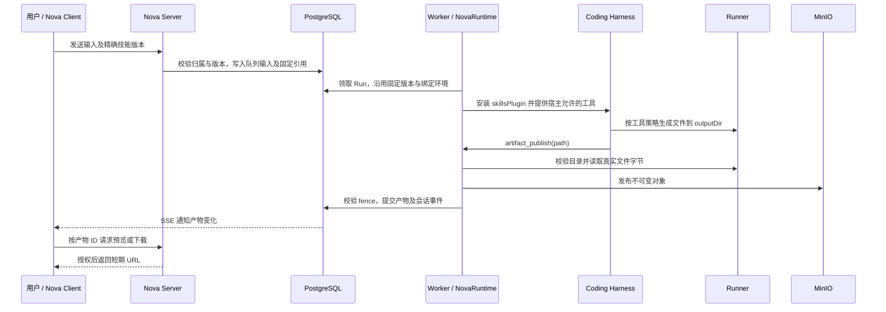

# Nova 产品 Skills 与产物设计

本文设计供 Nova 用户选择、由 Agent 使用的产品 Skills。以下新增表、工具、接口和界面均为设计目标，尚未实现。现状以当前源码为依据；本文不新增 Codex 开发技能，也不改变现有运行权限。

## 1. 核心决策

Skill 是一份有版本的任务方法和资源，指导同一个 Agent 完成工作。执行继续使用现有会话、输入队列、Run、Coding Harness 和工具策略。

- **技能定义**：内置技能随 `packages/tools/skills/` 发布；用户技能由服务端管理，正文与版本元数据进入 PostgreSQL，后续资源包进入 MinIO。
- **代码改动**：写入项目绑定的真实工作区，通过现有 diff 和工具记录查看。
- **可下载文件**：在绑定工作区生成，经显式发布进入 MinIO；PostgreSQL 保存产物索引，会话展示预览和下载入口。
- **Spec**：需求、设计和任务继续以 `spec_revisions` 为事实源。导出文件只是指定版本的快照。
- **首版选择方式**：每条输入显式选择至多一个用户技能，服务端可以同时加入当前场景必须的内置技能，例如 `nova.spec`。先不做模型自主检索和激活技能。

`.agents/skills/` 已用于开发助手。Nova 产品不自动加载这些目录，也不把用户运行产物写回技能源码目录。

## 2. 当前项目已经具备什么

| 能力             | 已核对的源码                                                                    | 设计含义                                                                                                                                             |
| ---------------- | ------------------------------------------------------------------------------- | ---------------------------------------------------------------------------------------------------------------------------------------------------- |
| 技能上下文注入   | `packages/harness/src/plugins/skills/index.ts`                                  | `SkillResource` 已有 `id/version/content/description`；`skillsPlugin` 按显式 ID 注入，默认正文总量上限 40,000 字符。它不扫描目录、安装资源或执行脚本 |
| 一个内置产品技能 | `packages/tools/src/spec-skill.ts`、`packages/tools/skills/spec/SKILL.md`       | `nova.spec@1.0.0` 已由 `nova-runtime.ts` 按 Spec 场景安装，可作为接入范例                                                                            |
| 输入框命令菜单   | `apps/nova-client/src/features/conversations/use-conversation-composer.ts`      | 当前 `ComposerSkill` 对应 `/goal`、`/plan`、`/build`、`/spec`、`/clear` 等宿主动作，尚无可选技能目录                                                 |
| 会话执行与恢复   | `modules/conversations`、`modules/runs`，均位于 `apps/nova-server/src/`         | 已有输入幂等、队列、checkpoint、Worker fence、审批、取消和未知结果处理，应在这里接入                                                                 |
| 工作区文件操作   | `packages/tools/src/tools.ts`、`packages/runner-sdk/src/session.ts`             | Runner SDK 已有 `fs.readBytes`，带校验和且限制 20 MiB；Agent 的 `read_file` 仍是文本工具                                                             |
| SSH 工作区       | `apps/nova-server/src/modules/runs/ssh-tool-context.ts`                         | 当前 `readBytes` 通过 `readText` 转换；底层文本读取上限 256 KiB，不能作为通用二进制产物读取实现                                                      |
| 私有对象存储     | `apps/nova-server/src/modules/attachments/upload-storage.ts`                    | 已使用 MinIO，但 `UploadStorage` 只支持 PNG/JPEG/GIF/WebP、图片读取和签名 URL，不能直接上传文档或 ZIP                                                |
| 文件展示契约     | `packages/agent-ui-contracts/src/messages.ts`                                   | 已有 `file/image` Block 与 `object/runner/ssh` 引用；当前图片签名接口只识别附件对象键，新增产物不能直接套用该接口                                    |
| 规格持久化       | `apps/nova-server/src/modules/specs/`、`database/schema/spec-revision.table.ts` | 保留版本化领域数据，不改为靠工作区 Markdown 驱动状态                                                                                                 |

以上模块路径描述当前事实，不代表所有连接能力已经打通。尤其需要新增通用文件存储、产物发布与下载授权。

## 3. 产品交互

1. 输入框保留现有快捷命令，增加「选择技能」入口，区分命令和技能的类型与回调。`/plan` 等继续执行宿主动作。
2. 技能列表展示名称、用途、来源和是否适用于当前环境。选择后在输入框显示可移除的技能标签；发送时携带精确版本。
3. 没有工作区时可选择纯分析类技能；需要执行程序或生成文件的技能说明「需要绑定工作区」。存储未配置时说明「文件产出暂不可用」。
4. 选择技能不切换 Plan/Build。要求写文件或执行命令的技能在 Plan 下不可执行，界面提示用户选择 Build。服务端也必须校验。
5. 消息记录显示这次采用的技能与版本。产物卡片显示文件名、大小、来源 Run、下载入口和运行结果；文本或图片可预览。
6. 提供「我的技能」管理页面，支持新建 Markdown 技能、编辑草稿、发布版本、停用以及查看发布历史。首版不开放公共市场和组织共享。

首版采用每次发送单独选择的语义：未传技能表示本次没有用户技能；不会从上一条消息或浏览器缓存静默继承。输入框可保留本地选择便于连续发送，但每条请求都明确提交并展示选择。清除上下文也清除该本地选择。

Goal 在没有新输入的自动迭代中沿用触发目标时固定的技能版本。steer 消息只补充方向，首版拒绝在活动 Run 内更换技能；更换在下一次普通输入生效。Spec 专用会话仍由服务端选择 `nova.spec`，用户技能不能授予确认、验收或改变任务绑定的能力。

## 4. 技能定义与版本

### 4.1 首版格式

每份用户技能从一个 `SKILL.md` 开始，必需的 YAML 字段只有 `name` 和 `description`。正文写适用任务、工作方法、需要读取的信息以及结果要求。发布 API 接收正文与本版执行要求，验证后形成不可变版本。

```markdown
---
name: test-report
description: 根据项目现有测试结果生成报告，区分通过、失败与未执行的检查。
---

从项目脚本和现有测试中确认验证入口，先列明验证范围。
执行用户任务所需的检查，根据真实回执记录结果。
将报告写入宿主给出的 outputDir，调用 artifact_publish 发布文件。
没有运行过的检查标记为未执行；发布失败时说明文件仅在工作区中生成。
```

名称和说明从 frontmatter 解析，不在表单与正文中维护两份。平台分配稳定技能 ID；发布版本使用与现有 `SkillResource.version` 兼容的语义版本号，发布后不能覆盖正文或执行配置。版本摘要覆盖规范化正文、执行配置及资源清单，草稿编辑不影响已排队或运行中的版本。

执行配置随技能版本固定，按以下阶段引入。要求由服务端在发布和运行准入时验证；它们只能收紧宿主提供的能力，不能新增工具或扩大权限。

| 配置               | 作用                                                    | 阶段  |
| ------------------ | ------------------------------------------------------- | ----- |
| `allowedModes`     | 声明允许的 Plan/Build 模式，不替用户切换模式            | P0    |
| `requiredTools`    | 校验当前宿主是否提供所需工具，不注册或授权新工具        | P0    |
| 是否需要工作区     | 区分消息分析与工作区操作                                | P0    |
| 是否要求发布文件   | 校验产物存储可用性与最终交付                            | P0/P1 |
| `requires`（可选） | 声明可运行的平台及解释器/版本要求，为环境适用性提供依据 | P2    |

P0/P1 不引入脚本依赖探测。P2 中包含可执行脚本的版本须声明 `requires`；纯 Markdown 技能仍可省略。技能内容可以跨平台分发，脚本是否可运行由声明与实际环境共同决定，不能承诺安装后在任何平台都能执行。

送入 Harness 时，内置技能保留 `nova.spec` 等既有 ID；用户技能使用 `skill.<平台UUID>`，避免直接把可能以数字开头的 UUID 传给插件。数据库 ID、显示名称和运行时 ID 的转换只在服务端适配处完成。

### 4.2 资源包扩展

后续出现引用文档、模板或脚本需求时，再扩展为完整目录：

```text
test-report/
  SKILL.md
  references/       # 按需读取的方法与格式说明
  assets/           # 用于生成结果的模板等资源
  scripts/          # 由工作区执行宿主运行的程序
```

按需增加 `skill_read_resource`，只读取本次 Run 已绑定版本的资源，避免将整个包灌入上下文。脚本通过已有命令执行工具调用，继续走模式、审批和执行预算；导入脚本不会自动注册新工具。

内置包继续随 `@nova/tools` 分发。用户包上传后校验相对路径、文件数、解压大小、软链接和摘要，存到不可变对象键。`SKILL.md` 的正文与解析元数据以发布版本为准；资源清单只记录其他文件的路径、大小和摘要，不复制正文事实。原始压缩包如保留，只用于审计或下载，不作为另一个运行时读取源。

资源实际需要在工作区执行时，按摘要缓存到 `.nova/skills/<skillId>/<version>/<bundleSha256>/`。现有 Runner 写文件 API 只有文本写入，二进制模板同步需要补充能力；不能因为 SDK 能读二进制，就假设完整包同步已具备。未完成同步前，首版用户技能仅支持 Markdown。

缓存放在工作区内，是因为现有 Runner 文件 RPC 只接受注册工作区内的相对路径，命令的 `cwd` 也经工作区路径解析。`.nova/skills/` 是本设计选定的具体目录；不能据此推断进程只可访问该目录。Runner 直接启动的程序具有其操作系统账户的权限，程序参数指向的其他路径不会因为 `cwd` 在工作区内而自动受限。

从项目目录导入也走发布流程，形成不可变版本。运行中的技能不会跟随 `.agents/skills/` 或远端工作区文件的实时变化。

#### 脚本执行契约（P2）

本节只扩展 P2，脚本首期保持所有者自用。继续由 Worker 经 Runner session RPC 派发命令，脚本在用户绑定的 Runner 机器执行；API/Worker 主机不执行导入脚本。资源物化、解释器探测和命令派发都不能绕过现有模式与工具策略。

**环境声明与准入。** `requires` 按平台选择唯一目标配置，再校验该配置下的全部解释器。例如，同一个 Node 脚本可声明：

```yaml
requires:
  targets:
    - platforms: [linux, macos, windows]
      interpreters:
        - executable: node
          versionRange: ">=22"
```

平台值与 Runner 的 `identity.platform` 对齐；当前 Rust Runner 返回 `linux`、`macos`、`windows` 等 OS 名称。不同平台需要不同启动程序时，分别声明目标配置，例如 Linux 的 `python3` 与 Windows 的 `python`。发布时验证平台集合不重叠、声明完整、版本约束可解析；未列入任何目标的平台不适用，不能由模型猜测替代。

`identity.platform` 只能用于 OS 匹配；当前握手没有解释器和依赖清单。解释器是否存在、解析到的程序路径及实际版本需要在**目标 Runner** 上探测，不能检查 Worker 本机，也不能把 `capabilities: [exec]` 当成解释器已安装。版本探测使用宿主支持的固定探测方式，不直接执行技能包提供的任意探测命令。解释器之外的项目依赖也应在脚本产生业务副作用前检查；缺失时报告具体原因，不因选择技能自动安装软件或提权。

环境适用性区分「满足」「不满足」「待验证」：未探测、Runner 离线、探测被拒或超时不能算满足，也不能谎报为未安装。选择菜单可以展示待验证；入队先做静态检查，Build Run 在脚本执行前通过已授权的命令通道完成探测。不满足或仍待验证时不派发脚本。Plan 不为探测临时开放命令执行。探测结果记录环境标识和时间，重连、进程重启、绑定变更或依赖变化后复查，缓存只辅助展示。

**启动方式与编写要求。** 当前 `bash` 工具的实际含义是「直接启动单个程序」，Rust Runner 使用 `Command::new(executable)`，不会根据脚本扩展名启动 shell。源脚本一律显式传入解释器及参数，例如 `node <script>`、`python3 <script>`、`sh <script>`，PowerShell 脚本使用已探测到的 PowerShell 程序并传 `-NoProfile -File <script>`。不依赖 shebang、文件关联或 POSIX 可执行位，不要求先执行 `chmod +x`。

`SKILL.md` 需说明所支持平台对应的解释器、包内入口路径、参数和输出约定。`command` 只放程序名或已验证程序路径，参数逐项放入 `args`；不得把命令行拼成一个程序名，也不依赖隐式的管道、重定向或变量展开。宿主把缓存目录、工作目录和 `outputDir` 注入本次上下文，脚本通过参数取得这些路径，不硬编码某台机器的绝对路径。示例调用保持现有工具格式：

```json
{
  "command": "node",
  "args": [
    ".nova/skills/<skillId>/<version>/<bundleSha256>/scripts/report.mjs",
    "--output-dir",
    ".nova/runs/<runId>/outputs/"
  ],
  "cwd": ".",
  "timeoutMs": 300000
}
```

示例中的路径均相对于当前项目 `canonicalCwd`，实际解释器以探测结果为准。脚本启动由原工具策略授权，程序内部的文件访问按 Runner 进程的操作系统权限执行，不承诺逐次经过文件 RPC 授权。交付文件通过 §7 的发布流程进入 MinIO。

**资源物化与完整性。** 导入时检查脚本编码和换行，对要求 LF 的 shell 脚本拒绝 CRLF，或在发布确认前统一为 LF；逐文件摘要、包摘要与下载内容均以最终发布字节为准。物化时不按目标平台重新转换字节。现有文本写入单文件上限为 1 MiB，大脚本和二进制资源须等资源同步能力补齐后支持，不截断文件后继续执行。

首次使用在本次绑定工作区物化资源，由宿主协调同一缓存键的并发物化，按清单逐文件校验长度和 SHA-256，全部匹配后才标记缓存可用；中途失败的部分缓存不可执行。缓存命中也须验证入口及包内依赖；缺失或损坏则重建，不能以「路径中含摘要」代替实际校验。执行记录关联固定版本、包摘要、入口摘要、解释器实际路径/版本、参数、cwd、超时及目标环境，便于核对真实执行内容。

**重连、换机与恢复。** 已有会话固定 binding revision，项目换绑不会自动迁移旧会话。运行目标继续取该会话 binding；显式迁移、新绑定运行，或同 Runner 身份的进程重启/环境变化后，重新匹配平台、探测依赖并验证目标工作区缓存，必要时重新物化。缓存和探测记录至少区分 `runnerId`、`bootId`、`workspaceId` 及 binding revision，不能只按技能版本认为另一台机器已安装。

资源重建不等于业务命令重放。发生过派发而结果未知时，先用原 Runner 操作 ID 和执行记录核实；原执行是否终止、是否生效未确认前，不在新机器重新执行脚本。恢复沿用 Run 原有截止时间，不因重新物化或重连重置预算。

**审批与共享边界。** 脚本调用除现有命令审批外，还需关联服务端从固定版本生成的包与入口信息。审批展示目标 Runner/工作区、解释器、参数、入口、包摘要和入口摘要，并支持查看对应已发布脚本内容。包级授权如允许会话内复用，须绑定摘要和目标环境；内容或环境变化后重新授权。当前 `checkpoint.approvals` 按工具名复用 `bash`，不能把这项普通命令授权标记为用户已审阅并认可任意技能包。

派发前校验实际文件与已审批摘要一致；服务端读取文件后再单独发起普通 `exec` 仍存在文件在两者之间被替换的窗口。现有 Runner `executeCommand` 不接收预期入口摘要，不能宣称已具备核验与启动的原子保证。组织共享/市场脚本开放前，须补充 Runner 侧核验并启动固定内容快照的能力（必要时从 `proto/runner/v1/` 更新协议），以及与该快照绑定的审批策略；仅在 UI 展示摘要不够。此处不把缓存目录当成沙箱，也不扩大进程账户权限。

**预算与结果。** 当前 `bash` 单命令默认 120 秒，可显式设置且最多 900 秒；Nova Run 的持久化截止时间为创建后 30 分钟。探测、物化、模型步骤、命令和产物发布共用剩余时间。脚本编写指南要求为长测试选择合理超时，优先使用项目已有的测试分组/分片，按可单独核验的步骤拆分，为发布预留时间；拆分不会延长 Run 总预算。需要超过预算的任务应明确报告限制，不能通过后台启动进程规避取消和超时。

退出码非零、已知超时或取消均如实记录，已生成文件与整体成功分别判断；断线后的未知结果沿原操作核实，不自动重试整个脚本。具体源码入口为 `packages/tools/src/tools.ts`、`packages/runner-sdk/src/session.ts`、`crates/runner/src/engine.rs`、`crates/runner/src/workspace.rs` 及 `apps/nova-server/src/modules/runs/conversation-executor.ts`。

## 5. 产物放在哪里

### 5.1 按结果性质确定事实源

| 结果                  | 持久化位置                                       | 用户如何获得                      | 示例                                           |
| --------------------- | ------------------------------------------------ | --------------------------------- | ---------------------------------------------- |
| 项目源码与文档改动    | 当前会话绑定的真实工作区，沿用现有版本化 binding | diff、文件浏览、后续 Git 操作     | `apps/.../feature.ts`、`docs/api.md`           |
| 可下载的交付文件      | MinIO 私有对象；PostgreSQL 保存索引和来源        | 会话产物卡片，后续可按会话聚合    | `test-report.md`、`analysis.csv`、`report.pdf` |
| Spec 需求、设计、任务 | PostgreSQL 的 `spec_revisions`                   | Spec 工作台；已有导出契约生成快照 | `requirements.md`、`design.md`、`tasks.md`     |
| 普通解释与结论        | 现有消息存储                                     | 会话消息                          | 审查意见、方案说明                             |
| 临时文件              | 执行工作区的运行临时目录                         | 通常不展示，不承诺长期保留        | 转换中间文件、临时脚本                         |

代码改动不自动复制到 MinIO。可下载文件发布后以对象快照为准，工作区同名文件后续改动不会改变历史产物。只需一段回答时，不强制生成文件。

### 5.2 工作区与对象键

执行宿主为每个 Run 提供相对于项目 `canonicalCwd` 的目录，并注入上下文：

```text
.nova/runs/<runId>/
  outputs/    # outputDir：准备发布的交付文件
  tmp/        # 临时文件
```

代码任务仍在项目原路径修改，目录约定只针对交付文件和临时文件。`runId` 隔离不同运行的文件命名；同一 Run 恢复继续使用相同目录。首次写入及命令执行继续遵守工具策略，目录约定本身不提供 shell 隔离。

如需从 Git 视图排除 `.nova/`，在工作区初始化流程中明确处理，不让技能每次自行修改项目 `.gitignore`。也不能默认仓库根目录已有的 `output/` 适用于用户工作区。

MinIO 可复用现有私有 bucket，新增对象前缀：

```text
skill-bundles/<ownerUserId>/<skillId>/<version>/<bundleSha256>/<resourcePath>
artifacts/<ownerUserId>/<conversationId>/<runId>/<artifactId>/<sha256>
```

所有 ID 和键由服务端构造；显示文件名存数据库，不参与拼接对象路径。前端持有产物 ID，下载时重新授权并签发短期 URL，不持久化签名 URL。暂不要求拆多个 bucket。

### 5.3 文件生成能力的边界

- Runner 首版发布单文件不超过 **20 MiB**，与现有 `fs.readBytes` 上限一致；这是产物限制，不修改现有图片附件的 30 MiB 限制。文件数、Run 总量和账户配额在发布前校验，并为并发上传预留额度。
- 首版通用文件发布只对 Runner 开放。SSH 在提供真实的 SFTP 二进制读取、项目目录内路径校验和大小限制后再开放，不能使用当前 `Buffer.from(readText(...).text)` 传输 PDF 或 Office 文件。
- 没有工作区时只支持消息结果；需要文件的技能不能降级为在 API/Worker 主机任意执行。将来如需无项目的文件生成，再引入独立托管工作区。
- 生成 PDF、DOCX、XLSX 等还取决于执行环境中的依赖。技能声明用途不代表环境已经具备转换器；执行前检查，缺失时说明原因，不临时在服务端安装。
- MinIO 未配置时仍可运行不需要文件的技能。要求交付文件的技能在准入阶段提示不可用，不能声称文件已可下载。

## 6. 从选择到执行



公开输入契约增加 `skills?: [{ skillId, version }]`，与本次 `SubmitInput` 绑定，不放进持续继承的模型/模式 `Configuration`。空列表和省略统一规范化为空列表；重复选择或超过首版数量上限返回校验错误。

服务端在入队前通过 Skills 模块校验所有权、项目范围、版本可用性、模式与所需工具。把精确的已发布版本引用写入 `pending_inputs` 的服务端元数据；规范化后的技能选择参与请求 fingerprint，同幂等键更换技能返回冲突。排队后技能更新不替换引用。

创建 Run 时把固定引用写入 `Checkpoint.skillExecution`，包括来源、技能版本 ID、运行时 ID、版本号与内容摘要。恢复使用同一版本，禁止重新读取「最新版本」。目标自动迭代按第 3 节继承；新普通输入重新计算，不能从上一份 checkpoint 意外保留已取消的技能。

内置技能也需要保留可恢复的内容：部署时按 ID、版本和内容摘要登记不可变内置版本，再由 Run 引用。否则只固定版本字符串仍可能在应用升级后丢失旧正文。同版本不同摘要拒绝覆盖。

执行前将固定版本转换为 `SkillResource[]`，把内置与用户技能合并到**同一个** `skillsPlugin`，避免重复插件 ID。保留插件 40,000 字符总预算；选择与准入阶段即可返回超限原因，不静默截断。首版不修改通用 Harness 的领域边界。

版本被停用后拒绝新的提交；已接受的排队和恢复仍使用原版本。已引用版本不物理删除。权限撤销或项目删除继续遵守宿主既有访问与终止规则，不把「固定版本」理解为永久授权。

## 7. 产物发布、恢复与下载

新增宿主工具 `artifact_publish({ path, name? })`。`path` 为相对 `outputDir` 的文件路径；服务端从当前 Run 派生 owner、会话、绑定环境和目录，不接受模型提供这些标识、对象键或下载 URL。

该工具使用 `effects: write`，走现有模式和审批策略；Plan 中不安装或不允许调用。需要 Plan 中展示结构化设计时，继续使用消息或既有 Spec 候选提交流程，不把持久化发布伪装成只读操作。

发布流程：

1. 通过当前 claim 检查 Run 仍可写，从工具执行身份派生稳定发布键。为 `(runId, toolExecutionId)` 创建唯一产物记录与额度预留；相同执行重放返回原记录，不新建产物。
2. 在事务外，通过绑定宿主解析并校验路径，确保真实文件位于本 Run 的 `outputs/` 内，拒绝目录、越界路径及符号链接逃逸。现有项目级目录约束仍需补充此更窄的运行目录约束。
3. 用 `fs.readBytes` 读取字节，服务端计算大小和 SHA-256，并验证允许的文件类型。冻结本次读取的字节及摘要后再上传；恢复时若源文件变化且旧对象未找到，则返回冲突，不能把新内容当成旧发布成功。
4. 先持久化摘要、大小和确定的对象键，再在事务外上传到不可变键。既有 MinIO 客户端能力可复用，但需新增通用文件存储接口，不能调用当前图片专用的 `completeUpload`。
5. 上传确认后，在同一数据库事务校验有效 Worker fence，将产物标记 `ready`、释放上传预留并提交 `artifact.changed` 事件。网络上传期间不持有数据库事务。旧 Worker 即使上传完成，也不能提交可见记录。
6. 工具返回产物 ID、实际大小和摘要。宿主根据数据库索引展示卡片；最终回复引用产物 ID，不解析模型给出的本机路径来创建下载项。

数据库和 MinIO 无法同事务提交，需要明确处理以下窗口：

| 情况                                               | 处理                                                                                           |
| -------------------------------------------------- | ---------------------------------------------------------------------------------------------- |
| 对象已上传，数据库结算或工具结果提交前 Worker 退出 | 恢复按稳定发布键找到原记录，核对对象大小、摘要后完成结算，返回同一产物 ID                      |
| 上传超时，是否写入未知                             | 查询原对象并校验；无法确认时保留待核实状态，继续沿原操作协调，不重新生成文件                   |
| 对象不存在，但旧上传尚不能确认停止                 | 保留待核实，不把一次 NotFound 当作可重新派发的依据                                             |
| 发布失败且结果已知                                 | 记录失败原因并释放额度预留；文件可继续保留在工作区。用户可发起一次明确的新发布，不重跑整个技能 |
| 发布成功，Run 随后失败或取消                       | 保留已完成的产物，卡片同时展示来源 Run 的结果，不能暗示整项任务通过                            |
| 技能声明必须交付文件，但 Run 结束前没有 ready 产物 | 宿主结算为交付失败并给出原因，不能只根据模型「已生成」的文字判定成功                           |

产物状态只描述文件发布：`publishing/ready/failed`。执行结果继续读取 `runs.state`，不维护第二套技能运行状态机。未知上传由 publishing 记录及其恢复元数据表达。

下载接口先验证产物所属 Run → 会话 → 当前用户/项目，再签发 URL；不得接受任意 object key 换签名。Markdown、纯文本和允许的图片可以预览；HTML、SVG 等主动内容默认下载。Office、PDF 首版可仅下载，后续按需要加入隔离预览。将产物再次作为模型输入是独立能力，不能假定当前图片输入链路已经支持文档。

清理区分长期对象和运行缓存：工作区临时目录在 Run 已知终态且所有发布已结算后按策略清理；不能清理待核实操作的源文件。删除会话时，在现有删除 Run 的事务中级联清理索引并写入对象删除 Job，事务外删除对象；项目删除沿会话清理处理。停用技能不删除历史产物。对象清理按 Job 重试和定期孤儿扫描兜底，保护 publishing 记录与有效预留，TTL/配额值留在配置中。

## 8. 数据与 API 的最小增量

### 8.1 数据结构

| 对象                        | 关键字段与约束                                                                                                                                              | 事实源                                                             |
| --------------------------- | ----------------------------------------------------------------------------------------------------------------------------------------------------------- | ------------------------------------------------------------------ |
| `skills`                    | UUID、来源 `builtin/user`、owner、可空 projectId、草稿正文及执行配置、可空 currentPublishedVersionId、停用标记、编辑 revision                               | 管理身份和可编辑草稿；项目技能校验项目归属，个人技能允许无项目会话 |
| `skill_versions`            | UUID、skillId、语义 version、发布正文、解析元数据、执行配置、内容摘要、可空资源清单、createdAt；`UNIQUE(skillId, version)`                                  | 不可变执行版本。资源功能上线后才加入对象引用                       |
| `run_artifacts`             | UUID、runId、toolExecutionId、可空 skillVersionId、name、mimeType、size、sha256、objectKey、state、恢复元数据、错误、时间；`UNIQUE(runId, toolExecutionId)` | 文件索引；归属由 Run/会话确定，避免另外维护可漂移的权限关系        |
| `pending_inputs.payload`    | 请求技能选择 + 经服务端验证的内部版本引用                                                                                                                   | 排队期间的版本固定与幂等依据                                       |
| `Checkpoint.skillExecution` | 本 Run 的固定版本引用                                                                                                                                       | 执行、审批挂起和恢复使用同一选择                                   |

`skill_versions` 到技能、`run_artifacts` 到 Run 及可选版本设置外键。版本引用进入 JSONB 的队列与 checkpoint，由服务端校验；已发布版本采用保留策略，不提供直接物理删除入口。草稿保存携带编辑 revision，防止并发覆盖。

首版最多一个用户技能，所以产物可归属本次用户技能；只有内置技能或普通会话时按实际来源记录或留空。以后多用户技能协作时，再增加能被宿主验证的产物来源绑定。

### 8.2 对外接口

下列路径均位于 `/api`，沿用现有成功/错误信封、鉴权和不可见资源返回 404 的约定。

| 接口                                          | 用途                                                                                      |
| --------------------------------------------- | ----------------------------------------------------------------------------------------- |
| `GET /skills?projectId=...&cursor=...`        | 查询可用技能与可选版本摘要，返回当前环境的不适用原因                                      |
| `POST /skills`                                | 创建个人或项目技能草稿                                                                    |
| `GET /skills/:id`                             | 读取有权限的草稿和发布状态                                                                |
| `PATCH /skills/:id/draft`                     | 带 `expectedRevision` 更新正文和执行配置                                                  |
| `POST /skills/:id/versions`                   | 带 `expectedRevision`、version 发布不可变版本；相同版本同内容返回原版本，内容不同返回冲突 |
| `GET /skills/:id/versions`                    | 分页读取发布历史                                                                          |
| `GET /skills/:id/versions/:version`           | 读取确切版本的正文和执行要求                                                              |
| `POST /skills/:id/disable`                    | 停止新的选择，保留已接受运行和历史记录                                                    |
| 现有会话创建/提交输入接口                     | 增加 `skills`，不新增技能专用 Run API；Goal 的触发入口同样传递选择                        |
| `GET /conversations/:id/artifacts?cursor=...` | 读取产物摘要，支持恢复页面和 SSE 断线后刷新                                               |
| `GET /artifacts/:id/download`                 | 验证访问权后返回短期下载 URL 和过期时间                                                   |
| `GET /artifacts/:id/preview`                  | 返回受限文本内容或允许图片的短期 URL，不返回任意可执行 HTML                               |

草稿和版本写入只允许所有者，内置技能只读。发布版本先做正文、frontmatter、上下文长度和执行配置校验。版本不存在、不可选或与当前模式不符，入队前返回明确原因；执行环境变化时在 Run 准入处重新验证。

新增 `artifact.changed` 仅携带 `{ artifactId, runId, state }`，索引变化和事件同事务提交；客户端刷新对应会话的产物查询。技能选择摘要进入输入/运行读模型，刷新和历史查看不依赖临时的 Composer 状态。事件、快照和投影在 `@nova/agent-ui-contracts` 中定义；HTTP 管理 schema 在服务端定义并导出 OpenAPI，客户端继续生成，不平行手写类型。

## 9. 代码落点

| 位置                                                                   | 责任                                                                                             |
| ---------------------------------------------------------------------- | ------------------------------------------------------------------------------------------------ |
| `apps/nova-server/src/modules/skills/`（新增）                         | 草稿、发布、可见性、版本解析及向运行入口提供固定版本；通过公开 `index.ts` 暴露服务               |
| `apps/nova-server/src/modules/artifacts/`（新增）                      | 文件读取与发布协调、产物索引、预览/下载授权、清理 Job；通用存储放在该模块已有需要的边界内        |
| `apps/nova-server/src/modules/conversations/`                          | 输入选择校验、幂等规范化、服务端元数据入队                                                       |
| `apps/nova-server/src/modules/runs/`                                   | 版本引用进入 checkpoint、恢复、工具安装、claim/fence 校验与交付结算；沿用现有 Service 事务作用域 |
| `apps/nova-server/database/schema/`                                    | 三张新增表及索引；通过新迁移更新数据库                                                           |
| `packages/tools/skills/`                                               | 保持内置技能源码；先保留 `spec/` 的路径与已有加载方式，再接入版本登记                            |
| `packages/tools/src/`                                                  | 可复用的技能相关工具定义；依赖宿主传入的窄接口，不导入数据库或 MinIO                             |
| `packages/harness/src/plugins/skills/`                                 | 继续只负责有界上下文贡献；首版不承担技能管理、权限或文件存储                                     |
| `packages/agent-ui-contracts/`                                         | 本次技能选择、运行摘要和产物通知的共享事件/展示契约                                              |
| `apps/nova-client/src/features/skills/`、`features/artifacts/`（新增） | 技能管理/选择、查询缓存、产物预览与下载                                                          |
| `packages/chat-ui/`                                                    | 通过 props/callbacks 展示菜单、标签和文件卡片；请求及持久化留给宿主                              |

暂不新增 `packages/skills`、独立技能执行服务或专门的工作流编排器。后续只有出现其他宿主需要复用的包解析/校验逻辑时，再提取公共包。

## 10. 实施顺序与验收

| 阶段                 | 交付范围                                                                                   | 关键验收                                                                                                                                                            |
| -------------------- | ------------------------------------------------------------------------------------------ | ------------------------------------------------------------------------------------------------------------------------------------------------------------------- |
| P0：可选择并固定版本 | Markdown 技能管理、两张技能表、输入契约、队列/checkpoint、单插件注入、选择摘要             | 发布 v2 后排队/恢复仍用 v1；同幂等键换技能冲突；新输入不意外继承旧技能；跨用户/项目不能选择；Spec 功能继续工作                                                      |
| P1：文件产物闭环     | `run_artifacts`、Runner 发布工具、通用 MinIO 文件存储、卡片、下载/预览与清理               | Markdown/CSV 生成后刷新可下载；同名不同 Run 不覆盖；20 MiB 超限明确失败；路径与符号链接逃逸被拒；上传后崩溃恢复不重复；旧 fence 无法提交；无存储/SSH 能力时提前提示 |
| P2：资源和丰富格式   | 包导入、资源按需读取、模板与脚本同步、§4.2 脚本执行契约、真实 SSH 二进制读取、按需隔离预览 | 包路径/解压限制生效；停用不破坏历史恢复；环境验证与脚本审批生效；PDF/Office 摘要与字节一致；不支持的环境可解释                                                      |

P2 脚本验收另覆盖以下行为，P0/P1 的范围和准入规则不变：

- 在声明支持的 Windows/Linux/macOS Runner 上通过显式解释器启动；缺少解释器、版本不符、依赖缺失及拒绝探测均有明确结果，待验证不显示为可执行。
- 无可执行位的脚本仍可通过解释器运行；CRLF shell 脚本在发布前被检查，物化后的每个文件与最终发布摘要一致；缓存损坏会阻止启动并触发重建。
- 项目换绑不改变旧会话目标；新绑定或 Runner 重启后重新验证环境与缓存，未知结果未核实前不在其他机器重复派发。
- 审批可查看固定版本内容、摘要及目标环境；普通 `bash` 会话授权不会被记录为包级认可。共享脚本须验证 Runner 对固定内容快照的核验/启动能力已实现，未实现则保持所有者自用。
- 验证默认 120 秒、显式超时不超过 900 秒，以及 Run 恢复仍使用原截止时间；超时/取消后核实原进程结果，不能把残留文件当成测试通过或已完成交付。

优先扩展已有 `apps/nova-server/tests/chat-protocol.integration.test.ts`、`specs.integration.test.ts`，验证技能加入后的排队、恢复与 Spec 行为；参照 `attachments.test.ts` 的存储替身模式验证产物服务。Harness 的技能版本校验和预算边界按需补充测试，不假设已有专门用例覆盖。产物模块增加必要的协议与崩溃窗口用例，真实数据库集成测试使用 `TEST_DATABASE_URL`。文件发布的真实端到端验收应在绑定 Runner 的工作区完成，包含断线、取消和上传状态未知场景。

首版示范先接入两个简单技能：`test-report` 产出 Markdown 测试报告，`repo-review` 产出消息形式的审查结论。既有 `nova.spec` 继续作为场景内置能力。前两者应在执行链路完成后再发布，不提前建立一批无法运行的技能目录。

本次仅新增设计文档，没有迁移数据库、创建运行资源、修改产品代码或安装新技能。

## 参考

- [现有 Spec 工作流](nova-sdd-mode.md)、[运行与工具边界](coding-harness-architecture.md)、[事务作用域](transaction-scope.md)。现有文档可能包含目标契约，能力判断以源码为准。
- [OpenAI Skills 文档](https://developers.openai.com/api/docs/guides/tools-skills)：技能由入口说明和支持文件组成。本文借鉴包的组织方式；Nova 的存储、执行与授权由本项目自行实现。
