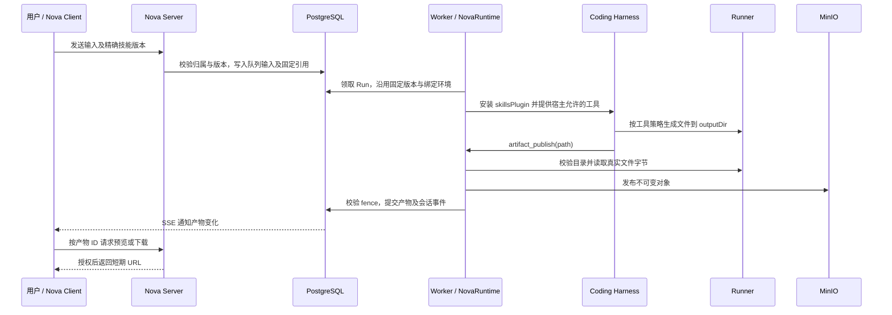

# Nova 产品 Skills 与产物设计

本文设计供 Nova 用户选择、由 Agent 使用的产品 Skills，以及 Runner 本地技能和 Agent 配置的发现。已有能力见 §2；本地发现、内置创建助手、通用版本管理和文件产物等增量均为设计目标。本方案不新增 Codex 开发技能，也不改变现有运行权限。

## 1. 核心决策

Skill 是一份有版本的任务方法和资源，指导同一个 Agent 完成工作。执行继续使用现有会话、输入队列、Run、Coding Harness 和工具策略。

- **技能定义**：内置技能随 `packages/tools/skills/` 发布；平台技能由服务端管理。Runner 启动时扫描其用户主目录的 `~/.nova/skills/` 和项目目录的 `.nova/skills/`，本地文件为可编辑源，服务端保存被接受版本的不可变快照。
- **本地 Agent**：发现 `~/.nova/agents/*.md`，并支持对应的项目级 `.nova/agents/*.md`，作为可选择的 Agent 配置，与技能目录分开。
- **创建助手**：内置 `nova.skills-creater`，帮助生成、校验和安装技能，默认写入项目级技能目录，按用户明确选择支持全局安装。
- **代码改动**：写入项目绑定的真实工作区，通过现有 diff 和工具记录查看。
- **可下载文件**：在绑定工作区生成，经显式发布进入 MinIO；PostgreSQL 保存产物索引，会话展示预览和下载入口。
- **Spec**：需求、设计和任务继续以 `spec_revisions` 为事实源。导出文件只是指定版本的快照。
- **首版选择方式**：每条输入显式选择至多一个用户技能，服务端可以同时加入当前场景必须的内置技能，例如 `nova.spec`。先不做模型自主检索和激活技能。

`.agents/skills/` 已用于开发助手。Nova 产品不自动加载这些目录，也不把用户运行产物写回技能源码目录。

## 2. 当前项目已经具备什么

| 能力             | 已核对的源码                                                                    | 设计含义                                                                                                                                             |
| ---------------- | ------------------------------------------------------------------------------- | ---------------------------------------------------------------------------------------------------------------------------------------------------- |
| 技能上下文注入   | `packages/harness/src/plugins/skills/index.ts`                                  | `SkillResource` 已有 `id/version/content/description`；`skillsPlugin` 按显式 ID 注入，默认正文总量上限 40,000 字符。它不扫描目录、安装资源或执行脚本 |
| 内置产品技能     | `packages/tools/src/spec-skill.ts`、`packages/tools/src/career-coach-skill.ts`  | `nova.spec` 按 Spec 场景安装，`nova.career-coach` 通过现有产品技能目录选择                                                                           |
| 输入框命令与技能 | `apps/nova-client/src/features/conversations/use-conversation-composer.ts`      | 已区分 `/` 宿主命令与 `@` 产品技能选择；当前产品技能主要用于无工具聊天，需扩展到 Runner 工作区场景                                                   |
| 会话执行与恢复   | `modules/conversations`、`modules/runs`，均位于 `apps/nova-server/src/`         | 已有输入幂等、队列、checkpoint、Worker fence、审批、取消和未知结果处理，应在这里接入                                                                 |
| 工作区文件操作   | `packages/tools/src/tools.ts`、`packages/runner-sdk/src/session.ts`             | Runner SDK 已有 `fs.readBytes`，带校验和且限制 20 MiB；Agent 的 `read_file` 仍是文本工具                                                             |
| SSH 工作区       | `apps/nova-server/src/modules/runs/ssh-tool-context.ts`                         | 当前 `readBytes` 通过 `readText` 转换；底层文本读取上限 256 KiB，不能作为通用二进制产物读取实现                                                      |
| 私有对象存储     | `apps/nova-server/src/modules/attachments/upload-storage.ts`                    | 已使用 MinIO，但 `UploadStorage` 只支持 PNG/JPEG/GIF/WebP、图片读取和签名 URL，不能直接上传文档或 ZIP                                                |
| 文件展示契约     | `packages/agent-ui-contracts/src/messages.ts`                                   | 已有 `file/image` Block 与 `object/runner/ssh` 引用；当前图片签名接口只识别附件对象键，新增产物不能直接套用该接口                                    |
| 规格持久化       | `apps/nova-server/src/modules/specs/`、`database/schema/spec-revision.table.ts` | 保留版本化领域数据，不改为靠工作区 Markdown 驱动状态                                                                                                 |

当前另有 `nova.career-coach` 内置技能及 `GET /api/skills` 目录，定义位于 `packages/tools/skills/career-coach/` 和 `apps/nova-server/src/modules/skills/index.ts`。输入契约已有单项 `skill: { id, version }`，接受输入时把完整资源固定到执行快照。`modules/runs/agent-profile.ts` 目前只接受无工具的 `chat` profile；`packages/agent-ui-contracts/src/skills.ts` 的技能来源也仅允许 `builtin`。因此本地发现需扩展现有目录和接受流程，不能另建一条独立技能执行链路。

Runner 当前在 `crates/runner/src/main.rs` 初始化 `App` 并建立连接，`config.rs` 将 `--workspace`（默认 `.`）规范化为注册工作区；握手尚无 skills/agents 目录。全局资源位于工作区之外，现有文件 RPC 无法直接读取。尤其需要新增受限的本地资源协议、通用文件存储、产物发布与下载授权。

## 3. 产品交互

1. 输入框保留现有快捷命令，增加「选择技能」入口，区分命令和技能的类型与回调。`/plan` 等继续执行宿主动作。
2. 技能列表展示名称、用途、来源和是否适用于当前环境。选择后在输入框显示可移除的技能标签；发送时携带精确版本。
3. 没有工作区时可选择纯分析类技能；需要执行程序或生成文件的技能说明「需要绑定工作区」。存储未配置时说明「文件产出暂不可用」。
4. 选择技能不切换执行模式。要求写文件或执行命令的技能在 Plan 下不可执行，界面提示使用已有 Build/Auto 模式，并继续遵守所选模式的授权规则。服务端也必须校验。
5. 消息记录显示这次采用的技能与版本。产物卡片显示文件名、大小、来源 Run、下载入口和运行结果；文本或图片可预览。
6. 新增独立路由 `/skills`，在侧栏提供「我的技能」入口，用于查看用户技能。平台草稿编辑、发布、停用及版本历史按对应管理能力开放；首版不开放公共市场和组织共享。

目录合并内置、平台和当前 Runner 的本地技能，显示「内置 / 平台 / 本机全局 / 项目」来源及不适用原因。本地技能由文件编辑，平台技能由服务端草稿编辑，不能对同一份本地源同时维护一个可独立修改的网页草稿。用户可选择「使用技能创建助手」，要求它创建新技能。Agent 选择独立展示，不与技能标签或 `/plan`、`/build` 命令混为一类。

首版采用每次发送单独选择的语义：未传技能表示本次没有用户技能；不会从上一条消息或浏览器缓存静默继承。输入框可保留本地选择便于连续发送，但每条请求都明确提交并展示选择。清除上下文也清除该本地选择。

Goal 在没有新输入的自动迭代中沿用触发目标时固定的技能版本。steer 消息只补充方向，首版拒绝在活动 Run 内更换技能；更换在下一次普通输入生效。Spec 专用会话仍由服务端选择 `nova.spec`，用户技能不能授予确认、验收或改变任务绑定的能力。

### 3.1 用户 Skills 页面

`/skills` 与会话、项目页面同级，放在现有 WorkspaceShell 中，沿用 RequireIdentity 登录边界。列表、加载与错误状态由 `apps/nova-client/src/features/skills/` 实现，`routes/skills/index.tsx` 只负责文件路由入口和 search 参数校验；路由树由现有生成流程更新。

页面默认展示当前用户的平台技能，并单独标识可用内置技能。选择 Runner 后展示该设备的全局技能；选择项目后，按该项目当前绑定的 Runner 和 `canonicalCwd` 展示项目与全局技能。项目未绑定、Runner 离线和扫描未完成均显示具体状态，不把它们当作「用户没有技能」。不默认汇总所有设备，避免同名技能失去执行环境。

筛选状态放入 URL，支持按关键词和来源筛选：

| URL 示例                | 查看范围                             |
| ----------------------- | ------------------------------------ |
| `/skills`               | 当前用户的平台技能及可用内置技能     |
| `/skills?runnerId=...`  | 增加所选 Runner 的全局技能           |
| `/skills?projectId=...` | 增加所选项目和对应 Runner 的全局技能 |

`projectId` 存在时由项目绑定确定 Runner；切换项目清理不匹配的设备筛选。服务端校验所有来源归属，不信任 URL 中的资源标识。分页、筛选和详情查询键隔离当前账号、项目、Runner 和版本。

每项展示名称、说明、来源、版本、关联项目/Runner、适用模式与可用状态；被同名项目技能遮蔽的全局项仍可查看来源。点击后在同一路由的详情面板中查看 `SKILL.md` 正文、执行要求、资源清单和目录诊断，使用可选 `skillId/version` search 参数支持刷新和直达。列表只取摘要，正文按需读取；本地详情通过受限资源协议获得匹配摘要的快照，不能读取任意文件路径。

「在会话中使用」将确切技能引用和所选环境带入新会话输入框，用户发送后才执行；「创建技能」预选内置 `nova.skills-creater`，沿用同一环境。页面读取和详情预览均不触发脚本或安装。内置和本地技能先提供查看与使用，平台技能编辑沿用其草稿接口；本地修改继续以 Runner 文件为源，避免另造网页草稿。

「刷新本地技能」仅在已选择且支持发现能力的 Runner 上可用，调用定向刷新接口后更新列表和诊断。刷新失败保留已显示结果并标记过期；目录为空、筛选无结果、设备离线、加载失败分别提供相应提示。

## 4. 技能定义与版本

### 4.1 首版格式

每份用户技能从一个 `SKILL.md` 开始，必需的 YAML 字段只有 `name` 和 `description`。正文写适用任务、工作方法、需要读取的信息以及结果要求。发布 API 接收正文与本版执行要求，验证后形成不可变版本。

本地技能可在 frontmatter 的可选 `nova` 字段中声明执行配置，字段内容复用平台发布配置的 schema；省略时应用同一默认值。服务端从文件派生配置和展示元数据，不为本地源另存可独立修改的配置。平台发布若同时接收显式配置与正文中的 `nova`，两者必须一致，否则拒绝，避免执行要求出现两个来源。

```markdown
---
name: test-report
description: 根据项目现有测试结果生成报告，区分通过、失败与未执行的检查。
---

从项目脚本和现有测试中确认验证入口，先列明验证范围。
执行用户任务所需的检查，根据真实回执记录结果。
将报告写入宿主给出的 outputDir，调用 artifact_publish 发布文件。
没有运行过的检查标记为未执行；发布失败时说明文件仅在工作区中生成。
```

名称和说明从 frontmatter 解析，不在表单与正文中维护两份。平台分配稳定技能 ID；发布版本使用与现有 `SkillResource.version` 兼容的语义版本号，发布后不能覆盖正文或执行配置。版本摘要覆盖规范化正文、执行配置及资源清单，草稿编辑不影响已排队或运行中的版本。

执行配置随技能版本固定，按以下阶段引入。要求由服务端在发布和运行准入时验证；它们只能收紧宿主提供的能力，不能新增工具或扩大权限。

| 配置               | 作用                                                    | 阶段  |
| ------------------ | ------------------------------------------------------- | ----- |
| `allowedModes`     | 声明允许的 Plan/Build/Auto 模式，不替用户切换模式       | P0    |
| `requiredTools`    | 校验当前宿主是否提供所需工具，不注册或授权新工具        | P0    |
| 是否需要工作区     | 区分消息分析与工作区操作                                | P0    |
| 是否要求发布文件   | 校验产物存储可用性与最终交付                            | P0/P1 |
| `requires`（可选） | 声明可运行的平台及解释器/版本要求，为环境适用性提供依据 | P2    |

P0/P1 不引入脚本依赖探测。P2 中包含可执行脚本的版本须声明 `requires`；纯 Markdown 技能仍可省略。技能内容可以跨平台分发，脚本是否可运行由声明与实际环境共同决定，不能承诺安装后在任何平台都能执行。

送入 Harness 时，内置技能保留 `nova.spec` 等既有 ID；用户技能使用 `skill.<平台UUID>`，避免直接把可能以数字开头的 UUID 传给插件。数据库 ID、显示名称和运行时 ID 的转换只在服务端适配处完成。

### 4.2 资源包扩展

后续出现引用文档、模板或脚本需求时，再扩展为完整目录：

```text
test-report/
  SKILL.md
  references/       # 按需读取的方法与格式说明
  assets/           # 用于生成结果的模板等资源
  scripts/          # 由工作区执行宿主运行的程序
```

按需增加 `skill_read_resource`，只读取本次 Run 已绑定版本的资源，避免将整个包灌入上下文。脚本通过已有命令执行工具调用，继续走模式、审批和执行预算；导入脚本不会自动注册新工具。

内置包继续随 `@nova/tools` 分发。用户包上传后校验相对路径、文件数、解压大小、软链接和摘要，存到不可变对象键。`SKILL.md` 的正文与解析元数据以发布版本为准；资源清单只记录其他文件的路径、大小和摘要，不复制正文事实。原始压缩包如保留，只用于审计或下载，不作为另一个运行时读取源。

资源实际需要在工作区执行时，按摘要缓存到 `.nova/cache/skills/<skillId>/<version>/<bundleSha256>/`。`.nova/skills/` 留给用户编辑的源目录，扫描器不扫描 `.nova/cache/`，避免把缓存重新当成技能。现有 Runner 写文件 API 只有文本写入，二进制模板同步需要补充能力；不能因为 SDK 能读二进制，就假设完整包同步已具备。未完成同步前，首版用户技能仅支持 Markdown。

缓存放在工作区内，是因为现有 Runner 文件 RPC 只接受注册工作区内的相对路径，命令的 `cwd` 也经工作区路径解析。全局源通过 §4.3 的受限资源协议读取，再物化固定版本到该缓存。不能据此推断进程只可访问缓存目录：Runner 直接启动的程序具有其操作系统账户的权限，程序参数指向的其他路径不会因为 `cwd` 在工作区内而自动受限。

本地技能经发现、选择后形成不可变执行快照，无需用户手动发布到平台才能使用；显式复制到平台才创建平台草稿。运行中的技能不会跟随远端源文件的实时变化。

#### 脚本执行契约（P2）

本节只扩展 P2，脚本首期保持所有者自用。继续由 Worker 经 Runner session RPC 派发命令，脚本在用户绑定的 Runner 机器执行；API/Worker 主机不执行导入脚本。资源物化、解释器探测和命令派发都不能绕过现有模式与工具策略。

**环境声明与准入。** `requires` 按平台选择唯一目标配置，再校验该配置下的全部解释器。例如，同一个 Node 脚本可声明：

```yaml
requires:
  targets:
    - platforms: [linux, macos, windows]
      interpreters:
        - executable: node
          versionRange: ">=22"
```

平台值与 Runner 的 `identity.platform` 对齐；当前 Rust Runner 返回 `linux`、`macos`、`windows` 等 OS 名称。不同平台需要不同启动程序时，分别声明目标配置，例如 Linux 的 `python3` 与 Windows 的 `python`。发布时验证平台集合不重叠、声明完整、版本约束可解析；未列入任何目标的平台不适用，不能由模型猜测替代。

`identity.platform` 只能用于 OS 匹配；当前握手没有解释器和依赖清单。解释器是否存在、解析到的程序路径及实际版本需要在**目标 Runner** 上探测，不能检查 Worker 本机，也不能把 `capabilities: [exec]` 当成解释器已安装。版本探测使用宿主支持的固定探测方式，不直接执行技能包提供的任意探测命令。解释器之外的项目依赖也应在脚本产生业务副作用前检查；缺失时报告具体原因，不因选择技能自动安装软件或提权。

环境适用性区分「满足」「不满足」「待验证」：未探测、Runner 离线、探测被拒或超时不能算满足，也不能谎报为未安装。选择菜单可以展示待验证；入队先做静态检查，Build/Auto Run 在脚本执行前通过已授权的命令通道完成探测。不满足或仍待验证时不派发脚本。Plan 不为探测临时开放命令执行。探测结果记录环境标识和时间，重连、进程重启、绑定变更或依赖变化后复查，缓存只辅助展示。

**启动方式与编写要求。** 当前 `bash` 工具的实际含义是「直接启动单个程序」，Rust Runner 使用 `Command::new(executable)`，不会根据脚本扩展名启动 shell。源脚本一律显式传入解释器及参数，例如 `node <script>`、`python3 <script>`、`sh <script>`，PowerShell 脚本使用已探测到的 PowerShell 程序并传 `-NoProfile -File <script>`。不依赖 shebang、文件关联或 POSIX 可执行位，不要求先执行 `chmod +x`。

`SKILL.md` 需说明所支持平台对应的解释器、包内入口路径、参数和输出约定。`command` 只放程序名或已验证程序路径，参数逐项放入 `args`；不得把命令行拼成一个程序名，也不依赖隐式的管道、重定向或变量展开。宿主把缓存目录、工作目录和 `outputDir` 注入本次上下文，脚本通过参数取得这些路径，不硬编码某台机器的绝对路径。示例调用保持现有工具格式：

```json
{
  "command": "node",
  "args": [
    ".nova/cache/skills/<skillId>/<version>/<bundleSha256>/scripts/report.mjs",
    "--output-dir",
    ".nova/runs/<runId>/outputs/"
  ],
  "cwd": ".",
  "timeoutMs": 300000
}
```

示例中的路径均相对于当前项目 `canonicalCwd`，实际解释器以探测结果为准。脚本启动由原工具策略授权，程序内部的文件访问按 Runner 进程的操作系统权限执行，不承诺逐次经过文件 RPC 授权。交付文件通过 §7 的发布流程进入 MinIO。

**资源物化与完整性。** 导入时检查脚本编码和换行，对要求 LF 的 shell 脚本拒绝 CRLF，或在发布确认前统一为 LF；逐文件摘要、包摘要与下载内容均以最终发布字节为准。物化时不按目标平台重新转换字节。现有文本写入单文件上限为 1 MiB，大脚本和二进制资源须等资源同步能力补齐后支持，不截断文件后继续执行。

首次使用在本次绑定工作区物化资源，由宿主协调同一缓存键的并发物化，按清单逐文件校验长度和 SHA-256，全部匹配后才标记缓存可用；中途失败的部分缓存不可执行。缓存命中也须验证入口及包内依赖；缺失或损坏则重建，不能以「路径中含摘要」代替实际校验。执行记录关联固定版本、包摘要、入口摘要、解释器实际路径/版本、参数、cwd、超时及目标环境，便于核对真实执行内容。

**重连、换机与恢复。** 已有会话固定 binding revision，项目换绑不会自动迁移旧会话。运行目标继续取该会话 binding；显式迁移、新绑定运行，或同 Runner 身份的进程重启/环境变化后，重新匹配平台、探测依赖并验证目标工作区缓存，必要时重新物化。缓存和探测记录至少区分 `runnerId`、`bootId`、`workspaceId` 及 binding revision，不能只按技能版本认为另一台机器已安装。

资源重建不等于业务命令重放。发生过派发而结果未知时，先用原 Runner 操作 ID 和执行记录核实；原执行是否终止、是否生效未确认前，不在新机器重新执行脚本。恢复沿用 Run 原有截止时间，不因重新物化或重连重置预算。

**审批与共享边界。** 脚本调用除现有命令审批外，还需关联服务端从固定版本生成的包与入口信息。审批展示目标 Runner/工作区、解释器、参数、入口、包摘要和入口摘要，并支持查看对应已发布脚本内容。包级授权如允许会话内复用，须绑定摘要和目标环境；内容或环境变化后重新授权。当前 `checkpoint.approvals` 按工具名复用 `bash`，不能把这项普通命令授权标记为用户已审阅并认可任意技能包。

派发前校验实际文件与已审批摘要一致；服务端读取文件后再单独发起普通 `exec` 仍存在文件在两者之间被替换的窗口。现有 Runner `executeCommand` 不接收预期入口摘要，不能宣称已具备核验与启动的原子保证。组织共享/市场脚本开放前，须补充 Runner 侧核验并启动固定内容快照的能力（必要时从 `proto/runner/v1/` 更新协议），以及与该快照绑定的审批策略；仅在 UI 展示摘要不够。此处不把缓存目录当成沙箱，也不扩大进程账户权限。

**预算与结果。** 当前 `bash` 单命令默认 120 秒，可显式设置且最多 900 秒；Nova Run 的持久化截止时间为创建后 30 分钟。探测、物化、模型步骤、命令和产物发布共用剩余时间。脚本编写指南要求为长测试选择合理超时，优先使用项目已有的测试分组/分片，按可单独核验的步骤拆分，为发布预留时间；拆分不会延长 Run 总预算。需要超过预算的任务应明确报告限制，不能通过后台启动进程规避取消和超时。

退出码非零、已知超时或取消均如实记录，已生成文件与整体成功分别判断；断线后的未知结果沿原操作核实，不自动重试整个脚本。具体源码入口为 `packages/tools/src/tools.ts`、`packages/runner-sdk/src/session.ts`、`crates/runner/src/engine.rs`、`crates/runner/src/workspace.rs` 及 `apps/nova-server/src/modules/runs/conversation-executor.ts`。

### 4.3 Runner 本地发现与目录同步

借鉴 OpenCode 的全局/项目来源、确定的同名覆盖顺序与按需加载；Nova 采用自己的 `.nova` 目录和远程同步协议。OpenCode 还支持向项目根回溯等来源，本阶段不照搬这些扩展。[OpenCode Skills](https://opencode.ai/docs/skills/) · [OpenCode Agents](https://opencode.ai/docs/agents/)

**扫描根与格式。** `~` 指 Runner 进程所属操作系统用户的主目录，不是 API/Worker 或浏览器用户的主目录；Windows 对应该进程用户目录。项目根默认是 Runner 启动目录；显式配置 `--workspace` 时，以其规范化后的注册工作区作为有效项目目录。会话的 `canonicalCwd` 指向工作区子目录时，按该目录单独发现项目层；不得把整个 workspace 的项目技能混给所有子项目。

```text
~/.nova/
  skills/<name>/SKILL.md       # 本机全局技能及同目录资源
  agents/<name>.md            # 本机全局 Agent 配置

<projectRoot>/.nova/
  skills/<name>/SKILL.md       # 项目技能源
  agents/<name>.md            # 项目 Agent 配置
  cache/skills/...            # 固定版本的执行缓存，不参与发现
  runs/<runId>/outputs/...    # 交付文件，不参与发现
```

首期 skills 只认源目录直接子目录中的 `SKILL.md`，agents 只认源目录直接子文件 `*.md`，不递归到脚本和引用资源里发现更多技能。名称使用与目录/文件名一致的小写 kebab-case，最长 64 字符；`name`、`description` 和正文在扫描边界校验。不自动搜索 `.agents/`、`.claude/`、祖先目录或任意额外路径。固定扫描根先规范化，包内路径和符号链接解析后不得逃出该源根。

**时机与诊断。** Runner 启动时发起全局和默认项目层扫描；认证接入完成后同步首个完整目录，不把全部正文塞进限时握手。目录未创建视为空；无主目录、权限不足、无效 frontmatter、过大文件及同源重复名称分别记录诊断，不导致整个 Runner 无法连接。只读扫描不执行脚本、不创建目录。限制扫描条目数、入口大小、资源清单大小和总耗时，扫描被截断或失败时明确标为不完整，不能用空结果冒充成功。

重连后重新发布目录版本；用户点击刷新、创建助手成功落盘、或首次访问新的 `canonicalCwd` 时定向重扫。首版不依赖文件监听。普通文本编辑会在下一次刷新形成新快照；已入队和运行中的版本保持不变。失败的刷新保留上次成功目录并标记过期，过期/不完整目录里的新选择须重新核实后才能接受。

**身份与覆盖。** 每条记录包含 `kind: skill|agent`、`scope: global|project`、Runner/workspace/项目相对目录标识、名称、说明、入口摘要和目录版本。来源身份参与稳定资源 ID，两个 Runner 的同名全局技能不是同一资源。同一项目的默认名称解析顺序为「项目 > 当前 Runner 全局 > 普通内置」；平台版本通过独立来源显式选择，不由磁盘同名文件覆盖。目录保留被遮蔽项的来源供用户查看，不依赖文件枚举顺序。内置 `nova.*` 的确切 ID 保留，调用 `nova.spec` 或 `nova.skills-creater` 不会被同名文件替换。

**受限协议。** 从 `proto/runner/v1/` 定义发现能力、目录发布、定向刷新及资源快照读取，再生成 TS/Rust 协议。目录只传摘要和必要元数据；按需通过资源 ID、预期摘要和包内相对路径读取正文/资源，不能接收模型提供的任意全局绝对路径。服务端在已认证 Runner session 下校验 owner、scope、workspace 和 `canonicalCwd`，不信任上报的用户或项目 ID。全局资源不作为另一个通用 workspace 注册，也不修改普通文件 RPC 的工作区边界。

入队前在事务外取得匹配目录摘要的内容快照，再在现有 Service 事务中校验归属、幂等并固定该快照。原文件已变化则刷新后重新选择，不以新内容替代旧摘要。无语义版本号的本地文件按来源身份及内容摘要映射到服务端递增的 `0.0.<revision>`，同摘要复用版本，保持现有 `id/version` 契约和 Harness 的版本格式；未来带资源的快照须同时固定资源清单与真实字节。PostgreSQL 保存执行版本和来源索引，磁盘文件保持唯一可编辑源；MinIO 用于后续资源包和交付物。

本地全局资源的发现只在对应 Runner 环境中生效。换绑时使用目标 Runner 的可见目录，不能把旧设备全局目录假装成本机已安装；历史执行仍沿原快照和 P2 恢复约束处理。旧 Runner 未声明发现能力时仍可使用内置和平台技能，UI 说明本地发现不可用，不伪造空目录或要求扩大主目录访问。

**Agent 配置。** `~/.nova/agents/reviewer.md` 和 `.nova/agents/reviewer.md` 使用 YAML frontmatter 加 Markdown 正文：名称取文件名，`description` 必填，正文为该角色的提示内容；可选 `modelId`、工具限制和技能名称引用须通过 Nova 对应 schema 校验。工具限制只缩小宿主能力，模型须在用户已有模型配置中可用；Agent 不能覆盖模式、审批或平台基础指令。实际提交的技能引用按同一项目的目录顺序解析，并与 Agent 内容一起固定到已接受执行快照。

首期把这些文件作为可选主 Agent profile，独立于技能选择。Agent 的技能引用只作为界面可见的预选建议，用户发送时仍显式提交至多一个用户技能，未传技能不隐式加载配置中的列表。现有 `agentProfileSchema` 只允许 `chat`，需要扩展为有来源和版本的配置引用，并保留旧聊天行为。导入 OpenCode 的 `mode: subagent/all` 等当前未支持字段时报告不兼容，不能当作可执行子 Agent 静默加载；本地目录发现本身不意味着已经实现子 Agent 调度。

### 4.4 内置技能创建助手

内置名称沿用 `skills-creater`，运行时 ID 为 `nova.skills-creater`，展示名为「技能创建助手」。技能源码规划在 `packages/tools/skills/skills-creater/SKILL.md`，通过 `@nova/tools/harness` 导出并接入现有 Skills 目录；与 `nova.spec` 合并到单个 `skillsPlugin` 使用，不另建执行循环，也不把它安装到 Codex 的开发技能目录。

触发范围是用户要求创建、改写或整理供 Nova 使用的技能。助手先理解要复用的任务和输入/输出，再检查目标目录和相近技能，确定名称、触发说明与最小工作方法。仅在需要时添加 `references/`、`assets/` 或 `scripts/`；脚本声明及校验遵守 §4.2，不生成空目录或依赖尚不存在的工具。

默认生成 `<projectRoot>/.nova/skills/<name>/SKILL.md`；用户明确要求全局可用时生成 Runner 用户的 `~/.nova/skills/<name>/SKILL.md`。未绑定 Runner 时可以在消息中给出完整技能草稿，但不能宣称已安装；Plan 只生成可审阅内容，写入遵守当前 Build/Auto 模式和既有授权。当前无工具的 chat profile 只能辅助起草，需扩展项目技能准入和工具提供后，才能开放落盘能力。

项目写入使用既有工作区工具。全局安装使用新增的受限本地资源写入能力：由 Runner 从 `scope`、合法技能名、包内相对文件路径和预期摘要解析目标，只允许写入已知技能源根，不提供任意 home 文件写入接口。该操作按实际写副作用授权，不使用只读发现权限进行安装。更新先读取现有内容，并用预期摘要防止覆盖并发编辑；不默认覆盖同名全局或项目技能，也不自动修改 Agent 配置。

创建结果须包含有效的 `name/description`、明确使用场景、必要输入和步骤、真实输出位置、失败处理与验证方法。完成后读取实际文件，校验 frontmatter、名称匹配、引用路径与资源完整性，再刷新对应目录，返回新目录版本和技能引用。至少用一个应触发和一个不应触发的请求检查描述边界；如创建了脚本，只有在实际执行并核对回执后才声称已验证。刷新失败时如实区分「文件已写入」与「已被目录发现」。

助手更新自身时只能生成新的用户技能或待发布源码，不覆盖产品内置版本；安装到本地不自动复制或发布到平台。创建技能的文件属于技能源，不进入 `.nova/runs/.../outputs/`，只有用户另行要求导出技能包时才按产物发布。

## 5. 产物放在哪里

### 5.1 按结果性质确定事实源

| 结果                  | 持久化位置                                       | 用户如何获得                      | 示例                                           |
| --------------------- | ------------------------------------------------ | --------------------------------- | ---------------------------------------------- |
| 项目源码与文档改动    | 当前会话绑定的真实工作区，沿用现有版本化 binding | diff、文件浏览、后续 Git 操作     | `apps/.../feature.ts`、`docs/api.md`           |
| 可下载的交付文件      | MinIO 私有对象；PostgreSQL 保存索引和来源        | 会话产物卡片，后续可按会话聚合    | `test-report.md`、`analysis.csv`、`report.pdf` |
| Spec 需求、设计、任务 | PostgreSQL 的 `spec_revisions`                   | Spec 工作台；已有导出契约生成快照 | `requirements.md`、`design.md`、`tasks.md`     |
| 普通解释与结论        | 现有消息存储                                     | 会话消息                          | 审查意见、方案说明                             |
| 临时文件              | 执行工作区的运行临时目录                         | 通常不展示，不承诺长期保留        | 转换中间文件、临时脚本                         |

代码改动不自动复制到 MinIO。可下载文件发布后以对象快照为准，工作区同名文件后续改动不会改变历史产物。只需一段回答时，不强制生成文件。

### 5.2 工作区与对象键

执行宿主为每个 Run 提供相对于项目 `canonicalCwd` 的目录，并注入上下文：

```text
.nova/runs/<runId>/
  outputs/    # outputDir：准备发布的交付文件
  tmp/        # 临时文件
```

代码任务仍在项目原路径修改，目录约定只针对交付文件和临时文件。`runId` 隔离不同运行的文件命名；同一 Run 恢复继续使用相同目录。首次写入及命令执行继续遵守工具策略，目录约定本身不提供 shell 隔离。

如需从 Git 视图排除 `.nova/`，在工作区初始化流程中明确处理，不让技能每次自行修改项目 `.gitignore`。也不能默认仓库根目录已有的 `output/` 适用于用户工作区。

MinIO 可复用现有私有 bucket，新增对象前缀：

```text
skill-bundles/<ownerUserId>/<skillId>/<version>/<bundleSha256>/<resourcePath>
artifacts/<ownerUserId>/<conversationId>/<runId>/<artifactId>/<sha256>
```

所有 ID 和键由服务端构造；显示文件名存数据库，不参与拼接对象路径。前端持有产物 ID，下载时重新授权并签发短期 URL，不持久化签名 URL。暂不要求拆多个 bucket。

### 5.3 文件生成能力的边界

- Runner 首版发布单文件不超过 **20 MiB**，与现有 `fs.readBytes` 上限一致；这是产物限制，不修改现有图片附件的 30 MiB 限制。文件数、Run 总量和账户配额在发布前校验，并为并发上传预留额度。
- 首版通用文件发布只对 Runner 开放。SSH 在提供真实的 SFTP 二进制读取、项目目录内路径校验和大小限制后再开放，不能使用当前 `Buffer.from(readText(...).text)` 传输 PDF 或 Office 文件。
- 没有工作区时只支持消息结果；需要文件的技能不能降级为在 API/Worker 主机任意执行。将来如需无项目的文件生成，再引入独立托管工作区。
- 生成 PDF、DOCX、XLSX 等还取决于执行环境中的依赖。技能声明用途不代表环境已经具备转换器；执行前检查，缺失时说明原因，不临时在服务端安装。
- MinIO 未配置时仍可运行不需要文件的技能。要求交付文件的技能在准入阶段提示不可用，不能声称文件已可下载。

## 6. 从选择到执行



公开输入契约沿用当前 `skill?: { id, version }`，与本次 `SubmitInput` 绑定，不另增平行的 `skills[]`，也不放进持续继承的模型/模式 `Configuration`。省略表示本次没有用户技能。本地目录项先映射为确切版本，再提交该引用；Agent 配置也由服务端解析版本，不能由客户端传任意 system prompt。

服务端在入队前通过 Skills 模块校验所有权、项目范围、版本可用性、模式与所需工具。把精确的已发布版本引用写入 `pending_inputs` 的服务端元数据；规范化后的技能选择参与请求 fingerprint，同幂等键更换技能返回冲突。排队后技能更新不替换引用。

创建 Run 时扩展现有 `Checkpoint.execution` / `AcceptedExecution`，保存来源、技能版本 ID、运行时 ID、版本号、内容摘要及已接受的 Agent 内容，不另建 `skillExecution`。恢复使用同一版本，禁止重新读取「最新版本」或当前磁盘文件。目标自动迭代按第 3 节继承；新普通输入重新计算，不能从上一份 checkpoint 意外保留已取消的技能。

内置技能也需要保留可恢复的内容：部署时按 ID、版本和内容摘要登记不可变内置版本，再由 Run 引用。否则只固定版本字符串仍可能在应用升级后丢失旧正文。同版本不同摘要拒绝覆盖。

执行前将固定版本转换为 `SkillResource[]`，把内置与用户技能合并到**同一个** `skillsPlugin`，避免重复插件 ID。保留插件 40,000 字符总预算；选择与准入阶段即可返回超限原因，不静默截断。首版不修改通用 Harness 的领域边界。

版本被停用后拒绝新的提交；已接受的排队和恢复仍使用原版本。已引用版本不物理删除。权限撤销或项目删除继续遵守宿主既有访问与终止规则，不把「固定版本」理解为永久授权。

## 7. 产物发布、恢复与下载

新增宿主工具 `artifact_publish({ path, name? })`。`path` 为相对 `outputDir` 的文件路径；服务端从当前 Run 派生 owner、会话、绑定环境和目录，不接受模型提供这些标识、对象键或下载 URL。

该工具使用 `effects: write`，走现有模式和审批策略；Plan 中不安装或不允许调用。需要 Plan 中展示结构化设计时，继续使用消息或既有 Spec 候选提交流程，不把持久化发布伪装成只读操作。

发布流程：

1. 通过当前 claim 检查 Run 仍可写，从工具执行身份派生稳定发布键。为 `(runId, toolExecutionId)` 创建唯一产物记录与额度预留；相同执行重放返回原记录，不新建产物。
2. 在事务外，通过绑定宿主解析并校验路径，确保真实文件位于本 Run 的 `outputs/` 内，拒绝目录、越界路径及符号链接逃逸。现有项目级目录约束仍需补充此更窄的运行目录约束。
3. 用 `fs.readBytes` 读取字节，服务端计算大小和 SHA-256，并验证允许的文件类型。冻结本次读取的字节及摘要后再上传；恢复时若源文件变化且旧对象未找到，则返回冲突，不能把新内容当成旧发布成功。
4. 先持久化摘要、大小和确定的对象键，再在事务外上传到不可变键。既有 MinIO 客户端能力可复用，但需新增通用文件存储接口，不能调用当前图片专用的 `completeUpload`。
5. 上传确认后，在同一数据库事务校验有效 Worker fence，将产物标记 `ready`、释放上传预留并提交 `artifact.changed` 事件。网络上传期间不持有数据库事务。旧 Worker 即使上传完成，也不能提交可见记录。
6. 工具返回产物 ID、实际大小和摘要。宿主根据数据库索引展示卡片；最终回复引用产物 ID，不解析模型给出的本机路径来创建下载项。

数据库和 MinIO 无法同事务提交，需要明确处理以下窗口：

| 情况                                               | 处理                                                                                           |
| -------------------------------------------------- | ---------------------------------------------------------------------------------------------- |
| 对象已上传，数据库结算或工具结果提交前 Worker 退出 | 恢复按稳定发布键找到原记录，核对对象大小、摘要后完成结算，返回同一产物 ID                      |
| 上传超时，是否写入未知                             | 查询原对象并校验；无法确认时保留待核实状态，继续沿原操作协调，不重新生成文件                   |
| 对象不存在，但旧上传尚不能确认停止                 | 保留待核实，不把一次 NotFound 当作可重新派发的依据                                             |
| 发布失败且结果已知                                 | 记录失败原因并释放额度预留；文件可继续保留在工作区。用户可发起一次明确的新发布，不重跑整个技能 |
| 发布成功，Run 随后失败或取消                       | 保留已完成的产物，卡片同时展示来源 Run 的结果，不能暗示整项任务通过                            |
| 技能声明必须交付文件，但 Run 结束前没有 ready 产物 | 宿主结算为交付失败并给出原因，不能只根据模型「已生成」的文字判定成功                           |

产物状态只描述文件发布：`publishing/ready/failed`。执行结果继续读取 `runs.state`，不维护第二套技能运行状态机。未知上传由 publishing 记录及其恢复元数据表达。

下载接口先验证产物所属 Run → 会话 → 当前用户/项目，再签发 URL；不得接受任意 object key 换签名。Markdown、纯文本和允许的图片可以预览；HTML、SVG 等主动内容默认下载。Office、PDF 首版可仅下载，后续按需要加入隔离预览。将产物再次作为模型输入是独立能力，不能假定当前图片输入链路已经支持文档。

清理区分长期对象和运行缓存：工作区临时目录在 Run 已知终态且所有发布已结算后按策略清理；不能清理待核实操作的源文件。删除会话时，在现有删除 Run 的事务中级联清理索引并写入对象删除 Job，事务外删除对象；项目删除沿会话清理处理。停用技能不删除历史产物。对象清理按 Job 重试和定期孤儿扫描兜底，保护 publishing 记录与有效预留，TTL/配额值留在配置中。

## 8. 数据与 API 的最小增量

### 8.1 数据结构

| 对象                     | 关键字段与约束                                                                                                                                                                              | 事实源                                                             |
| ------------------------ | ------------------------------------------------------------------------------------------------------------------------------------------------------------------------------------------- | ------------------------------------------------------------------ |
| `skills`                 | UUID、来源 `builtin/platform/runner-global/runner-project`、owner、可空 projectId、来源定位（Runner/workspace/cwd/name）、平台草稿、可空 currentPublishedVersionId、停用标记、编辑 revision | 管理身份；平台草稿可编辑，本地仅保存来源索引，不复制一份可编辑草稿 |
| `skill_versions`         | UUID、skillId、语义 version、发布正文、解析元数据、执行配置、内容摘要、可空资源清单、createdAt；`UNIQUE(skillId, version)`                                                                  | 不可变执行版本。资源功能上线后才加入对象引用                       |
| `run_artifacts`          | UUID、runId、toolExecutionId、可空 skillVersionId、name、mimeType、size、sha256、objectKey、state、恢复元数据、错误、时间；`UNIQUE(runId, toolExecutionId)`                                 | 文件索引；归属由 Run/会话确定，避免另外维护可漂移的权限关系        |
| `pending_inputs.payload` | 请求技能选择 + 经服务端验证的内部版本引用                                                                                                                                                   | 排队期间的版本固定与幂等依据                                       |
| `Checkpoint.execution`   | 扩展现有已接受执行快照，记录固定技能及 Agent 来源、版本、摘要和正文                                                                                                                         | 执行、审批挂起和恢复使用同一选择，不新增平行快照字段               |

`skill_versions` 到技能、`run_artifacts` 到 Run 及可选版本设置外键。版本引用进入 JSONB 的队列与 checkpoint，由服务端校验；已发布版本采用保留策略，不提供直接物理删除入口。草稿保存携带编辑 revision，防止并发覆盖。

本地来源按 `(owner, runnerId, scope, workspaceId/cwd, name)` 标识，按内容摘要复用不可变版本。Agent 目录首期由认证 session 持有，已选择的内容进入现有执行快照，暂不为仅有本地来源的 Agent 增加独立管理表。进程重连或目录刷新只更新可选目录，不改写历史快照。

首版最多一个用户技能，所以产物可归属本次用户技能；只有内置技能或普通会话时按实际来源记录或留空。以后多用户技能协作时，再增加能被宿主验证的产物来源绑定。

### 8.2 对外接口

下列路径均位于 `/api`，沿用现有成功/错误信封、鉴权和不可见资源返回 404 的约定。

| 接口                                                                                    | 用途                                                                                                                                           |
| --------------------------------------------------------------------------------------- | ---------------------------------------------------------------------------------------------------------------------------------------------- |
| `GET /skills?conversationId=...&projectId=...&runnerId=...&source=...&q=...&cursor=...` | 扩展现有目录，服务会话选择器及独立 Skills 页面；会话按原绑定、项目按当前绑定、纯设备按全局层解析，校验多参数一致性；无环境时只列内置与平台来源 |
| `GET /agents?conversationId=...&projectId=...`                                          | 查询当前 Runner/项目可见的主 Agent 配置与兼容性                                                                                                |
| `POST /runners/:id/resources/refresh`                                                   | 校验归属及 workspace/cwd 后定向刷新本地目录，返回目录版本和诊断                                                                                |
| `POST /skills`                                                                          | 创建个人或项目技能草稿                                                                                                                         |
| `GET /skills/:id`                                                                       | 读取有权限的草稿和发布状态                                                                                                                     |
| `PATCH /skills/:id/draft`                                                               | 带 `expectedRevision` 更新正文和执行配置                                                                                                       |
| `POST /skills/:id/versions`                                                             | 带 `expectedRevision`、version 发布不可变版本；相同版本同内容返回原版本，内容不同返回冲突                                                      |
| `GET /skills/:id/versions`                                                              | 分页读取发布历史                                                                                                                               |
| `GET /skills/:id/versions/:version`                                                     | 读取有权限的确切版本正文、执行要求及资源清单，供 Skills 详情面板使用                                                                           |
| `POST /skills/:id/disable`                                                              | 停止新的选择，保留已接受运行和历史记录                                                                                                         |
| 现有会话创建/提交输入接口                                                               | 沿用单项 `skill`，不新增技能专用 Run API；Goal 的触发入口同样传递选择                                                                          |
| `GET /conversations/:id/artifacts?cursor=...`                                           | 读取产物摘要，支持恢复页面和 SSE 断线后刷新                                                                                                    |
| `GET /artifacts/:id/download`                                                           | 验证访问权后返回短期下载 URL 和过期时间                                                                                                        |
| `GET /artifacts/:id/preview`                                                            | 返回受限文本内容或允许图片的短期 URL，不返回任意可执行 HTML                                                                                    |

平台草稿和版本写入只允许所有者，内置技能只读；本地编辑或安装走受限 Runner 资源写入，不能用平台草稿 API 覆盖源文件。发布和快照接受先做正文、frontmatter、上下文长度和执行配置校验。版本不存在、不可选或与当前模式不符，入队前返回明确原因；执行环境变化时在 Run 准入处重新验证。

新增 `artifact.changed` 仅携带 `{ artifactId, runId, state }`，索引变化和事件同事务提交；客户端刷新对应会话的产物查询。技能选择摘要进入输入/运行读模型，刷新和历史查看不依赖临时的 Composer 状态。事件、快照和投影在 `@nova/agent-ui-contracts` 中定义；HTTP 管理 schema 在服务端定义并导出 OpenAPI，客户端继续生成，不平行手写类型。

## 9. 代码落点

| 位置                                                                                              | 责任                                                                                                   |
| ------------------------------------------------------------------------------------------------- | ------------------------------------------------------------------------------------------------------ |
| `apps/nova-server/src/modules/skills/`（扩展）                                                    | 合并内置/平台/本地目录、平台草稿发布、版本解析与快照接受；复用现有公开 `index.ts`                      |
| `crates/runner/src/`、`proto/runner/v1/`、`packages/runner-sdk/`                                  | 本地源扫描、受限资源读写、目录同步和刷新；从 proto 生成协议，不放宽通用文件 RPC 边界                   |
| `apps/nova-server/src/modules/runs/agent-profile.ts`、`packages/agent-ui-contracts/src/skills.ts` | 扩展来源与 Agent profile，保留 `chat` 兼容，移除所有产品技能必须无工具聊天的限制，按实际要求准入       |
| `apps/nova-server/src/modules/artifacts/`（新增）                                                 | 文件读取与发布协调、产物索引、预览/下载授权、清理 Job；通用存储放在该模块已有需要的边界内              |
| `apps/nova-server/src/modules/conversations/`                                                     | 输入选择校验、幂等规范化、服务端元数据入队                                                             |
| `apps/nova-server/src/modules/runs/`                                                              | 版本引用进入 checkpoint、恢复、工具安装、claim/fence 校验与交付结算；沿用现有 Service 事务作用域       |
| `apps/nova-server/database/schema/`                                                               | 三张新增表及索引；通过新迁移更新数据库                                                                 |
| `packages/tools/skills/`                                                                          | 保留 `spec/`、`career-coach/`，新增 `skills-creater/` 内置源码及对应资源导出；按同一目录和版本规则接入 |
| `packages/tools/src/`                                                                             | 可复用的技能相关工具定义；依赖宿主传入的窄接口，不导入数据库或 MinIO                                   |
| `packages/harness/src/plugins/skills/`                                                            | 继续只负责有界上下文贡献；首版不承担技能管理、权限或文件存储                                           |
| `packages/agent-ui-contracts/`                                                                    | 本次技能选择、运行摘要和产物通知的共享事件/展示契约                                                    |
| `apps/nova-client/src/features/skills/`、`features/artifacts/`（新增）                            | 技能管理/选择、查询缓存、产物预览与下载                                                                |
| `apps/nova-client/src/routes/skills/index.tsx`、`apps/nova-client/src/app/sidebar/`               | 独立 `/skills` 路由、类型化筛选参数及「我的技能」导航入口；复用 WorkspaceShell 与鉴权                  |
| `packages/chat-ui/`                                                                               | 通过 props/callbacks 展示菜单、标签和文件卡片；请求及持久化留给宿主                                    |

暂不新增 `packages/skills`、独立技能执行服务或专门的工作流编排器。后续只有出现其他宿主需要复用的包解析/校验逻辑时，再提取公共包。

## 10. 实施顺序与验收

| 阶段                 | 交付范围                                                                                                                           | 关键验收                                                                                                                                                            |
| -------------------- | ---------------------------------------------------------------------------------------------------------------------------------- | ------------------------------------------------------------------------------------------------------------------------------------------------------------------- |
| P0：可选择并固定版本 | 扩展现有内置目录；Runner 本地 skills/agents 发现与同步、平台 Markdown 管理、来源索引与版本、已有输入/checkpoint 扩展、内置创建助手 | 本地发现有界且不执行脚本；项目覆盖全局、确切内置 ID 不被替换；正文固定后编辑不影响恢复；创建助手能按模式起草或安装；既有 chat/Spec 兼容                             |
| P1：文件产物闭环     | `run_artifacts`、Runner 发布工具、通用 MinIO 文件存储、卡片、下载/预览与清理                                                       | Markdown/CSV 生成后刷新可下载；同名不同 Run 不覆盖；20 MiB 超限明确失败；路径与符号链接逃逸被拒；上传后崩溃恢复不重复；旧 fence 无法提交；无存储/SSH 能力时提前提示 |
| P2：资源和丰富格式   | 包导入、资源按需读取、模板与脚本同步、§4.2 脚本执行契约、真实 SSH 二进制读取、按需隔离预览                                         | 包路径/解压限制生效；停用不破坏历史恢复；环境验证与脚本审批生效；PDF/Office 摘要与字节一致；不支持的环境可解释                                                      |

P0 本地发现和创建助手另验证：

- `/skills` 可从侧栏进入并直接访问，登录边界与其他工作区页面一致；筛选和详情在刷新后恢复，跨账号/项目/Runner 的查询不串用；查看、预览及选择待发送技能均不自动执行。
- 技能正文按需加载，来源、版本、同名遮蔽和环境状态可识别；空列表、筛选无结果、设备离线、扫描未完成及接口失败有不同提示。
- 默认启动目录与显式 `--workspace` 均按约定扫描；`canonicalCwd` 子项目相互隔离；全局目录属于 Runner 用户，Worker 主目录不参与发现。
- 缺目录、不可读、错误 frontmatter、同源重名、截断和越界链接有明确结果；认证前不向服务端发送资源正文，扫描不会执行脚本或阻塞 Runner 接入。
- 项目同名覆盖全局，另一台 Runner 的资源不串用；断线、刷新失败和能力不支持时 UI 正确显示状态，已接受版本不被热替换。
- `skills-creater` 默认创建项目技能，明确全局请求才写全局根；Plan 或无工具聊天只起草；已有修改由预期摘要保护；写入后刷新并可选，刷新失败不假报已安装可用。
- 本地 Agent 可选择且按版本固定，无法授予宿主未提供的工具；未实现的子 Agent 模式显示不兼容；原有 `nova.career-coach` 和 `nova.spec` 继续工作。

P2 脚本验收另覆盖以下行为，P1 文件发布及已有脚本准入规则保持不变：

- 在声明支持的 Windows/Linux/macOS Runner 上通过显式解释器启动；缺少解释器、版本不符、依赖缺失及拒绝探测均有明确结果，待验证不显示为可执行。
- 无可执行位的脚本仍可通过解释器运行；CRLF shell 脚本在发布前被检查，物化后的每个文件与最终发布摘要一致；缓存损坏会阻止启动并触发重建。
- 项目换绑不改变旧会话目标；新绑定或 Runner 重启后重新验证环境与缓存，未知结果未核实前不在其他机器重复派发。
- 审批可查看固定版本内容、摘要及目标环境；普通 `bash` 会话授权不会被记录为包级认可。共享脚本须验证 Runner 对固定内容快照的核验/启动能力已实现，未实现则保持所有者自用。
- 验证默认 120 秒、显式超时不超过 900 秒，以及 Run 恢复仍使用原截止时间；超时/取消后核实原进程结果，不能把残留文件当成测试通过或已完成交付。

优先扩展已有 `apps/nova-server/tests/chat-protocol.integration.test.ts`、`specs.integration.test.ts`，验证技能加入后的排队、恢复与 Spec 行为；参照 `attachments.test.ts` 的存储替身模式验证产物服务。Harness 的技能版本校验和预算边界按需补充测试，不假设已有专门用例覆盖。产物模块增加必要的协议与崩溃窗口用例，真实数据库集成测试使用 `TEST_DATABASE_URL`。文件发布的真实端到端验收应在绑定 Runner 的工作区完成，包含断线、取消和上传状态未知场景。

首版优先内置 `nova.skills-creater`，保留既有 `nova.career-coach` 和场景内置 `nova.spec`。`test-report`、`repo-review` 可作为创建助手的后续示范：前者产出 Markdown 报告，后者产出消息形式的审查结论。它们在对应执行链路完成后发布，不提前建立一批无法运行的技能目录。

本文更新仅修改设计文档；Runner 扫描、资源协议、Agent 目录及 `skills-creater` 的代码实现和安装不在本次文档交付中。

## 参考

- [现有 Spec 工作流](nova-sdd-mode.md)、[运行与工具边界](coding-harness-architecture.md)、[事务作用域](transaction-scope.md)。现有文档可能包含目标契约，能力判断以源码为准。
- [OpenAI Skills 文档](https://developers.openai.com/api/docs/guides/tools-skills)：技能由入口说明和支持文件组成。本文借鉴包的组织方式；Nova 的存储、执行与授权由本项目自行实现。
