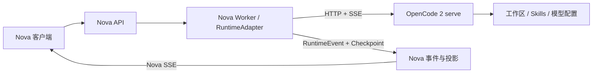

# Nova 接入 OpenCode 2 设计

**设计提案**。已用 Windows 上的 OpenCode 2.4.1 验证核心 API 行为。

## 1. 目标与首版范围

新建项目会话可以选择 OpenCode 作为执行后端。用户安装官方 CLI，在代码所在机器启动服务即可，执行路径无需安装 Nova Runner。OpenCode 负责模型循环、工作区工具和本地 Skills。Nova 负责项目绑定、会话、输入队列、审批界面、事件持久化和产品工作流。

首版支持普通项目会话，覆盖文本、多轮、工具卡片、单次审批、取消、断线恢复和显式选择本地 Skill。Spec、Goal、附件与产物继续走各自已支持的执行路径，逐项完成兼容验证后再接入。后端通过 `backendId` 选择，既有会话继续使用已绑定的后端。需要迁移时新建项目会话，原聊天历史仍可查看。

接入 **OpenCode 2** 的服务 API，首个验证版本为 `2.4.1`。Nova Worker 使用官方 `@opencode/client`，通过版本探测和兼容矩阵控制可用范围。`opencode run --format json` 可用于命令行排查。产品交互通过服务 API 获取会话状态、处理审批和取消。 [OpenCode 安装](https://opencode.ai/docs/) · [CLI 命令](https://opencode.ai/docs/cli/commands/) · [HTTP 客户端](https://opencode.ai/docs/build/client/)

## 2. 架构与用户安装



在代码所在机器安装并启动 OpenCode。试点也可以用 `npm install -g @opencode/cli@2.4.1` 固定到已验证版本。启动前使用 `OPENCODE_PASSWORD` 配置实例凭据，Nova 通过已授权的服务端连接读写该实例。 [服务配置与认证](https://opencode.ai/docs/cli/web/)

```sh
npm install -g @opencode/cli
opencode --version
opencode serve --hostname 127.0.0.1 --port 4096
```

| 部署方式 | Nova Worker 如何访问 |
| --- | --- |
| 单机试点 | Worker 与 OpenCode 同机，连接回环地址 |
| 代码在远程开发机 | 复用 Nova 的 SSH 连接归属与凭据管理，扩展受控端口转发，访问目标机器的回环地址 |
| Nova 在云端，代码在个人电脑 | 使用 Worker 可达的受控私网入口或隧道。个人电脑上的 `127.0.0.1` 只能被该机器直接访问，单独安装 CLI 无法建立云端连接 |

绑定记录保存连接归属、实例标识、目标目录和凭据引用。工作区由 OpenCode 所在机器解释，Nova 校验目录位于绑定允许的范围。按用户或受信工作区隔离实例和操作系统权限。服务凭据由 Worker 使用，实例级事件在适配器按会话和工作区过滤。首版沿用 OpenCode 自身的模型配置与凭据，Nova 的模型选择可在后续映射到可用的 provider/model。 [项目绑定 schema](../apps/nova-server/src/modules/projects/project-binding.schema.ts) · [SSH 连接服务](../apps/nova-server/src/modules/remotes/remote.service.ts) · [OpenCode 模型配置](https://opencode.ai/docs/providers/)

## 3. Nova 侧接入

| 代码入口 | 计划改动 |
| --- | --- |
| [RuntimeAdapter](../apps/nova-server/src/modules/runs/runtime-adapter.ts) 与 [ConversationExecutor](../apps/nova-server/src/modules/runs/conversation-executor.ts) | 注册 `opencode` 后端。适配器通过 `execute` 处理 `start` 和 `recover`，实现 `cancel` 与 `dispose`，接通现有 Worker、租约和事件提交流程。API 准入与 Worker 都从同一注册入口获取支持的后端 |
| [项目绑定](../apps/nova-server/src/modules/projects/project-binding.schema.ts) 与 [会话准入](../apps/nova-server/src/modules/conversations/conversation.service.ts) | 支持 OpenCode 实例与工作目录，提交时校验归属、可用性、输入类型和运行模式。连接重绑后为新执行建立新的运行上下文，存续 Run 使用先前绑定 |
| [Run 持久化](../apps/nova-server/src/modules/runs/run.repository.ts) 与 [产品事件契约](../packages/agent-ui-contracts/src/events.ts) | 从通用 `commit` 写入产品事件、消息和 checkpoint。上游字段限制在适配器内部。Run 终态由宿主结算，连续产品序号由 Nova 分配 |
| [有效能力](../apps/nova-server/src/modules/runs/run-dto.ts) 与 [产品 Skills](../apps/nova-server/src/modules/skills/index.ts) | 按后端、目标环境和模式暴露实际能力。Skill 目录查询绑定项目和环境，输入框提交确切选择。后端校验与界面开关采用相同的能力判断 |

每个 Nova 会话上下文对应一个 OpenCode `sessionID`，不同 Run 可在这个上游会话继续上下文。每个 Run 保存输入 ID、提交阶段、已处理的上游事件标识及待交互请求映射。Nova 已有 checkpoint 和上下文 epoch，可承载这部分关联。开始执行前保存身份和提交意图，接收事件后将上游进度、投影和输入消费一并提交。试点会话由 Nova 串行提交，避免同一个上游会话的 CLI 并行输入混入当前 Run。 [Run 准备与提交](../apps/nova-server/src/modules/runs/run.repository.ts)

运行模式需在 OpenCode 生效后才对用户开放。Plan 限制应由执行端权限落实。验证写入、Shell、插件和 MCP 的权限边界后再开放对应能力。首版仅提供单次允许及拒绝，Nova 的「本会话允许」和 OpenCode 的 `always` 需要验证授权范围一致后再映射。 [OpenCode 权限](https://opencode.ai/docs/permissions/) · [Nova 交互契约](../packages/agent-ui-contracts/src/interactions.ts)

## 4. 事件兼容性

| OpenCode 2 来源 | Nova 产品事件 | 转换规则 |
| --- | --- | --- |
| `session.text.*`、`session.reasoning.*` | `message.started`、`block.upsert`、`text.delta`、`text.reset`、`message.committed` | 用上游消息 ID 和块序号建立稳定标识。增量 offset 按 Nova 的字符串长度计算。结束事件或消息快照提供完整正文，修复缺片后提交消息 |
| `session.tool.called/success/failed` | `block.upsert`、`tool.changed` | 关联消息和 call ID，呈现部分输入、运行状态和结果。`tool.output` 需来源提供真实通道、增量和 offset，缺少这些字段时展示工具结果 |
| `permission.asked/replied` | `interaction.changed`、`run.changed` | 保存上游请求 ID 和 Nova 交互 revision。用户回复映射 `once` 或 `reject`，重连时通过待审批列表核实是否已处理 |
| `form.created/replied/cancelled` | `interaction.changed` | V2 表单与 Nova 单个问题存在结构差异。后续支持可表达的单问题表单，多字段表单按产品需要扩展 |
| `session.inbox.delivered` | `message.committed`、`input.consumed` | 用相同批次提交用户消息并确认输入消费。收到 `prompt` 响应表示已入上游队列，到投递时才确认消费 |
| `session.usage.updated` | `usage.changed` | 按上游统计口径投影用量，避免将会话累计值按事件重复相加。恢复时可用消息快照补齐已完成消息的用量 |
| `session.execution.succeeded/failed/interrupted` | `run.changed` | 按当前上游会话和已提交输入归属结算，失败原因归一为 Nova 公共错误。取消结合中断确认和状态对账 |
| Spec、Goal 和计划变更 | `spec.changed`、`goal.changed`、`plan.changed` | 产品状态由 Nova 业务流程生成。OpenCode 工具结果可作为业务输入，产品状态变更仍需通过已有校验与结算 |

映射以 OpenCode 2 API 为准。`session.inbox.delivered`、文本开始／增量／结束、工具调用和成功、单次审批、用量、运行成功与中断已在隔离环境观测。思考流、交互式表单、Steer、压缩和输出分通道仍需联调。 [OpenCode API](https://opencode.ai/docs/api) · [Nova 产品事件](../packages/agent-ui-contracts/src/events.ts) · [投影与游标约束](../packages/agent-ui-contracts/src/projection.ts)

### 4.1 断线、接管和取消

1. **提交。** 先订阅并确认连接，再提交 prompt。由 Nova 输入 ID 派生稳定的 OpenCode 消息 ID，并保存请求指纹。用同一 ID 重试前确认提交状态。实测重复 ID 只保留一条待投递输入，改变正文后再次提交同一 ID 也返回原输入，因此 Nova 要先校验指纹。
2. **接管。** Worker 恢复时使用已有 `sessionID` 和输入 ID 查上游 inbox、消息历史、活动状态和待审批。利用已确认的消息及终态修复投影。当前 `prepare` 根据 continuation 与 outcome 决定 `recover` 的时机，接入时须把上游已提交和待确认状态纳入该判断。Nova 的 fence 保护数据库提交，调用上游前仍须校验租约及会话归属。
3. **补读。** `/api/event` 只提供实时流。Windows 2.4.1 的实验性 session log 在试验的 `after` 和 `follow` 组合下只返回 `log.synced`，基于上游快照对账应进入首版验收。快照可以恢复最终文本、已完成的工具结果和消息终态，断线期间缺失的中间增量允许丢失。Nova 已落库的事件继续按产品游标重放。
4. **审批和取消。** 审批请求落库后可挂起 Run，恢复时用已记录的回复和上游待审批状态对账。取消调用 `interrupt`，由匹配的中断事件或确认后的状态收口。首版需覆盖 Worker 接管时 Run 已处于 `cancelling` 的路径。无法确认停止时进入 `cancelled_unconfirmed`，用户能看到状态并在对账完成后继续。

[OpenCode 事件订阅语义](https://opencode.ai/docs/build/client/#stream-events) · [OpenCode 会话 API](https://opencode.ai/docs/api) · [Nova Run 恢复](../apps/nova-server/src/modules/runs/run.repository.ts)

## 5. Skills 兼容性

OpenCode 2 原生发现 `.opencode/skills`、`.agents/skills`、`.claude/skills` 及相应全局目录，也可通过 `skills` 配置增加目录和 HTTP 清单。原生 ID 由目录或文件名决定，frontmatter `name` 用于展示。Nova 输入框继续承担显式选择，适配器在 prompt 上提交 `skills: [{ id }]`。与所选工作区一同查询目录，区分正在加载、无技能、连接离线和配置错误。 [OpenCode Skills](https://opencode.ai/docs/skills/) · [OpenCode API](https://opencode.ai/docs/api)

| Nova 中的来源 | 兼容程度与接法 |
| --- | --- |
| 工作区和用户已有的 OpenCode Skills | 首版通过 OpenCode 目录 API 读取，按项目与连接作用域展示。让 OpenCode 解析目录优先级和权限。实测 `.agents/skills` 与显式配置来源可发现，显式选择可加载正文 |
| Nova 设计中的 `.nova/skills` | 通过 OpenCode 的 `skills` 显式配置纳入，保留用户可编辑的文件来源。可为 OpenCode 项目直接使用 `.opencode/skills`，已有目录无需搬迁 |
| `nova.career-coach` | 纯 Markdown 正文可复用，使用 `career-coach` 作为 OpenCode ID。Nova 当前仅有 `builtin` 产品目录且限制为自有聊天 Agent。迁移时保留 Nova ID/version、显式选择和无工具策略，首版继续沿用现有聊天入口 |
| `nova.spec` | Markdown 可注册，业务行为依赖 `spec_read`、`spec_update` 与 Nova 的修订校验和结算。后续通过 OpenCode 插件或 MCP 提供这些工具，并将调用权限限制在当前 Run 绑定的 Spec 版本 |
| 平台发布的 Skills 和资源包 | Nova 保存发布版本和摘要，通过固定版本目录或清单交给 OpenCode。正文、脚本和模板按同一版本交付。脚本执行遵守项目和用户已授予的工具权限 |

当前 Skill 合同只描述可选的内置版本。OpenCode 本地 Skill 是执行环境里的目录项，接入时应区分其来源与 Nova 平台发布版本。若 Nova 在队列中保存了确定版本，提交前发现源内容或归属变化就返回冲突并要求重新选择，已提交的 Run 继续使用此前接受的快照。纯正文的显式选择可随 prompt 提交。含资源的 Skill 需要固定配套文件；对这类本地目录没有固定版本能力时，首版将其标为实时工作区资源，按实际能力展示。 [Nova Skill 契约](../packages/agent-ui-contracts/src/skills.ts) · [当前 Skill 准入](../apps/nova-server/src/modules/runs/agent-profile.ts) · [Spec Skill](../packages/tools/skills/spec/SKILL.md) · [Nova Skills 与产物设计](nova-skills.md)

## 6. 实施与验收

| 阶段 | 范围 | 放行条件 |
| --- | --- | --- |
| 1. 新项目试点 | 同机或受控连接、OpenCode 后端、文本多轮、工具卡片、单次审批、取消、Skill 选择 | 安装官方 CLI 的环境完成完整流程。错误的连接凭据、跨项目会话 ID 和越界目录均被拒绝。技能冷启动可恢复，选择后可观察实际加载 |
| 2. 新项目默认 | 断线对账、Worker 接管、超时、取消未知、版本探测与能力开关 | 模拟 prompt 已执行但响应丢失、断线漏掉终态、审批期间 Worker 重启和重复投递。验证无重复执行、最终消息一致、SSE 游标连续。各受支持平台通过相同验收 |
| 3. 产品能力迁移 | Spec、Goal、附件、产物发布以及其余仍依赖 Runner 的入口 | 逐项验证产品状态、权限和失败恢复。新会话采用 OpenCode，存量依赖完成迁移或关闭后下线 Runner 注册和协议入口 |

运行期优先观测连接版本、Run 状态、事件流断开与恢复、对账耗时和取消未确认次数。日志用 Nova Run ID 与上游会话 ID 关联，过滤消息正文、技能内容、凭据和工作区敏感数据。

### 已验证与待验证

- **已验证**。Windows 临时目录安装 `@opencode/cli@2.4.1` 并启动 `opencode serve`。使用本地模拟模型验证 HTTP 认证、文本 SSE、输入交付和用量、运行成功与中断、工具读取和单次审批、重复消息 ID，以及 Skills 目录发现和显式加载。
- **实测差异**。服务冷启动时技能列表曾暂时为空。实验性 session log 在试验中未补出历史事件，消息列表能返回完整文本及结束状态。重复 ID 即使正文改变也返回原输入。
- **待验证**。Nova 适配器、数据库事务与前端 SSE 的端到端行为，跨平台及 SSH 部署，断线与 Worker 接管时的审批和取消，Spec、Goal、附件与产物的兼容性。
