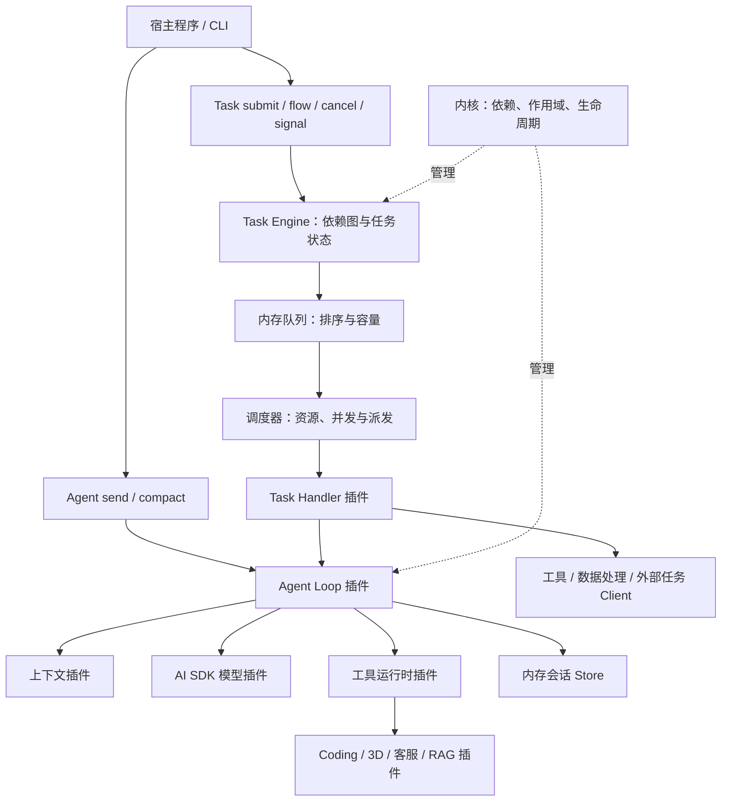
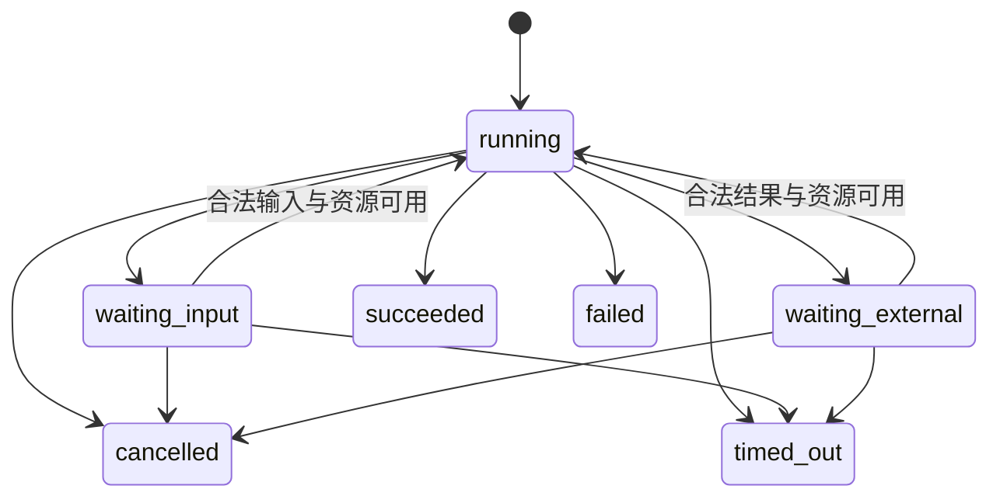
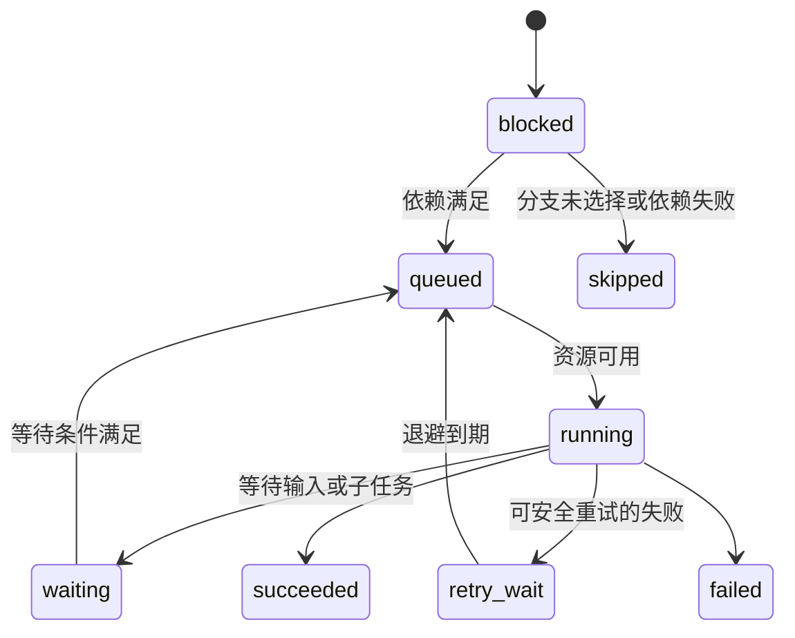

# 自研插件化 Agent 框架实现方案

> 设计日期：2026-09-13。目标包：`@nnova/harness`。本文定义的进程内核心框架已实现并通过受控集成验证：插件生命周期、Agent Loop、Task/Flow、等待恢复、AI SDK Adapter、压缩、Telemetry、动态 Schema、MCP/Skills 扩展和 Coding 场景均已接通。测试入口与覆盖范围见 [测试说明](./TESTING.md)。具体业务后端仍通过宿主插件和 client 注入。
>
> 核心决策：用 TypeScript 自研进程内插件框架，保留 Agent Loop、任务队列、异步执行、并发控制和复杂 Task 编排；首个模型适配器使用 Vercel AI SDK。框架不依赖 DeepSeek Harness 或其 Cordis 分支。
>
> 当前范围：可嵌入 Node.js 应用的 SDK。删除服务端 API、独立服务进程、数据库接入和部署方案；队列与 Task Engine 是框架内能力，当前采用内存实现。

## 目录

1. [需求与当前基础](#1-需求与当前基础)
2. [架构选择与自研范围](#2-架构选择与自研范围)
3. [最小内核与插件边界](#3-最小内核与插件边界)
4. [插件协议与生命周期](#4-插件协议与生命周期)
5. [公共 API 与用法](#5-公共-api-与用法)
6. [运行循环与状态机](#6-运行循环与状态机)
7. [Vercel AI SDK 适配](#7-vercel-ai-sdk-适配)
8. [工具执行策略](#8-工具执行策略)
9. [消息上下文与记忆](#9-消息上下文与记忆)
10. [事件与内存状态](#10-事件与内存状态)
11. [队列并发与复杂任务编排](#11-队列并发与复杂任务编排)
12. [四类场景的扩展](#12-四类场景的扩展)
13. [文件模块划分](#13-文件模块划分)
14. [分阶段实现与验收](#14-分阶段实现与验收)
15. [测试与质量门禁](#15-测试与质量门禁)
16. [版本与迁移](#16-版本与迁移)
17. [设计决策记录](#17-设计决策记录)
18. [依据与参考资料](#18-依据与参考资料)

## 1. 需求与当前基础

### 1.1 交付目标

一个核心框架能够组装出：

| 产品           | 用户希望完成的事                     | 框架复用能力                           | 场景自己实现的能力                     |
| -------------- | ------------------------------------ | -------------------------------------- | -------------------------------------- |
| 通用业务 Agent | 多轮讨论、查询与受控业务操作         | 消息、Loop、模型路由、工具、取消、会话 | 业务 Prompt、领域 API、授权规则        |
| Coding Agent   | 阅读代码、修改、测试、提交可审查结果 | 同上，加并发 Task、产物、长任务        | 工作区、隔离执行器、文件/Git/测试工具  |
| 3D 生成 Agent  | 需求澄清、提交生成、选择与修改模型   | 同上，加任务队列、异步等待、多模态引用 | GPU Job 服务、资产版本、预览与质量评估 |
| AI 客服        | 知识问答、订单查询、退款申请、转人工 | 同上，加检索、业务审批、handoff        | 客服渠道、CRM、订单和人工工单服务      |
| RAG Agent      | 检索知识并生成可核验回答             | 上下文贡献、工具、来源引用、评测       | 文档摄取、ACL、切块、索引、召回与重排  |

“一切皆插件”落实为：**所有可替换的能力均通过显式插件契约安装；插件的生命周期、依赖检查和作用域规则由一个小内核保证。** 不把每个函数包装成插件，也不让可选插件决定是否执行基本隔离与资源释放规则。

### 1.2 已检查的本地事实

- 首次检查时目录只有包配置与 README；目前已完成 `src/contracts`、`src/kernel`、`src/plugins`、`tests/scenarios`、`tests/fixtures` 与 `examples` 的核心实现，构建、边界和测试入口均已接通。
- 当前包名为 `@nnova/harness`，采用 ESM，TypeScript 为 `nodenext`，Node 引擎声明为 `>=22.18.0`。
- 当前目录不是独立 Git 仓库；实施时需确定作为独立仓库还是迁入 Nova 的 workspace。本方案先按当前目录单包开发，不预设已存在 monorepo。
- 已阅读用户指定的 [SERVER_AGENT_ADOPTION.md](../../nova/packages/dsh-agent/docs/SERVER_AGENT_ADOPTION.md)，以及该包实际的 [README](../../nova/packages/dsh-agent/README.md)、`src/contracts.ts` 和 `src/index.ts`。
- 接入文档的 `./README.md` 链接在其 `docs/` 目录下不存在；本方案以包根 README 中的实际 API 为使用方式参考。
- 参考材料用于核对进程内 API 与业务工具用法；其中的服务端建设内容不纳入当前方案。

这些文档是需求与实现背景。其“必须使用 DSH”“不启用本地文件工具”等具体选型不作为本项目指令：本项目采用自研框架，Coding 场景可以通过独立插件启用受控文件与执行能力。

### 1.3 延续和调整的行为

| 参考用法/设计                                        | 新框架处理                                                 |
| ---------------------------------------------------- | ---------------------------------------------------------- |
| `kernel → createAgent → send/compact/cancel/dispose` | 延续操作顺序，保留业务调用的认知成本                       |
| 根内核持有模型配置与并发额度                         | 延续；模型实现、限流策略以插件提供                         |
| 会话持有历史、工具、取消与压缩状态                   | 延续隔离语义；具体能力由会话作用域插件提供                 |
| 相同会话不可并发 `send/compact`                      | 直接调用忙时拒绝；需要排队时显式使用 Task API              |
| 每轮固定模型配置                                     | 延续；配置更新影响后续轮次                                 |
| 业务数据由业务服务持有                               | 延续；Agent 轨迹不代替订单、代码仓库或 3D Job              |
| 工具 Schema 暴露 `idempotencyKey`                    | 调整：键由宿主生成并注入执行上下文，模型不能控制           |
| 仅字符串消息                                         | 扩展为结构化消息，`text` 保留为便捷输入                    |
| DSH Session Event                                    | 不沿用内部协议；定义自有版本化事件                         |
| 原接口只返回终态                                     | 基础调用保留终态；异步任务阶段增加同进程挂起与唤醒结果     |
| 复杂任务                                             | 新增有界内存队列、并发调度、依赖图、分支汇合、重试与子任务 |

## 2. 架构选择与自研范围

### 2.1 推荐组合

**最小插件内核 + 自研 Agent Loop + 进程内 Task Engine + 内存队列 + AI SDK 单步模型适配器 + 场景插件。**



普通对话可以直接 `agent.send()`；需要排队、后台并发或多个依赖步骤时，使用 `kernel.tasks`。二者复用同一个 Agent Loop 和会话互斥机制，不复制一套运行状态。

### 2.2 什么自己写，什么复用

| 部分                  | 选择                                        | 原因                                                    |
| --------------------- | ------------------------------------------- | ------------------------------------------------------- |
| 插件依赖与生命周期    | 自研小内核                                  | 显式依赖、作用域、可追踪注册、逆序释放                  |
| Agent 步骤推进        | 自研 `basic-loop` 插件                      | 控制单轮模型/工具交互、停止与取消                       |
| Task 编排             | 自研 `task-engine` 插件                     | 负责依赖图、分支、汇合、重试、取消和子任务              |
| 队列                  | `queue-memory` 插件                         | 有界容量、FIFO/优先级、延迟就绪，运行时无需额外基础设施 |
| 调度与并发            | Task Engine 内的 scheduler                  | 根据就绪状态与资源额度派发，不让普通 Promise 自行竞争   |
| 模型协议与基础流解析  | Vercel AI SDK 与所需 provider 包            | 避免重复维护各家请求协议                                |
| 模型路由与能力矩阵    | 自有模型插件                                | 固定每轮配置，隔离 SDK 类型                             |
| 输入 Schema           | Zod 定义静态工具；JSON Schema 接入动态工具  | 静态类型和运行时校验共享定义                            |
| JSON Schema 校验      | 动态工具需要时接入 Ajv                      | 统一严格校验与 Schema 方言限制                          |
| 会话和任务记录        | 分别由内存 Session Store 与 Task Store 管理 | 会话历史与任务调度状态各有一个 owner                    |
| 观测                  | 只读 observer；可选 OpenTelemetry 适配      | 观察运行信息，不参与控制流                              |
|                       |
| 文件、进程、GPU、检索 | 工具或 Task Handler 注入执行 client         | 保留扩展接口，不在核心实现各类产品基础设施              |

AI SDK 提供工具调用和可选多步生成；本方案仅使用单步模型调用，由自己的 Loop 推进工具交互。这是本项目的架构选择。[AI SDK 工具调用](https://ai-sdk.dev/docs/ai-sdk-core/tools-and-tool-calling)、[Agent 概览](https://ai-sdk.dev/docs/agents/overview)

### 2.3 自研边界

队列不是 `Promise.all` 的包装：它需要容量、优先级、等待、公平性和取消语义。Task Engine 也不是第二个 Agent Loop：它调度显式任务节点，节点中的 Agent 决策仍由唯一 Loop 完成。

| 方案                                 | 本项目判断                                           |
| ------------------------------------ | ---------------------------------------------------- |
| 全部手写模型协议                     | 首期维护面过大，优先使用 AI SDK                      |
| 直接把所有操作放进一个 ToolLoopAgent | 普通对话方便；本项目还需要明确的任务图与资源调度边界 |
| 自研通用分布式执行平台               | 当前范围过大；先实现单进程、可验证的异步 Task 能力   |
| 插件内核 + Loop + 内存 Task Engine   | 推荐；复杂任务现在就设计和实现，基础设施保持简单     |

当前不实现 HTTP 服务、数据库存储、跨进程恢复和部署管理；保留队列/Store 的替换接口，不为尚未实现的后端承诺持久性。插件市场、运行中热卸载和图形化 DAG 编辑器也不在当前范围。

## 3. 最小内核与插件边界

### 3.1 内核固定职责

1. 校验插件 ID、配置、协议版本、依赖和 capability 冲突。
2. 管理 kernel、session、run 作用域及资源释放。
3. 提供有类型的 capability 注册、解析和只读安装清单。
4. 强制同一 session 的操作互斥、作用域隔离与关闭状态。
5. 管理取消信号、活动操作与共享资源准入；排队策略交给 Task Engine。
6. 将公开 Agent/Task 操作交给所安装能力；缺少提供者则明确失败。

内核中不出现 Coding、3D、客服或 RAG 的领域分支，也不导入模型 SDK。队列算法、任务图、工具执行和摘要均通过插件实现。

### 3.2 作用域与任务归属

| 作用域  | 生命周期                               | 合适的状态                                  | 禁止放置的状态                                  |
| ------- | -------------------------------------- | ------------------------------------------- | ----------------------------------------------- |
| kernel  | 创建内核到 dispose                     | 插件图、模型目录、任务调度器、共享资源额度  | 随时被覆盖的全局 currentSession/currentIdentity |
| session | 创建会话到 dispose                     | 调用方身份、AgentDefinition、工具目录、历史 | 其他会话可变消息和令牌                          |
| run     | 一次 send/compact 或恢复后的活动执行段 | AbortController、模型快照、步骤状态、预算   | 生命周期结束后仍无人管理的异步工作              |

Task Engine 在 kernel 作用域拥有 TaskScope；它复用 scope 的取消与清理机制，不另建一套插件安装层级。TaskScope 管理 handler、子任务和等待注册；等待时释放执行配额，逻辑任务状态仍由 Task Store 持有。

同一进程中的挂起 run 仅保留可序列化的 continuation 数据；恢复时新建活动 run 作用域。进程退出后内存状态丢失，当前不支持跨重启续跑。

会话可使用 `(namespace, sessionId)` 作为隔离键，namespace 默认 `local`；身份与业务 client 由受信宿主提供，模型输入不能修改它们。当前不实现登录、租户管理或权限管理产品。

### 3.3 能力提供者和贡献者

| capability / 扩展点    | 个数                    | 首个插件                  | owner                                |
| ---------------------- | ----------------------- | ------------------------- | ------------------------------------ |
| `agent.executor`       | 每 session 一个         | `basic-loop`              | 模型/工具步骤推进                    |
| `model.router`         | 一个可见提供者          | `model-ai-sdk`            | 路由、模型能力、单步请求             |
| `session.store`        | 每 session 一个         | `session-memory`          | 会话消息、工具记录与原子内存提交     |
| `task.engine`          | 每 kernel 一个          | `task-engine`             | Task 状态、依赖图、派发和取消        |
| `task.queue`           | 每 kernel 一个          | `queue-memory`            | 就绪项排序、有界容量、延迟项索引     |
| `task.store`           | 每 kernel 一个          | `task-store-memory`       | Task/Flow 快照与事件记录             |
| `task.handler`         | 多个、kind/version 唯一 | Agent、工具、数据处理插件 | 执行一个任务节点，返回结果或等待指令 |
| `context.builder`      | 一个                    | `context-default`         | 最终模型输入与预算                   |
| `tool.runtime`         | 一个                    | `tool-runtime`            | 校验、策略、并发、执行与结果         |
| `context.contribution` | 多个、有序              | Prompt、Skills、RAG       | 提交片段，不能直接改历史             |
| `tool.definition`      | 多个、名字唯一          | 领域插件                  | 工具定义与执行函数                   |
| `policy.rule`          | 多个、拒绝优先          | allow-list、调用方策略    | 返回决策，由运行时执行               |
| `context.compactor`    | 零或一个                | `compaction-summary`      | 摘要候选                             |
| `event.observer`       | 多个                    | 日志、Trace               | 有界只读观测                         |

单例冲突启动失败，不采用最后注册覆盖。一个 Agent 的 Loop 只有一个 owner；Task Engine 可以调用它，但不能自己追加模型消息或执行隐藏的工具循环。

## 4. 插件协议与生命周期

### 4.1 插件描述草案

以下为目标协议片段；未展示的领域类型在第 13 节对应契约文件中定义。公共框架 API 以 `src/contracts` 和根入口导出为准，文中片段用于说明边界与语义。

```ts
type ScopeKind = "kernel" | "session" | "run";
type Cleanup = () => void | Promise<void>;

interface PluginManifest {
  id: string; // 例如 nnova.model.ai-sdk
  version: string; // 插件实现版本
  apiVersion: 1; // 本框架插件协议版本
  scope: ScopeKind;
  requires: readonly CapabilityRequirement[];
  optional?: readonly CapabilityRequirement[];
  provides: readonly CapabilityDeclaration[];
  contributes?: readonly ContributionDeclaration[];
  before?: readonly string[];
  after?: readonly string[];
}

interface PluginDefinition<Config> {
  manifest: PluginManifest;
  configSchema: ConfigSchema<Config>;
  setup(ctx: PluginContext, config: Config): void | Promise<void>;
}

interface PluginContext {
  readonly signal: AbortSignal;
  resolve<T>(key: CapabilityKey<T>): T;
  provide<T>(key: CapabilityKey<T>, value: T): void;
  contribute<T>(key: ContributionKey<T>, value: T): void;
  onDispose(cleanup: Cleanup): void;
}
```

`CapabilityKey<T>` 由契约模块导出，用稳定字符串 ID 加类型标记表达；运行时以 ID 与协议版本验证，避免多份依赖中的不同 Symbol 造成无法解析。插件消费者只可解析自己声明的依赖，不提供任意字符串 `getService()`。

普通业务插件通常只需 `definePlugin()` 和 `defineTool()`。外部插件依赖公共契约出口，不导入 `src/kernel/*` 或其他插件的内部实现。

### 4.2 安装算法

1. 将宿主选定的 preset 展开为显式插件数组；preset 只是组合数据，不是另一套运行时。
2. 校验配置和插件 API 版本；拒绝重复 ID、未知必需能力、冲突的单例和重名工具。
3. 校验生命周期依赖：run 可以依赖 session/kernel，session 可以依赖 kernel；长生命周期实例不能捕获短生命周期实例。
4. 将必需依赖与 `before/after` 转为有向图；发现循环给出完整路径；同级无依赖项按稳定 ID 排序。
5. 按顺序执行 `setup`；在获得资源后立即注册 `onDispose`，不能只依赖 setup 成功后的返回值清理。
6. 记录本插件创建的 capability、贡献、订阅、连接和清理函数；任何一步失败，逆序撤销所有已完成注册，包括失败插件已经获得的资源。
7. kernel 准备完成后冻结安装图；session 和 run 建立自己的局部注册表，完成装配后同样冻结。
8. 暴露 `inspectPlugins()`，输出清单、版本、作用域、依赖、配置摘要和 manifest hash；密钥字段必须删除。

第一版禁止运行中安装/卸载插件。变更插件清单通过创建新 kernel 完成；关闭旧 kernel 前等待或取消其任务。模型配置更新是受控的配置版本更新，不等同插件热替换。

### 4.3 清理和故障隔离

- `dispose()` 幂等：先拒绝新工作，再取消/等待子作用域，再逆序执行清理；多个调用复用同一关闭 Promise。
- 所有清理都尝试执行；一个清理失败不跳过后续清理。错误聚合为宿主可记录的安全错误码。
- 业务决策 hook 失败会阻止对应动作；Trace 等 observer 失败只记录观测异常。
- 不允许 observer 改 Prompt、工具 allow-list、运行状态或内部提交。
- 同进程插件均为受信代码；能力注册表不是恶意代码沙箱。第三方不可信插件使用独立进程/容器，经受控 RPC 接入。
- 无响应的 JavaScript 工具不能通过 `Promise.race` 真正停止；进程内未退出前不得释放互斥锁并允许新操作。若宽限期超时，标记该执行单元不可复用并通知宿主；隔离进程可被终止，同进程 JavaScript 不能假装已被强杀。

### 4.4 新增业务插件的最短路径

以库存查询为例，新增一个 `inventory-plugin.ts` 即可完成首个版本：

1. 声明 session 作用域的插件 manifest，声明贡献 `tool.definition`，业务 client 通过插件工厂参数显式注入。
2. 在 setup 中定义 `inventory_get` 工具，inputSchema 只接受商品 ID 和仓库 ID；declare effects 为 read。
3. 将工具通过 `ctx.contribute(toolDefinitions, tool)` 注册到当前会话目录；调用时从工具执行上下文取得受信身份和 signal，传给业务 client。
4. 在应用的 preset 中加入这个插件，并为目标 AgentDefinition 开放工具名；其他 Agent 不会自动获得它。
5. 增加一个“查询成功”和一个“仓库不属于当前租户”的代表性集成用例。

这个过程只增加业务插件及装配配置，不修改 kernel、Loop、模型 Adapter 或 Store。若业务 client 由宿主共享，插件不负责关闭它；若插件自己创建连接，则立即登记清理函数。`provides` 声明独占能力，`contributes` 声明有序集合贡献，二者都应纳入安装清单和冲突校验。

## 5. 公共 API 与用法

### 5.1 与现有调用习惯一致的入口

下面展示第一阶段完成后的预期用法。`modelConfig`、`identity` 和业务 client 由宿主提供；模型名、能力及网关地址必须由宿主配置验证。

```ts
import { createAgentKernel, defineTool } from "@nnova/harness";
import { basicLoopPlugin } from "@nnova/harness/plugins/basic-loop";
import { memorySessionPlugin } from "@nnova/harness/plugins/session-memory";
import { contextPlugin } from "@nnova/harness/plugins/context";
import { toolRuntimePlugin } from "@nnova/harness/plugins/tools";
import { summaryCompactionPlugin } from "@nnova/harness/plugins/compaction";
import { aiSdkModelPlugin } from "@nnova/harness/plugins/model-ai-sdk";
import { z } from "zod";

const quote = defineTool({
  name: "quote_total",
  description: "计算商品报价总额，金额以分为单位",
  inputSchema: z
    .object({
      quantity: z.number().int().positive(),
      unitPriceCents: z.number().int().nonnegative(),
    })
    .strict(),
  outputSchema: z.object({ totalCents: z.number().int().nonnegative() }),
  effects: "read",
  async execute({ quantity, unitPriceCents }) {
    return { totalCents: quantity * unitPriceCents };
  },
});

const kernel = await createAgentKernel({
  maxConcurrentRuns: 4,
  plugins: [
    memorySessionPlugin(),
    aiSdkModelPlugin({
      models: [
        {
          id: "business-fast",
          protocol: modelConfig.protocol,
          baseURL: modelConfig.baseURL,
          apiKey: modelConfig.apiKey,
          model: modelConfig.model,
          contextWindow: modelConfig.contextWindow,
          maxOutputTokens: 4096,
        },
      ],
      defaultModel: "business-fast",
    }),
    contextPlugin(),
    toolRuntimePlugin({ maxParallelReads: 4, maxParallelWrites: 1 }),
    summaryCompactionPlugin({ thresholdRatio: 0.8 }),
    basicLoopPlugin({ maxSteps: 12, maxToolCalls: 24 }),
  ],
});

try {
  const agent = await kernel.createAgent({
    sessionId: "conversation-123",
    identity, // 受信宿主上下文，模型不能修改
    systemPrompt: "你是采购助手，金额计算必须调用报价工具。",
    tools: [quote],
    allowedTools: ["quote_total"],
  });
  try {
    await agent.send({ text: "项目 BLUE-57：3 件商品，每件 1900 分。" });
    const result = await agent.send({
      text: "项目代号和总金额是多少？",
      timeoutMs: 60_000,
      onEvent(event) {
        if (event.type === "assistant.delta") process.stdout.write(event.text);
      },
    });
    console.log(result.status, result.text, result.usage);
    await agent.compact({ timeoutMs: 30_000 });
  } finally {
    await agent.dispose();
  }
} finally {
  await kernel.dispose();
}
```

装配器根据依赖排序，数组位置不承担隐式依赖语义。后续可以提供 `createBusinessPreset()` 简化样板，但 preset 必须可展开、可检查，并明确替换默认插件，不能重复安装 Store 或 executor。

### 5.2 API 语义

| API                                              | 精确定义                                                                           |
| ------------------------------------------------ | ---------------------------------------------------------------------------------- |
| `createAgentKernel(config)`                      | 编译插件图、初始化根资源；依赖错误启动失败                                         |
| `kernel.createAgent(options)`                    | 创建唯一的 `(namespace, sessionId)` 活动句柄并校验必要能力                         |
| `agent.send({ text / message, ... })`            | 两种输入互斥；接受新消息并执行本轮的模型/工具循环                                  |
| `agent.compact(options)`                         | 维护操作；和 send 互斥；无 compactor 时返回 skipped，原因 `CAPABILITY_UNAVAILABLE` |
| `agent.cancel()`                                 | 幂等地请求取消当前操作；完成与清理通过等待原操作 Promise 确认                      |
| `agent.dispose()`                                | 取消关联任务并等待收敛后释放句柄与会话内存                                         |
| `kernel.updateModel(config)`                     | 整体更新配置版本；当前活动轮次使用已有快照                                         |
| `kernel.dispose()`                               | 关闭全部活动会话和根插件资源                                                       |
| `agent.resume({ runId, continuationId, input })` | 异步任务阶段实现；在同进程恢复合法等待点，不追加重复用户消息                       |
| `kernel.tasks.submit / submitFlow`               | 显式排队并返回 Task/Flow Handle，详见第 11 节                                      |
| `kernel.tasks.signal / cancel`                   | 唤醒或取消受本内核管理的任务                                                       |
| `kernel.inspectPlugins()`                        | 返回脱敏的装配结果，用于启动验证与排错                                             |

重复创建活动会话返回 `DUPLICATE_SESSION`；已释放会话可以用相同 ID 创建全新历史。创建新句柄不恢复之前已经释放的内存状态。

`send` 接受成功前的错误抛出带 code 的异常：`INVALID_CONFIG`、`INVALID_INPUT`、`UNKNOWN_MODEL`、`BUSY`、`CAPACITY`、`CLOSED`。接受并创建 run 之后的失败通过 `RunResult` 表达；调用方无需猜测有没有创建运行记录。

### 5.3 结果与 ID

```ts
type TerminalStatus = "succeeded" | "failed" | "cancelled" | "timed_out";

type RunResult =
  | {
      kind: "completed";
      sessionId: string;
      runId: string;
      status: TerminalStatus;
      text: string; // 最终提交的回答；不是所有中间 delta 的拼接
      toolCalls: readonly ToolCallResult[];
      usage: UsageSummary; // 未知 token 数用 null，不能当成 0
      error?: SafeError;
    }
  | {
      kind: "suspended"; // 异步任务阶段启用，仅支持同进程
      sessionId: string;
      runId: string;
      status: "waiting_input" | "waiting_external";
      continuationId: string;
      text: string;
    };
```

- `sessionId`：跨多轮对话；与 namespace 联合形成会话隔离键。
- `runId`：一次用户输入产生的逻辑运行；同进程挂起和恢复保持不变。
- `taskId / flowId`：排队任务与任务图；并非每个 Task 都调用模型。
- `attemptId`：任务或具体执行的尝试标识，重试时变化。
- `stepId`：本轮模型决策步骤，在内存提交后固定。
- `toolCallId`：模型生成的调用标识；作用域至少包含 run 和 step。
- `executionId`：框架在调用前分配并记入内存；同一执行的重试保持不变。
- `turnId`：迁移兼容层可以暂时作为 `runId` 别名，不在新协议里维护第二套轮次事实。

`onEvent` 定位为同步只读通知。新框架 observer 抛错不取消业务运行，而是隔离并报告；这与旧包的 `EVENT_CALLBACK_FAILED` 行为不同，迁移时需要明确告知调用方。需要取消应使用 `signal` 或 `cancel()`。

## 6. 运行循环与状态机

### 6.1 唯一 owner

| 状态/行为                        | 唯一 owner         |
| -------------------------------- | ------------------ |
| Agent 句柄、会话互斥、关闭       | kernel scope       |
| 模型/工具循环、停止或挂起        | Agent executor     |
| 单次模型流与协议映射             | 模型 Adapter       |
| 工具校验、确认、并发与结果       | tool-runtime       |
| 会话消息、摘要、工具执行记录     | Session Store      |
| Task/Flow 状态、重试、派发、取消 | Task Engine        |
| 就绪任务排序、延迟索引           | Task Queue         |
| 业务对象的最终状态               | 宿主注入的业务能力 |

Agent Loop 处理“这轮如何回答和调用工具”；Task Engine 处理“哪些任务可运行、何时运行、使用多少资源”。任务节点结果不是另一份对话历史。

### 6.2 一轮循环的实施步骤

1. 通过统一准入入口获取会话互斥和活动额度；直接 send 不排队，Task 调度只在有资源时调用内部启动入口。
2. 固定模型配置、工具目录、Prompt 版本、身份与预算，创建 run 并接受消息。
3. 检查取消、截止时间、剩余步数和 token/成本预算。
4. context builder 组装输入；必要时在完整轮次边界压缩。
5. 模型 Adapter 发起一次请求，只返回文本、完整调用和结果元数据。
6. 展示 delta，成功收齐本步骤后校验并提交完整 assistant 消息。
7. 没有调用且回答完整则结束；截断或限额耗尽要明确返回失败原因。
8. 工具调用统一进入 tool-runtime；它检查 Schema、allow-list 和宿主策略。
9. 需要用户输入或长任务结果时，保存内存 continuation 和未决调用；释放活动执行槽，返回 suspended。
10. 工具完成后提交配对结果；还需继续时回到步骤 3。
11. 所有退出路径统一关闭流并让活动执行收敛；成功提交后再通知 observer。

参数 delta 或半截 JSON 不能触发工具。第一版在整个模型步骤成功提交后才执行其中的工具，避免请求重试产生不可追踪副作用。

### 6.3 Agent Run 状态



Run 不保存 queued 状态；排队属于 Task。等待中的 run 仍独占该会话的逻辑对话位置，但不占模型请求额度或 Task 执行槽。其他同会话消息留在队列，合法 resume 优先于后续新消息。直接 send 遇到等待会话返回 BUSY。

Task Handler 通过框架提供的 Agent 适配入口处理 suspended 结果，不能把它错误地当作任务已完成。当前挂起只在本进程有效。

### 6.4 并发、预算和取消

- `send/compact/resume` 复用同一会话互斥；Task 提交与直接调用都遵守同一资源计数，不各自建立可绕过的配额。
- `maxConcurrentRuns` 限制活动 Agent 段；Task Handler 槽、模型请求数、工具并发和资源组分别配置，见第 11 节。
- 默认读工具最多并行 4 个、写工具串行；跨任务操作相同文件/资源还要经过共享资源键。
- 工具可乱序完成，但提交给下一次模型请求的结果按原调用顺序配对。
- 运行 deadline、模型/工具超时、步数和调用次数都有限额；任务总 deadline 包含排队、退避和等待时间。
- 取消传播到队列项、Task Handler、run、模型、工具和摘要；已完成的写操作不会自动撤销。
- 没有返回或忽略 signal 的函数仍占据实际执行资源；超时结果不能让它与下一次写操作重叠。
- 摘要、重试和子任务参与共享总预算；缺失 usage 保持未知，不能当 0。

## 7. Vercel AI SDK 适配

### 7.1 稳定模型契约

```ts
interface ModelAdapter {
  readonly id: string;
  capabilities(route: ModelRouteSnapshot): ModelCapabilities;
  stream(request: ModelStepRequest): AsyncIterable<ModelChunk>;
}

type ModelChunk =
  | { type: "text.delta"; partId: string; text: string }
  | { type: "tool.call"; callId: string; name: string; input: unknown }
  | { type: "message.completed"; message: AssistantMessage }
  | { type: "usage"; usage: ModelUsage }
  | { type: "finished"; reason: FinishReason }
  | { type: "error"; error: SafeModelError };
```

`ModelStepRequest` 包含完整消息 parts、tool schema、模型快照、AbortSignal、输出预算和经过允许的 provider options。业务包不持有 AI SDK 的 `ModelMessage`、`LanguageModel` 或完整 `StreamTextResult`。

模型接口支持文本、图片/文件引用与结构化工具消息；嵌入向量另设 `EmbeddingModel` 能力，实际 3D 模型生成通过领域 Job，不强塞进文本 `ModelAdapter`。

### 7.2 单步适配约束

在 `plugins/model-ai-sdk/adapter.ts` 内部：

1. 根据 `protocol` 选择对应 provider 工厂；只导入实际采用的 provider 包。
2. 将自有消息转换为该 SDK 版本接受的消息格式，校验输入 modality 和工具调用能力。
3. 调用 `streamText`，只提供工具名称、描述与 Schema，**不传工具 `execute`**。
4. 不使用 `ToolLoopAgent`，不配置让 SDK 持续执行多步的停止条件，也不使用 SDK 自动修复调用并重试执行的功能。
5. 设置 `maxRetries: 0`；所固定版本如果还有流自动重试选项，同样显式关闭。当前在线参考页可见 `streamRetries`，实施时按锁定版本核验。
6. 转换 `fullStream` 等单个消费通道；不要为了分别读文本与调用而启动两个模型请求。统一处理流内 error、迭代异常及取消。
7. 只将完成的工具调用交给框架。第一阶段禁止 provider 内建的远程执行工具，避免它绕过本地工具执行边界。
8. 严格映射 finish reason、可用 usage、文件引用和 provider continuation metadata；无法表达的必要能力返回明确不兼容错误。

官方参考列出了 `streamText` 的执行配置、取消、流事件等接口；具体参数以实施时固定的包版本为准。[streamText 参考](https://ai-sdk.dev/docs/reference/ai-sdk-core/stream-text)

### 7.3 不复制协议，但必须验证语义

| 检查面         | 要求                                                                                   |
| -------------- | -------------------------------------------------------------------------------------- |
| 多轮工具配对   | assistant tool call 与 tool result ID 完整对应，不能压缩拆散                           |
| 混合输出       | 一次 assistant 消息可以同时含文本、文件和多个工具调用                                  |
| 供应商延续字段 | 必要的签名、reasoning/continuation token 用受限 opaque metadata 保存，不能在转换时丢失 |
| 推理内容       | 不强制要求供应商暴露内部推理；默认不向前端或普通日志输出原始 reasoning                 |
| usage          | 缓存、推理 token 和未知值单独表达，不把缺失当 0，不重复累计 step 与 total              |
| 模型切换       | 下一轮重新验证历史可转换性与输入预算；不兼容时摘要转换或拒绝，不能静默抹掉协议必需信息 |
| contextWindow  | 来自经验证配置，不由名称猜测；要预留输出与协议开销                                     |
| API Key        | 注入当前模型 client，不修改 `process.env`；事件与历史只保存 route/config ID            |
| endpoint       | 宿主允许的协议与域名；不能由模型指定任意 baseURL                                       |
| 缓存           | key 包含租户/权限范围、模型配置和 Prompt/工具版本；带用户数据默认不跨租户共享          |

统一的 `reasoning: low/medium/high` 只能表示意图；不同 provider 的实际映射由 Adapter 明确实现。不要复制旧适配器中某一种 `thinking` 字段到所有模型。

### 7.4 重试边界

模型请求只由模型插件重试，工具只由工具运行时重试；Task Engine 只处理任务边界的安全重试，不能在模型和工具重试之外再重跑整轮。所有层都受总 deadline 与共享预算限制。

模型在未提交 assistant 步骤、未执行工具时，可以按安全错误类别重试。已经向 UI 发过部分 delta 时，必须发 `assistant.reset` 或建立新 `messageAttemptId`，避免重试文本拼接重复。同进程工具步骤已提交后，续跑使用已保存的调用与执行结果，不重新让模型生成同一组写操作。

## 8. 工具执行策略

### 8.1 统一工具定义

`defineTool()` 支持 `name`、描述、输入/输出 Schema、效果类别、超时、重试声明、资源冲突键和 execute。静态工具优先从 Schema 推导参数类型，不再要求调用者同时维护手写泛型和 JSON Schema。

| 字段                  | 语义                                                            |
| --------------------- | --------------------------------------------------------------- |
| `effects`             | `read` / `write` / `external-job`；只声明类别，不能自行授予权限 |
| `inputSchema`         | 模型可填写的业务参数；不包含 tenantId、userId、令牌、回调 URL   |
| `outputSchema`        | 校验工具结果；超大结果转 ArtifactRef                            |
| `retry`               | 只读或确认具备下游幂等保障的操作才自动重试                      |
| `resourceKey`         | 标识需要串行处理的资源；涉及跨进程一致性仍依赖业务服务版本控制  |
| `execute(input, ctx)` | 接收受信身份、signal、runId、executionId、幂等键与受限 client   |

输入默认严格校验，不隐式转换类型、填默认值或接受未知权限字段。MCP/旧工具的动态 JSON Schema 用同一个运行时校验入口；禁止不受控外部 `$ref` 网络解析，并限制嵌套、长度和 schema 大小。

### 8.2 不能绕过的执行顺序

```text
模型完整调用
  → 工具存在且属于本 session 快照
  → 输入 Schema 校验
  → allow-list 与当前资源授权
  → 业务规则/额度检查
  → 如有要求：创建绑定具体参数的审批
  → 保存 executionId、参数摘要和幂等执行意图
  → 下游执行
  → 输出校验/脱敏/产物外置
  → 保存结果与匹配的 tool result
```

模型可见目录过滤与执行时授权两次检查都需要。MCP、子 Agent、HTTP 工具等都通过 `tool-runtime`，不能在 Adapter 内隐藏自动执行。策略组合采用拒绝优先，审批只能满足已允许动作的附加条件，不能覆盖资源越权。

### 8.3 幂等与未知结果

框架在调用前分配 executionId 并记入内存，由受信宿主生成 idempotencyKey，例如编码 (namespace, runId, executionId)。同一执行重试时保持不变；当前内存记录不提供跨进程去重保证。

还需明确区分：

- 同一执行重试：复用 executionId，不能多次扣费或重复创建 Job。
- 模型后续再次提出类似动作：这是新的 executionId；是否属于业务重复，由订单请求号、草稿版本等业务唯一约束判断，不能只按 Prompt 文本去重。
- 请求超时但下游可能已经成功：执行状态为 `unknown`；查询下游操作状态或使用同一幂等键安全重试。
- 下游既不支持查询也不保证幂等：保持可见的未决状态并人工核对，不宣称 exactly-once，不自动重复不可逆写操作。
- 更新使用业务 client 支持的 `expectedVersion`；返回冲突后让 Agent 重新读取与决策，不直接覆盖最新业务状态。
- 写工具返回后输出 Schema 校验失败，仍可能已经完成业务副作用；保存受限的诊断引用并核对结果，不能当作“未执行”直接重试。

### 8.4 宿主确认与异步输入

工具可以由宿主策略要求确认：工具运行时生成绑定 executionId、toolVersion、参数 hash 与有效期的等待点，交给宿主展示或处理。这里保留框架接口，不实现审批管理系统。

普通只读工具默认直接执行；确认通过后执行原调用，拒绝后补入相同 toolCallId 的结构化拒绝结果。参数发生变化必须重新确认，确认结果不能覆盖原本不允许的资源权限。

等待使用第 11 节的内存 continuation 与 signal 机制，不占活动执行槽。一个模型步骤包含多个调用时，保存每项完成结果和未决调用；继续时只处理未决项，不能重复执行已完成的同批次工具。

## 9. 消息上下文与记忆

### 9.1 四种不同的数据

| 数据                  | owner 与用途                                                |
| --------------------- | ----------------------------------------------------------- |
| 原始会话消息/执行记录 | Store；当前进程内的历史、查询与投影重建                     |
| 本步骤模型输入        | context builder；预算内的有序投影，不直接覆盖原始记录       |
| 长期记忆              | 可选 memory 插件；明确租户/用户范围、来源、有效期和删除策略 |
| 检索知识/业务事实     | 知识或业务服务；Agent 获得可验证引用，不能以摘要代替事实源  |

消息使用 parts：text、image/file reference、tool-call、tool-result、source reference，以及必要的受限 provider metadata。消息与 Task 状态必须可序列化，不能保存活对象、函数、AbortSignal、临时访问凭据或明文密钥。

### 9.2 上下文组装

推荐固定顺序：系统与宿主策略 → 场景 Prompt → 会话摘要 → 保留的完整近期轮次 → 当前输入及其附件/检索片段。资料来源由结构化 provenance 标明。

文件、网页、RAG 片段和工具输出按外部数据处理；其中“忽略系统要求”“调用任意工具”等文本不升级为策略。上下文插件可以提出 Prompt 片段，但不能修改宿主授权、删除待配对调用或修改身份。

Skills 可以是带元数据的 Markdown 资源：声明适用任务、资源版本和所需能力；按需加载。Skill 中的命令文本并不自动获得 Shell 权限；实际执行仍经过工具运行时。

### 9.3 压缩算法

1. 估算 `输入消息 + 系统 Prompt + 工具 Schema + 多模态开销`，预留 `maxOutputTokens` 和安全余量。
2. 超阈值时选择旧的完整轮次；保留系统约束、当前用户请求、未决审批/工具调用及必要 provider 延续字段。
3. 生成结构化摘要：目标、已确认事实、决策、待办、关键引用、不能丢失的约束；注明这是有损压缩。
4. 校验摘要输出与 token 预算，在期望 revision 下原子提交摘要投影。
5. 摘要失败、被取消或版本冲突时不替换当前投影；原始历史保留。
6. 即使摘要也无法容纳输入时返回 `CONTEXT_LIMIT`；不无限压缩重试，也不伪造更大的 contextWindow。

摘要属于一次有成本的模型操作，参与本轮预算。手动 compact 使用最近一次完成轮次的模型配置 ID，解析最新配置并固定本次快照；没有历史则使用 session 默认模型。自动 compact 使用当前 run 的模型快照。

## 10. 事件与内存状态

### 10.1 决策调用与观测分离

| 通道           | 特性                           | 示例                                                        |
| -------------- | ------------------------------ | ----------------------------------------------------------- |
| 内部决策调用   | await、错误影响业务            | buildContext、authorizeTool、commit、dispatch               |
| 已提交状态事件 | 同进程有序、可在保留窗口内重读 | run.started、message.committed、task.waiting、task.finished |
| 实时展示增量   | 有界、可合并/丢弃，不是事实源  | assistant.delta、工具进度                                   |

事件总线不承载隐式任务调度。Task Engine 直接提交状态并唤醒调度器；observer 只观察，不能追加任务状态或修改授权结果。

事件 envelope 包含 schemaVersion、eventId、namespace、sessionId/runId 或 taskId/flowId、seq、时间和脱敏 payload。run 与 flow 可以各有事件序列，通过 ID 关联；不要求两个独立 Store 维护一个全局顺序。

assistant delta 携带 messageId、messageAttemptId 和局部 offset。最终 message.committed 给出完整结果或引用，调用方用它校准展示，不能把最终文本再追加一遍。

### 10.2 内存 Store 与一致性

Session Store 维护消息、摘要投影、run、工具执行记录和同进程 continuation。Task Store 维护任务、依赖结果、尝试、deadline、等待注册和任务图状态。二者不重复保存对方拥有的事实。

- Session Store 采用 `commit(batch, expectedRevision)`，在一次同步临界区提交关联消息、运行状态和工具结果，避免只更新了一半。
- Task Engine 使用单一状态更新入口，验证合法转换并更新 Task Store，然后触发后续派发。
- Queue 保存 Task ID 与排序索引，不复制任务结果或自行推进状态；派发前重新检查 Task 状态。
- Agent Task 首次接受时分配并绑定 runId；任务重试先查询该 run 的内存状态，不能重复追加用户输入。
- Store/Queue 更新只在同进程受控临界区完成；不要持有锁跨网络请求或用户函数 await。
- 状态事件在提交后产生；observer 抛错不撤销已经提交的业务事实。

这提供进程存活期间的一致性，不提供进程崩溃后的恢复保证。当前不设计数据库表、日志落盘协议或分布式锁。

### 10.3 资源上限与清理

会话、Task/Flow、结果引用、事件缓冲和等待注册分别设置数量/大小/保留上限。只限制 running 数量而不限制 queued/waiting 数量仍会耗尽内存。

已完成任务可按 TTL/LRU 回收，但仍被下游、父任务或 Handle 结果读取所需的数据不能提前删除。去重记录保留期不能短于关联任务可见期；过期后再次提交相同 key 可以创建新任务，必须明确这一语义。

大文件、模型与日志用宿主提供的 ArtifactRef 表达。内存 Store 只保存引用和摘要，不缓存全部二进制；引用读取由宿主能力处理。

`kernel.dispose()` 默认停止接受新任务、取消 queued/waiting 和活动任务、等待真实执行收敛，再释放队列计时器、订阅和内存。需要等待现有任务完成时，调用方先显式 `tasks.drain({ timeoutMs })`；依赖外部输入的等待任务也受该超时约束。

### 10.4 同进程重读与测试回放

状态查询读取 Store 快照；保留窗口内的事件可用于重新订阅与排错，不承诺无限历史。测试回放使用脱敏模型/工具 fixture，不访问真实模型、不重复真实副作用。

自动重试只继续当前进程已知且可安全重试的执行。关闭或重启后，内存队列、任务去重、等待结果与会话历史全部丢失。未来若需要持久化，应另行定义其恢复契约，不把“可替换 Store”描述成已经支持恢复。

## 11. 队列并发与复杂任务编排

### 11.1 Task、Flow、Queue、Scheduler 的职责

| 概念         | 职责                                          | 不拥有的行为                      |
| ------------ | --------------------------------------------- | --------------------------------- |
| Task         | 一个有输入、状态、deadline 和结果的可调度单元 | 不等于一次 LLM 请求               |
| Task Handler | 执行已注册 kind/version 的任务                | 不自行更新队列与 Flow 状态        |
| Flow         | 一组依赖任务及其分支、汇合、失败策略          | 不维护另一份会话消息              |
| Queue        | 对可调度 ID 排序，维护延迟项和容量            | 不执行模型/工具，也不控制重试次数 |
| Scheduler    | 选择可运行任务，原子获取资源并派发            | 不解析业务 Prompt                 |
| Task Store   | 保存运行状态、输入/结果引用与等待位置         | 不隐式发起异步函数                |

队列和复杂 Task 都属于当前框架的正式实现范围。默认使用进程内数据结构与受管理 Promise；无需启动网络监听或额外服务。

### 11.2 提交与 Handle 草案

```ts
interface TaskSpec {
  kind: string; // 已注册 handler，例如 agent.send
  version: number;
  input: JsonValue;
  idempotencyKey?: string; // 宿主生成；作用域是 namespace
  priority?: number;
  notBefore?: number; // 最早开始时间
  deadlineAt: number; // 包括排队、重试和等待
  maxAttempts?: number; // 默认 1；handler 声明可安全重试才允许增加
  concurrencyKey?: string; // 例如 workspace:123
  resources?: Readonly<Record<string, number>>;
}

interface TaskHandle {
  readonly taskId: string;
  result(): Promise<TaskResult>; // 以结构化终态 resolve
  snapshot(): TaskSnapshot;
  events(): AsyncIterable<TaskEvent>;
  cancel(reason?: string): void; // 取消完成需等待 result/实际清理
}

interface TaskEngine {
  submit(spec: TaskSpec): TaskHandle;
  submitFlow(spec: FlowSpec): FlowHandle;
  signal(input: TaskSignal): SignalReceipt;
  cancel(taskId: string, reason?: string): void;
  drain(options: { timeoutMs: number }): Promise<DrainResult>;
}
```

`submit` 校验并接受任务后立即返回 Handle，不等待执行；非法输入、未知 kind、容量已满或关闭则同步拒绝，不先接受再悄悄丢弃。输入使用受控 handler ID 和可序列化数据，函数只在插件安装时注册。

示例：

```ts
const task = kernel.tasks.submit({
  kind: "agent.send",
  version: 1,
  input: { sessionId: "conversation-123", text: "分析当前代码结构" },
  idempotencyKey: "analysis-request-001",
  deadlineAt: Date.now() + 120_000,
});
const result = await task.result();
```

handler 根据当前 namespace 解析受信会话；模型不能通过 task.input 伪造身份或选择任意插件。Task input 中的 sessionId 是引用，不创建第二个会话对象。

建议独立插件装配：

```ts
plugins: [
  // 基础 Agent 插件省略；完整列表见第 5 节
  memoryTaskStorePlugin({ maxTasks: 5_000, completedTtlMs: 600_000 }),
  memoryTaskQueuePlugin({ maxPending: 1_000 }),
  taskEnginePlugin({
    maxConcurrentTasks: 8,
    maxConcurrentPerKey: 1,
    maxNodesPerFlow: 100,
    maxDepth: 4,
    retry: { baseDelayMs: 500, maxDelayMs: 10_000, jitter: true },
  }),
  agentTaskPlugin(),
];
```

这些数字是起始配置示例，需按实际工作负载校准。当前队列/调度器 API 已由内存实现提供；未安装 task-engine 时仍可使用普通 Agent API，读取 tasks 则返回 CAPABILITY_UNAVAILABLE。

### 11.3 内存队列算法

1. Task Engine 验证任务/图与容量；分配 ID 并记录初始状态，只有已满足依赖的节点才能进入就绪队列。
2. 默认同优先级 FIFO，以接受序号作为稳定次序；显式优先级用优先队列，并通过等待时间提升优先级或配额轮转避免长期饥饿。
3. `notBefore` 与退避重试使用延迟堆；只为最近到期项维护计时器，不为每个任务启动一个长期 timer。
4. 调度器在新任务、额度释放、依赖完成、等待唤醒或延迟到期时被触发；同一时刻只有一个 drain 循环更新调度状态。
5. 同会话消息保持提交顺序；其他资源被占用的任务留在候选集中，继续选择其他可运行 key，避免队头阻塞。
6. 接受容量同时考虑 queued、blocked、retry_wait、waiting 和尚未结束的图节点；整张图原子接受或拒绝，动态扩图也先预留节点额度。
7. 首期满额直接返回 QUEUE_FULL；调用方可显式退避重交，不创建无界的“等待入队 Promise 队列”。

同 namespace 的 idempotencyKey 在保留窗口内映射到同一 Task Handle；相同 key 配合不同输入 hash 返回冲突，不能返回不相干任务。这个保证仅在内存有效期内成立。

### 11.4 并发资源与避免死锁

| 配额             | 计数对象                   | 释放时机                           |
| ---------------- | -------------------------- | ---------------------------------- |
| Task 执行槽      | 正在运行的 handler 段      | 段结束或安全进入 waiting           |
| Agent 活动槽     | 正在推进的 run 段          | 完成、失败或合法挂起               |
| 模型请求槽       | 实际发出的模型请求         | 请求/流真实结束                    |
| 工具资源组       | 实际执行的读/写/命令       | executor 真实结束                  |
| concurrencyKey   | 有冲突的文件/会话/业务对象 | 对应操作结束，或等待期间可安全让出 |
| Task/Flow 总预算 | 全部节点与尝试消耗         | 整体结束，不因重试/子任务重置      |

所有直接调用与排队调用经过同一准入机制。Agent Task Handler 使用已经获得准入凭证的内部入口，不能再调用会重复申请同一个槽的公开 send。多个必需资源按原子预留方式取得；不允许拿着资源 A 无限等待 B。

父任务等待子任务时返回 waiting 指令，由调度器释放它的 handler 槽；不能在持有唯一槽时 `await child.result()`。父 Agent 持有会话逻辑位置时，不允许创建需要同一会话的子 Agent；使用独立会话或拒绝该依赖。

“释放执行槽”不等于释放尚未结束的真实外部操作配额。例如 GPU Job 已提交后可以释放 JavaScript handler 槽，但表示 GPU 活动任务数的配额必须直到确认 Job 结束才释放。无法核实结束时保留占用并向宿主报告。

CPU 密集任务不能用更多 Promise 实现并行，应由 handler 调用受控进程/执行器，或拆成短小可让出事件循环的步骤。该边界是执行插件能力，不要求建立独立服务系统。

### 11.5 复杂 Flow 能力

当前以代码/类型化对象定义有向无环任务图，不做图形编辑器。

| 能力               | 规则                                                                    |
| ------------------ | ----------------------------------------------------------------------- |
| 顺序依赖           | dependsOn；默认全部成功后就绪                                           |
| 并行分支           | 同时就绪的节点按可用资源并行运行                                        |
| 条件分支           | 注册的纯判定函数读取已验证输出，未选分支记为 skipped                    |
| 汇合               | 显式选择全部成功、全部结束或仅所选分支成功；默认 skipped/失败向依赖传播 |
| fan-out / map      | 展开前校验项目数、节点数和资源预算，设置局部 maxConcurrency             |
| fan-in / reduce    | 通过稳定 node ID 收集结果，不依赖完成时间顺序                           |
| race / any-success | 显式选择；首个满足条件结果确定后取消未完成分支，等待其收敛              |
| 子任务/子图        | 绑定 parentTaskId、共享总预算、限制层数和节点数                         |
| 重试               | 节点级可分类重试，退避与 attempts 均有上限                              |
| 补偿               | 由业务显式注册独立补偿步骤，不宣称能回滚任意副作用                      |

`race` 优先用于只读分支；写分支被取消仍可能产生副作用，宿主必须显式接受这种语义或禁止该组合。任务图在所有已启动节点和必要清理收敛后才形成最终完成结果，不能留下未跟踪后台分支。

示例图：

```text
理解需求
   ├── 检索知识 ──────────┐
   └── 读取项目 ──────────┤
                         ↓
                       生成方案
                         ↓
                  展开 N 个候选任务
                    ├─ 候选 A ─┐
                    ├─ 候选 B ─┤
                    └─ 候选 C ─┤
                               ↓
                           评估与汇总
```

`FlowSpec` 必须包含节点 ID、handler kind/version、输入绑定、依赖、资源与失败策略。输出绑定采用受限对象路径和显式引用，禁止字符串 eval。建图时检查重复 ID、环、未知依赖、Schema 和额度；动态扩图只能追加受控节点并重新验证，不能修改已运行节点的输入。

汇总结果保留节点状态、错误和产物引用。独立分支允许部分成功，但依赖失败结果的节点不能伪装成功。

### 11.6 Task 状态与重试



上图展示主推进路径。所有非终态均可收到取消/总 deadline：未启动项立即转 cancelled/timed_out；活动项先进入 cancelling，向实际执行发出信号，收敛后再进入相应终态。需要依赖终态才能判定的 skipped 同样由引擎确定。

Task 重试只针对声明安全的 handler。Agent Task 不能因某个模型错误从头重跑用户消息：模型重试由模型插件负责，工具重试由 tool-runtime 负责；Task 层只重试尚未开始业务执行的启动失败，或进入显式的已知续跑位置。

退避等待不占 handler 槽；maxAttempts、绝对 deadline 与 Flow 总预算同时约束。参数错误、权限拒绝、主动取消及未知副作用结果默认不可自动重试。

Flow 默认在节点不可恢复失败后取消其他活动分支，未运行依赖标记 skipped；也可显式选择 continue-independent，继续与失败节点无依赖的分支。规则在提交时固定。

### 11.7 异步等待与信号

handler 不应在执行槽内等待数分钟的外部 Job 或人工输入。采用可序列化等待指令：

```ts
type HandlerOutcome =
  | { kind: "completed"; output: JsonValue }
  | { kind: "waiting"; waitId: string; state: JsonValue; expiresAt: number };

interface TaskHandler {
  kind: string;
  version: number;
  execute(input: JsonValue, ctx: TaskContext): Promise<HandlerOutcome>;
  resume?(
    state: JsonValue,
    signal: TaskSignal,
    ctx: TaskContext,
  ): Promise<HandlerOutcome>;
}
```

等待记录保存 handler/version、关联 task/run、waitId、输入 Schema、续跑 state 与有效期。唤醒走 resume，不能从 execute 开头重复提交之前的写操作。

宿主用 `tasks.signal({ taskId, waitId, eventId, payload })` 提交结果。引擎验证范围、Schema、有效期和状态；相同 eventId 或已经消费的等待点不再次推进，取消后信号返回 ignored。

为避免结果先于 waiting 提交，handler 在发起外部请求前通过 `ctx.createWait()` 预注册有界等待槽；信号可以先保存在该槽，handler 返回 waiting 时立即匹配。请求失败或返回 completed 时清理预注册槽。禁止把未知 task/waitId 的任意信号无界缓存。

外部任务没有主动通知能力时，可提交带 notBefore 的查询 Task；轮询有最大次数、截止时间和退避，由确定性 handler 完成，不让 LLM 反复询问状态。

### 11.8 非阻塞使用与生命周期

Handle 的 result Promise 由 Task Engine 管理；用户暂时不 await 不代表任务失去 owner。事件订阅提前退出只取消该订阅，取消任务必须显式调用 cancel。

异步工具、外部任务 client 和子任务都传递 AbortSignal。队列关闭时清理延迟计时器，等待注册在终态或超时后移除，所有进行中的 Promise 被跟踪并处理 rejection。

首个复杂任务验收不依赖真实模型：用可控 handler 验证 A/B 并行、C 依赖二者、B 可重试、父任务等待释放槽、信号提前到达和取消传播，再把 Agent/3D/RAG 适配进同一引擎。

## 12. 四类场景的扩展

### 12.1 Coding Agent

组合代码任务 Prompt、工作区上下文、工具、执行器和 Task Handler。

| 插件             | 职责                                     |
| ---------------- | ---------------------------------------- |
| coding-workspace | 受控工作区、base commit、变更归属        |
| coding-context   | 仓库说明、目录地图、任务相关文件         |
| coding-tools     | 读取、搜索、补丁、diff、测试命令         |
| sandbox-executor | 受控进程/文件/网络、进程树取消、输出上限 |
| coding-tasks     | 分析、修改、测试、审查节点与依赖         |

典型 Flow：扫描项目 → 多模块只读分析并行 → 汇总修改计划 → 按工作区资源键修改 → 独立测试并行 → 汇总 diff 与验证证据。

同一工作区写入串行；多 Agent 修改优先独立 worktree，并将合并作为显式节点。不能把共享文件路径仅用字符串前缀判断安全，还需真实路径和符号链接边界；写入核对 hash/version。

进程执行器是插件，不在当前方案中建设完整 IDE。首个验收任务是“读小项目 → 改函数 → 跑测试 → 返回 diff”，并检验取消是否能停止实际执行。

### 12.2 3D 模型生成 Agent

工具定义需求澄清、生成提交、状态查询、取消、产物选择与修改；实际生成能力由注入的模型/Job client 提供。

典型 Flow：

1. Agent 输出经过 Schema 校验的尺寸、风格、用途和格式。
2. 宿主策略要求确认时进入 waiting_input，确认结果绑定生成参数。
3. 生成 handler 预注册 waitId，提交外部 Job，取得 jobId。
4. 需要等待产物时返回 waiting；仅要求提交任务时也可把 jobId 作为完成结果。
5. 宿主获得外部结果后调用 tasks.signal；没有通知能力时安排有界的延迟查询 Task。
6. resume 接续产物验证、预览和筛选节点；多个候选的生成可受 GPU/供应商资源组限制。
7. 汇总 ArtifactRef、格式、版本和预览引用，不把大型模型文件放进会话历史。

当前不实现 GPU 调度系统和通知接收服务。Task Engine 保留同进程等待、提前信号处理和取消语义；进程退出后不宣称能自动接回旧 Job。

取消 Agent/Flow 不代表 GPU 工作已停止；要调用 client 的取消能力并核实结果。未知业务结果不自动重新提交付费生成。

### 12.3 AI 客服

组合客服 Prompt、检索、订单查询、受控操作与转人工工具；身份、订单和渠道 client 由宿主注入。

典型 Flow：问题分类 → 并行查询授权订单与知识 → 生成有依据的答复 → 必要时确认业务操作 → 返回结果或转人工引用。

订单号是模型参数也需由业务 client 校验其归属；金额/资格规则通过业务能力验证，不能只写在 Prompt。知识不足、来源冲突或操作结果未知时，场景规则选择补充查询或转人工。

当前不实现登录、渠道网关、订单系统或人工工单后台；框架只定义工具、Task 与结果接口，可用 fake client 完成行为验证。

### 12.4 RAG

将文档处理与在线问答定义为不同 Flow，复用同一队列和 Task Engine：

```text
文档处理：读取资料 → 有界并发解析 → 切块 → 批量 embedding → 写入索引 client
问答：问题分析 → 向量/关键词并行检索 → 去重重排 → 上下文 → 回答 → 引用校验
```

- 文档 fan-out 限制数量、单文件大小、批次大小和 embedding 并发，不用无限 Promise.all。
- 检索既可作为显式 Task，也可作为工具/context contribution；同场景选定触发方式，避免重复检索。
- 检索后端通过 client 注入，当前不建设向量数据库或文档管理系统。
- 片段包含 documentId、version、chunkId、范围/页码、来源引用；权限过滤与来源可访问性由宿主能力保证。
- 汇总结果保留引用 ID；后处理验证引用存在且来自本轮允许的片段，证据不足则继续检索或回答未知。
- 文档失败可以配置 continue-independent，保留其他文档的成功结果；最终报告必须列明部分失败。

### 12.5 多 Agent 与复杂 Task

多个 Agent 使用独立会话，注册为 Task Handler，并由 Flow 表达依赖、并发和汇总。委派插件负责最小上下文、权限交集、深度与总预算，调度仍由统一 Task Engine 管理。

子 Agent 不绕过 model/tool 额度；父任务等待子任务必须让出执行槽。对于同一资源的修改，独立会话不代表资源自动隔离，仍需要工作区/业务对象的 concurrencyKey。

Agent 可以提出结构化任务图，但图在提交前必须经过宿主允许的 handler 列表、Schema、节点上限、环检查和策略校验；模型不能安装任意 handler 或取消其他任务。

## 13. 文件模块划分

### 13.1 单包按职责组织

在现有 `@nnova/harness` 中开发，插件通过 subpath exports 隔离。目录是设计边界，npm 包是发布边界；先完成可运行闭环，再按实际发布需求拆包。

阶段标记：P1 = Agent 与基础队列；P2 = 模型/上下文完善；P3 = 复杂 Task/异步等待；P4 = 场景；P5 = 稳定与按需拆包。以下树是最终职责规划；当前核心插件已实现，具体领域场景仍通过宿主插件和 client 组合，不为未纳入范围的后端创建空实现。

```text
harness/
├─ package.json
├─ tsconfig.json
├─ README.md
├─ docs/
│  └─ PLUGIN_AGENT_FRAMEWORK_PLAN.md
├─ src/
│  ├─ index.ts                          # [P1] 公共 Agent API、定义助手
│  ├─ contracts/
│  │  ├─ plugin.ts                      # [P1] manifest、scope、capability
│  │  ├─ agent.ts                       # [P1] Kernel/Agent/Run 接口
│  │  ├─ message.ts                     # [P1] 消息 parts、来源、附件引用
│  │  ├─ model.ts                       # [P1] 单步模型契约
│  │  ├─ tool.ts                        # [P1] 工具定义、执行上下文与结果
│  │  ├─ session.ts                     # [P1] 内存提交、revision、历史
│  │  ├─ event.ts                       # [P1] 状态事件与展示增量
│  │  ├─ context.ts                     # [P1] 输入投影与贡献
│  │  ├─ task.ts                        # [P1/P3] Task、Handle、Handler、状态
│  │  ├─ queue.ts                       # [P1] 排序/容量/延迟索引契约
│  │  ├─ flow.ts                        # [P3] 图节点、依赖、分支、结果绑定
│  │  ├─ continuation.ts                # [P3] 同进程等待指令和信号
│  │  ├─ artifact.ts                    # [P3] 大结果引用
│  │  └─ errors.ts                      # [P1] 安全错误分类
│  ├─ kernel/
│  │  ├─ kernel.ts                      # [P1] 创建、会话注册、关闭
│  │  ├─ plugin.ts                      # [P1] definePlugin 与 manifest 校验
│  │  ├─ graph.ts                       # [P1] 插件依赖图与冲突检查
│  │  ├─ registry.ts                    # [P1] typed capability/贡献注册
│  │  ├─ scope.ts                       # [P1] 资源归属、逆序清理
│  │  ├─ operation.ts                   # [P1] Agent 操作互斥、取消与超时
│  │  └─ admission.ts                   # [P1] 共享资源准入，直接/排队调用复用
│  └─ plugins/
│     ├─ basic-loop/
│     │  ├─ index.ts                    # [P1] 插件声明与配置
│     │  ├─ loop.ts                     # [P1] 模型/工具步骤推进
│     │  └─ run-state.ts                # [P1/P3] Run 状态与内存续跑位置
│     ├─ model-ai-sdk/
│     │  ├─ index.ts                    # [P1] 公开配置与装配
│     │  ├─ adapter.ts                  # [P1] 单步请求、流与错误映射
│     │  ├─ messages.ts                 # [P1] 消息与 metadata 转换
│     │  └─ routes.ts                   # [P1] 模型快照、能力与凭据注入
│     ├─ tools/
│     │  ├─ index.ts                    # [P1] defineTool / 运行时装配
│     │  ├─ runtime.ts                  # [P1] 校验→策略→执行→结果
│     │  ├─ catalog.ts                  # [P1] 工具目录与重名检查
│     │  ├─ schema.ts                   # [P1/P2] 静态/动态 Schema
│     │  └─ policy.ts                   # [P1/P3] allow-list 与宿主确认
│     ├─ session-memory/
│     │  └─ index.ts                    # [P1] 内存 Session Store 与批次提交
│     ├─ task-store-memory/
│     │  └─ index.ts                    # [P1/P3] Task/Flow 状态、去重和回收
│     ├─ queue-memory/
│     │  ├─ index.ts                    # [P1] 队列插件与容量配置
│     │  └─ queue.ts                    # [P1/P3] FIFO/优先/延迟索引和公平性
│     ├─ task-engine/
│     │  ├─ index.ts                    # [P1] 提交、查询、取消、drain 入口
│     │  ├─ scheduler.ts                # [P1/P3] 就绪选择、资源预留与派发
│     │  ├─ task-state.ts               # [P1/P3] 状态转换、尝试和终态
│     │  ├─ handlers.ts                 # [P1] handler kind/version 注册与解析
│     │  ├─ retry.ts                    # [P3] 退避、抖动、分类与预算
│     │  ├─ flow.ts                     # [P3] DAG 校验、就绪、分支与汇合
│     │  ├─ children.ts                 # [P3] 子任务、动态展开与共享预算
│     │  └─ waits.ts                    # [P3] 预注册等待、信号去重与续跑
│     ├─ agent-task/
│     │  └─ index.ts                    # [P1/P3] Task→Agent，复用准入与 Loop
│     ├─ context/
│     │  ├─ index.ts                    # [P1] 上下文插件
│     │  ├─ builder.ts                  # [P1] 有序贡献与完整工具配对
│     │  └─ budget.ts                   # [P2] token 估算与容量
│     ├─ compaction/
│     │  ├─ index.ts                    # [P2] 摘要插件
│     │  └─ summarize.ts                # [P2] 摘要候选与校验
│     ├─ telemetry/
│     │  └─ index.ts                    # [P2] 有界只读 observer
│     ├─ skills/
│     │  └─ index.ts                    # [P4] 按需 Markdown 资源
│     └─ mcp/
│        ├─ index.ts                    # [P4] 连接配置与生命周期
│        └─ tools.ts                    # [P4] MCP→统一工具目录
├─ tests/
│  ├─ kernel.contract.test.ts           # [P1] 装配、隔离、失败回滚
│  ├─ agent.integration.test.ts         # [P1/P2] 多轮、工具、取消、压缩
│  ├─ model-adapter.contract.test.ts    # [P1/P2] 实际 Adapter 协议转换
│  ├─ task-engine.integration.test.ts   # [P1/P3] 队列、并发、重试、取消
│  ├─ flow.integration.test.ts          # [P3] 图、子任务、等待竞态
│  ├─ scenarios.integration.test.ts     # [P4] 四类代表场景
│  └─ fixtures/
│     ├─ scripted-model.ts             # [P1] 可编程模型响应
│     ├─ model-transport.ts            # [P1] 本地协议 fixture，仅测试用途
│     └─ scripted-tasks.ts             # [P1/P3] 可控 handler、时钟与故障
└─ examples/
   ├─ business-agent.ts                # [P1] 两轮报价
   ├─ queued-agents.ts                 # [P1] 多会话任务排队与并发
   ├─ cancellation.ts                  # [P1] 取消后继续
   ├─ custom-plugin.ts                 # [P2] 扩展能力
   ├─ complex-flow.ts                  # [P3] 分支、fan-out/fan-in、部分失败
   └─ async-generation.ts              # [P3] 外部 Job 的同进程等待
```

插件依赖图在 kernel/graph.ts，业务任务图在 task-engine/flow.ts：前者决定装配顺序，后者决定任务运行次序，不合并为万能图运行时。

contracts 仅放跨边界的类型；小插件可先用一个文件。根 index 不静态加载所有可选插件；AI SDK/MCP 依赖留在对应子路径。

### 13.2 依赖方向

```text
contracts        → 稳定类型与轻量 Schema 契约
kernel           → contracts
basic-loop       → model/tool/context/session 的契约
task-engine      → task/queue/flow 契约 + 共享准入机制
queue-memory     → queue 契约
agent-task       → 公共 Agent 执行能力 + task 契约
model-ai-sdk     → model/message 契约 + ai + provider
domain plugins   → 工具/Task/上下文契约 + 宿主 clients
composition      → kernel + 显式选择的插件
```

Task Engine 不直接导入 AI SDK；Agent Loop 不操作队列内部堆；queue 不导入业务 handler；业务 client 不依赖框架。使用 package exports 和导入限制验证边界。

### 13.3 场景文件归属

| 场景目录      | 文件职责                                            |
| ------------- | --------------------------------------------------- |
| coding-agent  | preset、workspace、tools、tasks；执行器单独注入     |
| model3d-agent | preset、tools、generation-task、artifact-validation |
| support-agent | preset、tools、answer-flow、handoff                 |
| rag-agent     | preset、retrieval、ingestion-flow、citations        |

先在实际场景所在业务包中实现这些模块；用普通 fake client 即可验证框架组合，不要求先建设场景后台。

### 13.4 按需拆包

真正出现独立发布、重依赖隔离或多个产品消费时，再考虑：

| 包                     | 内容                                                |
| ---------------------- | --------------------------------------------------- |
| @nnova/harness         | 最小内核与公共契约                                  |
| @nnova/harness-runtime | Loop、工具、上下文、内存会话的默认组合              |
| @nnova/harness-tasks   | Task Engine、内存 Queue/Store 与 Agent Task adapter |
| @nnova/harness-ai-sdk  | 模型适配与 provider 依赖                            |
|                        |
| 场景包                 | Prompt、工具、Task Handler 与 Flow                  |

拆包不改变状态 owner 和公共契约，不为每个工具或小算法发布独立 npm 包。

## 14. 分阶段实现与验收

### 14.1 实施阶段

以下为 1–2 名熟悉 TypeScript 的工程师的参考投入，不是工期承诺；真实模型/业务执行 client 建设另计。

| 阶段                | 参考投入        | 交付                                                       | 验收                                               |
| ------------------- | --------------- | ---------------------------------------------------------- | -------------------------------------------------- |
| P0 契约与环境       | 2–3 人日        | 固定接口、依赖、构建与测试入口                             | 有效 typecheck/build/test，无 DSH 依赖             |
| P1 Agent 与基础队列 | 9–13 人日       | 插件内核、Loop、工具、内存会话、FIFO、有界并发、Agent Task | 多轮工具闭环；多会话排队；同会话串行；取消收敛     |
| P2 模型与上下文     | 5–8 人日        | 压缩、实际需要的协议、多模态引用、usage、观测              | 压缩失败不破坏历史，模型切换与资源释放正确         |
| P3 复杂 Task        | 8–12 人日       | 优先/延迟队列、DAG、分支汇合、子任务、重试与信号等待       | 依赖顺序、容量限制、父子无死锁、提前信号与取消正确 |
| P4 场景验证         | 每场景 3–8 人日 | 3D、RAG、客服、Coding 的代表插件与 Flow                    | 新场景通过插件组合，内核没有领域分支               |
| P5 稳定与按需分包   | 4–6 人日        | 故障注入、内存/并发压力、兼容入口、包边界                  | 有界资源与关闭行为验证通过                         |

P0–P3 约 24–36 人日，得到带队列和复杂 Task 的进程内 SDK。服务端建设不在本计划中，也不作为完成当前框架的前置条件。

### 14.2 首批工单

1. 固定 agent/model/tool/session/task/queue 最小契约、错误和 ID；Flow 类型在 P3 随真实示例完善。
2. 完成插件图、作用域、共享准入和 dispose；验证部分 setup 失败清理。
3. 完成内存 Session Store 与 scripted model，打通一轮回答。
4. 实现工具循环、严格 Schema、allow-list、取消与预算。
5. 实现内存 Task Store、FIFO、有界任务数、调度器和 Handle。
6. 注册 Agent Task handler，验证直接 send 与排队调用共用会话锁和活动额度。
7. 接入一个实际模型协议，再完善多轮、压缩与需要的模态。
8. 以纯函数 handler 做出 A/B 并行→C 汇总的 Flow，再加入条件、部分失败、重试和动态 fan-out。
9. 实现等待指令、子任务让出槽和提前信号处理，用 fake 3D client 验证完整过程。
10. 把 RAG、Coding 等场景任务接入统一 Task Engine，最后进行资源压力验证和必要拆包。

### 14.3 交付判定

- 不改 kernel 即可替换模型插件、注册新工具或新 Task Handler。
- 100 个任务、全局并发 4 时实际执行不超过 4；相同 concurrencyKey 不重叠，队列满额明确拒绝。
- 同会话排队消息顺序稳定；不同会话可并发，直接调用不绕过额度。
- 父任务在并发上限为 1 时等待子任务仍可完成；不会因为父任务占槽死锁。
- 两个分支完成前汇总节点不启动；一个分支失败时按选定规则传播。
- 等待外部结果释放 handler 槽；提前/重复信号只推进一次，取消后的信号不复活任务。
- 3D 与 RAG 示例通过 fake client 验证；真实模型 canary 单独显式执行。
- dispose 后计时器、事件订阅和可取消执行全部收敛；无法停止的执行明确报告。

## 15. 测试与质量门禁

测试针对真实边界，用 scripted model/task 和可控时钟重现并发、延迟与故障，不测无语义的转发包装。

| 测试组     | 必须验证                                                           |
| ---------- | ------------------------------------------------------------------ |
| 插件契约   | 缺依赖、循环、重复 provider、跨作用域依赖、失败回滚                |
| 会话与准入 | BUSY/CAPACITY；直接/排队共享限制；不同会话不串历史和身份           |
| 模型协议   | 流、多个调用、配对、finish reason、usage 缺失、metadata            |
| 工具       | 半截调用不执行、参数校验、allow-list、输出上限、未知副作用不盲重试 |
| 队列       | FIFO/优先级、饥饿规避、容量、延迟、取消待执行项、去重冲突          |
| 调度器     | 最大实际并发、资源键排他、不双重获取准入、不发生队头阻塞           |
| Flow       | 环/未知依赖拒绝、分支/汇合、fan-out 上限、部分失败与输入绑定       |
| 子任务     | 父子共享预算、限制深度、取消传播、单槽等待不死锁                   |
| 重试       | 退避上限、attempts、deadline 含排队/等待、不重跑整轮写操作         |
| 异步等待   | 提前信号、重复消费、过期输入、取消后信号、resume 不重跑 execute    |
| 内存与观测 | Store 提交一致性、事件缓冲上限、结果引用回收、observer 错误隔离    |
| 关闭       | timer/订阅/等待注册清理；不合作函数不提前释放真实资源              |
| 场景       | Coding 路径边界、3D 重复提交、客服身份范围、RAG 来源引用           |

压力验证至少包括大量 queued/waiting 项、快速取消、连续重试、慢 observer、优先级任务持续进入和动态子图膨胀。验收结果同时报告任务数、峰值实际并发、内存占用与未清理资源数。

质量门禁为 format/lint、typecheck、build、核心/Task 集成与 Adapter 契约测试。真实模型测试显式启用并限制成本；未执行则明确说明。

原有无效 protocol/smoke 脚本已替换为 typecheck/build/test；当前测试还覆盖核心契约、Task/Flow、Adapter、压缩、Telemetry、MCP/Schema 和 Agent Task 恢复。真实供应商 canary 仍需显式启用并限制成本。

## 16. 版本与迁移

### 16.1 依赖与配置

- 只安装实际使用的 AI SDK provider、Schema 与运行库，不引入 DSH 依赖。
- 基础开发依赖、Zod、AI SDK 和 OpenAI provider 已安装并由 `pnpm-lock.yaml` 固定；其他执行能力仍通过宿主插件按需接入，避免核心引入无关依赖。
- SDK 实验性字段仅在 Adapter 内使用，并针对固定版本编译与测试。
- 当前 Node 声明 >=22.18.0 是已有配置；实际运行环境应通过依赖兼容检查。
- run/Task 记录插件 manifest、模型配置、handler、工具 Schema 和 Prompt 版本，凭据不进入状态或事件。

### 16.2 插件与任务定义版本

插件实现版本、插件 API version、消息/event schemaVersion 与 Task Handler version 分别管理。Flow 固定所使用 handler 版本和图定义，运行过程中不替换 handler。

变更插件或任务定义时创建新 kernel；旧实例停止接受新任务，选择有界 drain 或 cancel。当前不迁移活动 Promise、排队任务或内存 continuation；关闭旧实例即结束其内存状态。

新增任务字段采用显式默认值，破坏性 handler 修改提升版本。替换 queue 插件需通过同一排序、容量、取消和延迟契约测试，不因为实现能 enqueue/dequeue 就视为兼容。

### 16.3 与旧调用方式的兼容

| 旧接口/语义             | 处理                                                 |
| ----------------------- | ---------------------------------------------------- |
| createDshAgentKernel    | 新建 createAgentKernel；可提供独立兼容入口           |
| JSON Schema defineTool  | 动态 schema 适配；新工具优先从 Schema 推导类型       |
| turnId                  | 兼容别名映射 runId                                   |
| 旧事件                  | 协议 adapter 显式映射                                |
| callback 抛错取消业务   | 新 API 隔离 observer 错误；兼容入口需明确行为        |
| 模型 reasoning/protocol | 按实际协议映射并验证                                 |
| send 忙时拒绝           | 直接调用保持；显式 Task API 才排队                   |
| 旧进程内会话            | 只在宿主主动提供规范化历史时讨论导入，不恢复运行对象 |

兼容以行为测试为准，不能因为函数名称相近就宣称完全兼容。

## 17. 设计决策记录

| 编号   | 决策                                            | 代价与检查点                               |
| ------ | ----------------------------------------------- | ------------------------------------------ |
| ADR-01 | 小内核负责生命周期与不可绕过的准入              | 需要维护作用域规则；领域能力留在插件       |
| ADR-02 | Agent Loop 是插件且只有一个 owner               | Task Engine 调用它，不复制其状态机         |
| ADR-03 | AI SDK 只做单步模型接入                         | 自有消息转换与工具边界需要契约测试         |
| ADR-04 | 保留内存队列和复杂 Task，当前不建设服务端       | 进程退出任务丢失，明确边界                 |
| ADR-05 | Queue 排序、Scheduler 派发、Task Store 持有状态 | 三者职责清晰，不维护多份任务事实           |
| ADR-06 | 直接调用与排队调用共用准入                      | 防止绕过限制或重复获取同一个槽             |
| ADR-07 | 等待返回结构化指令，释放执行槽                  | 必须处理提前信号、取消与 continuation 清理 |
| ADR-08 | 子任务受父任务预算和生命周期约束                | 防止无限扩图与单槽死锁                     |
| ADR-09 | 启动冻结插件图，先单包模块化                    | 升级使用新 kernel，拆包由实际需求驱动      |
| ADR-10 | 场景通过工具、Handler 和 Flow 组合              | Coding/GPU/检索 client 作为执行能力注入    |

增加场景应主要增加 Prompt、工具、上下文贡献、Task Handler 与 Flow。若需要修改 kernel 的领域 switch、复制会话状态或绕过统一队列并发，应重新检查扩展边界。

## 18. 依据与参考资料

本文接口、目录、队列、并发与任务图均为本项目设计。引用说明原有用法或模型适配能力，不代表所选库已经实现本框架的任务调度。

| 来源                                                                                      | 核验日期   | 用途                                         |
| ----------------------------------------------------------------------------------------- | ---------- | -------------------------------------------- |
| [用户提供的接入参考](../../nova/packages/dsh-agent/docs/SERVER_AGENT_ADOPTION.md)         | 2026-09-13 | 参考调用习惯与工具边界，不沿用服务端建设内容 |
| [旧包实际 README](../../nova/packages/dsh-agent/README.md)                                | 2026-09-13 | 多轮、取消、压缩与当前 API                   |
| [AI SDK Tool Calling](https://ai-sdk.dev/docs/ai-sdk-core/tools-and-tool-calling)         | 2026-09-13 | 单次生成、可选 execute 与多步机制            |
| [AI SDK streamText](https://ai-sdk.dev/docs/reference/ai-sdk-core/stream-text)            | 2026-09-13 | 单步模型配置、取消和流事件；按锁定版本实施   |
| [AI SDK Agents](https://ai-sdk.dev/docs/agents/overview)                                  | 2026-09-13 | 说明选择的模型接入层                         |
| [AI SDK MCP](https://ai-sdk.dev/docs/ai-sdk-core/mcp-tools)                               | 2026-09-13 | 可选工具桥接                                 |
| [MCP Architecture](https://modelcontextprotocol.io/specification/2026-07-28/architecture) | 2026-09-13 | 外部能力边界与协议版本匹配                   |

MCP 工具也进入本框架 tool-runtime，不能把带 execute 的外部工具集合直接传入模型 Adapter。能力范围按所选客户端版本核验。[createMCPClient 参考](https://ai-sdk.dev/docs/reference/ai-sdk-core/create-mcp-client)

当前已完成进程内核心运行时、稳定契约、插件边界、Task/Flow 调度、AI SDK 协议适配和 Coding 场景验证。真实供应商 canary 需由宿主显式提供凭据与 transport；不执行 canary 时不宣称已验证真实网络。数据库持久化、跨进程恢复、HTTP 服务和具体业务系统仍不在当前框架交付范围。
